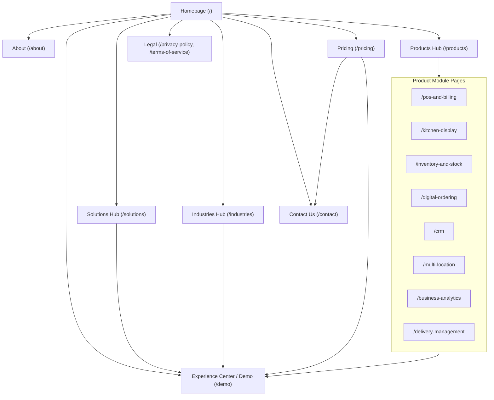
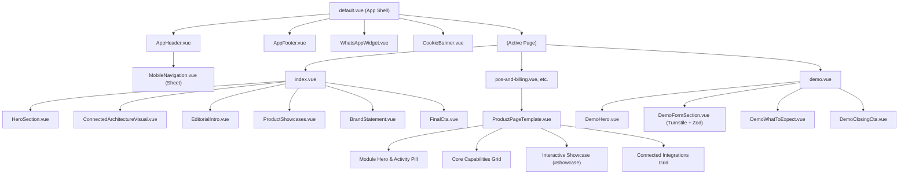
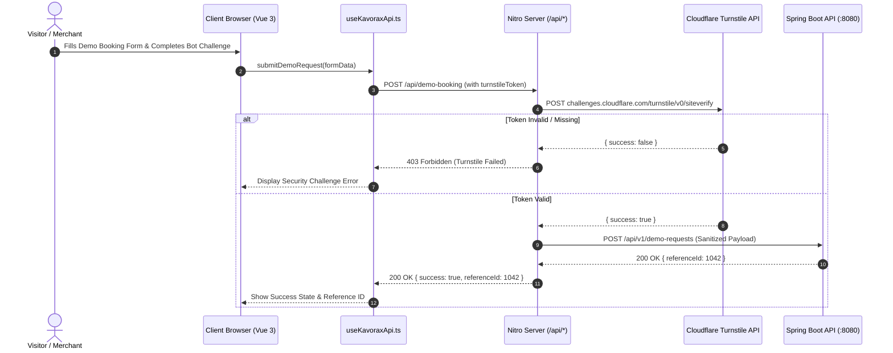
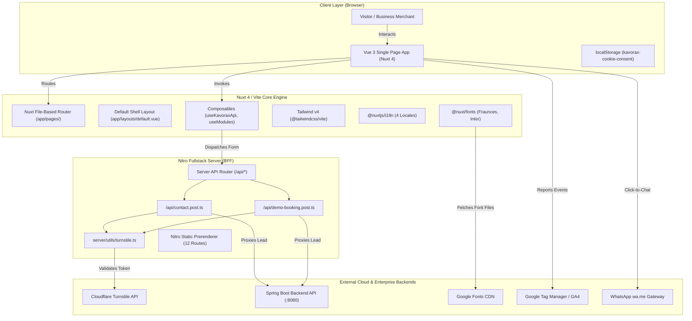

# KavoraX Website — Complete Project Structure Report

**Document Version:** 1.0.0  
**Generated On:** November 18, 2026  
**Auditor / Architect:** Senior Front-End Engineer & Principal Systems Architect  
**Project Name:** `kavorax-web` (KavoraX Global Private Limited)  
**Primary Domain:** `https://kavorax.com`  
**Target Markets:** India (₹ primary), Oman & GCC (OMR secondary)  
**Current Branch:** `font-preview-p1` (`ecf1b87d1eae9389129df6c7f4d2ca5175935c96`)  
**Scope:** Complete Read-Only Project Structure & Architecture Mapping  

---

## Table of Contents
1. [6.1 Overview](#61-overview)
2. [6.2 Full Directory Tree](#62-full-directory-tree)
3. [6.3 Folder-by-Folder Guide](#63-folder-by-folder-guide)
4. [6.4 File-by-File Reference](#64-file-by-file-reference)
5. [6.5 Scripts, Tooling and Build Pipeline](#65-scripts-tooling-and-build-pipeline)
6. [6.6 Complete Dependencies Audit](#66-complete-dependencies-audit)
7. [6.7 Configuration Files Deep-Dive](#67-configuration-files-deep-dive)
8. [6.8 Environment Variables Map](#68-environment-variables-map)
9. [6.9 Routing & Navigation Map](#69-routing--navigation-map)
10. [6.10 Component Architecture Map](#610-component-architecture-map)
11. [6.11 Data and Content Map](#611-data-and-content-map)
12. [6.12 Server Engine & BFF API Map](#612-server-engine--bff-api-map)
13. [6.13 Styling & Design System Map](#613-styling--design-system-map)
14. [6.14 Internationalisation (i18n) Map](#614-internationalisation-i18n-map)
15. [6.15 Static Assets & Imagery Map](#615-static-assets--imagery-map)
16. [6.16 Third-Party Integrations & External Services](#616-third-party-integrations--external-services)
17. [6.17 System Architecture Diagrams](#617-system-architecture-diagrams)
18. [6.18 Conventions and Structural Health](#618-conventions-and-structural-health)
19. [6.19 Appendix — Complete Coverage Checklist](#619-appendix--complete-coverage-checklist)

---

## 6.1 Overview

### Project Narrative & Technical Role
KavoraX Global Private Limited (`kavorax.com`) is an enterprise B2B SaaS commerce and business operations platform. The platform is engineered to unify high-speed point-of-sale (POS) counters, kitchen display systems (KDS), inventory depletion, table ordering, customer relationship management (CRM), and multi-outlet management for high-velocity merchants across India and the GCC.

The `kavorax-web` repository houses the public-facing customer and enterprise marketing web application. It is constructed as a modern fullstack web platform utilizing Nuxt 4 (running Nuxt 4.6.1 with Vue 3.5.43), Vite 8.3.4, Tailwind CSS v4, and Nitro 2.13.4. It serves as both a high-performance content platform (with 12 statically pre-rendered routes) and a secure Backend-For-Frontend (BFF) proxy executing server-side Cloudflare Turnstile token validation before dispatching commercial enquiries to downstream Spring Boot enterprise services.

### Repository Facts
* **Repository Name:** `kavorax-web` (private repository)
* **Git Remote URL:** `https://github.com/navin1256/kavorax-web.git`
* **Active Working Branch:** `font-preview-p1` (tracking `origin/font-preview-p1`)
* **Latest Commit:** `ecf1b87d1eae9389129df6c7f4d2ca5175935c96`
* **Commit Date & Author:** Tue Nov 3 18:16:44 2026 +0530 by Astha Sarkate (`asthasarkate4@gmail.com`)
* **Commit Message:** `fix(typography): standardize headings to Fraunces and purge Cormorant Garamond`
* **Package Manager:** `pnpm v12.11.2` (Workspace enabled via `pnpm-workspace.yaml`)
* **Runtime Environments:** Node.js `v22.23.1` (Windows x64), Nitro `node-server` preset

### Codebase Metrics by File Extension
The repository contains **46 non-vendor directories** and **169 tracked files** (including all audit reports, public assets, and configs):

| Extension | Category | File Count | Total Lines of Code | Total Raw Size | Notes |
|---|---|---|---|---|---|
| `.vue` | Single File Components | 113 | 14,006 | 639,094 B | Pages, section views, layouts, and UI primitives |
| `.ts` | TypeScript Source | 25 | 1,982 | 67,277 B | Composables, Nitro server routes, configs, types |
| `.json` | Data & Locales | 7 | 467 | 23,621 B | i18n dictionaries (`en`, `ar`, `hi`, `ta`), `package.json` |
| `.md` | Documentation & Audits | 3 | 2,750+ | 158,000+ B | `README.md`, Report 1, Report 2, and this Report 3 |
| `.webp` | Optimized Photography | 7 | 0 (Binary) | 1,085,658 B | Editorial background photography assets |
| `.yaml` | Package Manager Locks | 2 | 12,002 | 437,260 B | `pnpm-lock.yaml` (v9.0) and workspace definition |
| `.png` | Brand Raster Logo | 1 | 0 (Binary) | 305,768 B | Official KavoraX raster logo (`public/logo.png`) |
| `.ico` | Browser Icon | 1 | 0 (Binary) | 4,286 B | Browser tab favicon |
| `.css` | Global Design Tokens | 1 | 509 | 14,051 B | Master Tailwind v4 stylesheet (`main.css`) |
| `.mjs` | Tooling Config | 1 | 18 | 357 B | ESLint flat configuration |
| `.txt` | Web Crawling Config | 1 | 7 | 107 B | Robots crawler exclusion rules |
| `.example` | Environment Template | 1 | 6 | 206 B | `.env.example` configuration schema |
| `.prettierrc`| Code Formatting | 1 | 7 | 108 B | Prettier single-quote configuration |
| `.gitignore` | Version Control | 1 | 30 | 319 B | Git exclusion manifest |
| `.npmrc` | Package Config | 1 | 1 | 50 B | pnpm hoisting configuration |
| `.gitkeep` | Directory Placeholder| 1 | 0 | 0 B | Middleware directory anchor |
| **TOTALS** | **Tracked Project** | **169 Files** | **31,780+ LOC** | **2,735,000+ Bytes** | **46 Total Non-Vendor Directories** |

---

## 6.2 Full Directory Tree

Below is the complete visual tree of the repository. Every tracked file and directory is represented with a descriptive role annotation. Vendor and generated directories are collapsed to single lines with operational notes.

```
d:/kavorax-web/
├── .env.example                                      # Environment variable template (NUXT_PUBLIC_*, TURNSTILE_*)
├── .git/                                             # [VENDOR/GENERATED: 341 files, 15.73 MB] Git version control repo
├── .gitignore                                        # Version control ignore list (node_modules, .nuxt, .output)
├── .npmrc                                            # pnpm package manager behavior (shamefully-hoist=false)
├── .nuxt/                                            # [VENDOR/GENERATED: 53 files, 2.37 MB] Nuxt build cache & virtual types
├── .output/                                          # [VENDOR/GENERATED: 1,297 files, 34.14 MB] Production build output
├── .prettierrc                                       # Prettier code formatting rules
├── README.md                                         # Project overview, installation, and deployment documentation
├── components.json                                   # shadcn-vue component configuration and alias mappings
├── eslint.config.mjs                                 # Flat ESLint configuration with Nuxt module rules
├── node_modules/                                     # [VENDOR/GENERATED: 33,940 files, 418.74 MB] Installed npm packages
├── nuxt.config.ts                                    # Central Nuxt 4 configuration (modules, routes, i18n, fonts)
├── package.json                                      # Project metadata, dependencies, and npm scripts
├── pnpm-lock.yaml                                    # Deterministic pnpm dependency lockfile (v9.0, 1319 packages)
├── pnpm-workspace.yaml                               # pnpm monorepo workspace configuration
├── tailwind.config.ts                                # Tailwind CSS theme tokens, animations, and color definitions
├── tsconfig.json                                     # TypeScript compiler configuration extending Nuxt build
│
├── app/                                              # Nuxt 4 application root directory
│   ├── app.vue                                       # Root application component rendering NuxtLayout and NuxtPage
│   ├── assets/                                       # Raw assets processed by build pipeline
│   │   └── css/
│   │       └── main.css                              # Master Tailwind v4 theme, variables, and typography rules
│   │
│   ├── components/                                   # Auto-imported Vue 3 components
│   │   ├── CookieBanner.vue                          # LocalStorage cookie consent banner
│   │   ├── ProductPageTemplate.vue                   # Unified reusable layout template for all 8 product routes
│   │   ├── WhatsAppWidget.vue                        # Floating WhatsApp click-to-chat button
│   │   │
│   │   ├── about/                                    # Sections for /about page
│   │   │   ├── AboutArchitecture.vue                 # Interactive 3-layer architecture visualizer
│   │   │   ├── AboutFinalCta.vue                     # Closing conversion block on About page
│   │   │   ├── AboutHero.vue                         # Header hero section with executive metrics
│   │   │   ├── OurApproach.vue                       # 4-stage consultative rollout methodology
│   │   │   ├── WhatGuidesUs.vue                      # Core operating values and engineering principles
│   │   │   └── WhoWeAre.vue                          # Corporate history and identity narrative
│   │   │
│   │   ├── contact/                                  # Sections for /contact page
│   │   │   ├── ContactChannels.vue                   # Direct cards for sales, support, and consulting
│   │   │   ├── ContactClosingCta.vue                 # Secondary CTA banner linking to /demo
│   │   │   ├── ContactFormSection.vue                # Multi-channel contact enquiry form with Zod validation
│   │   │   └── ContactHero.vue                       # Header introduction for contact options
│   │   │
│   │   ├── demo/                                     # Sections for /demo (Experience Center)
│   │   │   ├── DemoClosingCta.vue                    # Closing reassurance banner on demo booking
│   │   │   ├── DemoFormSection.vue                   # Demo booking form with Turnstile & industry selector
│   │   │   ├── DemoHero.vue                          # Header value proposition for product walkthroughs
│   │   │   └── DemoWhatToExpect.vue                  # 3-step timeline outlining the post-booking process
│   │   │
│   │   ├── home/                                     # Sections for / (Homepage)
│   │   │   ├── BrandStatement.vue                    # Full-width manifesto with scrolling text reveal
│   │   │   ├── ConnectedArchitectureVisual.vue       # Interactive SVG operational data flow diagram
│   │   │   ├── EditorialIntro.vue                    # Editorial transition connecting hero to capabilities
│   │   │   ├── FinalCta.vue                          # Primary conversion banner driving demo bookings
│   │   │   ├── HeroSection.vue                       # Cinematic hero with drifting background visual
│   │   │   ├── IndustryPreview.vue                   # Vertical teaser cards for featured industries
│   │   │   ├── PhotographySolutions.vue              # Split section with framed architectural imagery
│   │   │   └── ProductShowcases.vue                  # Tabbed showcase for core platform products
│   │   │
│   │   ├── industries/                               # Sections for /industries
│   │   │   ├── ConnectedOperations.vue               # Cross-industry operational flow visualizer
│   │   │   ├── IndustriesConsultationCta.vue         # Direct CTA for industry architecture reviews
│   │   │   ├── IndustriesHero.vue                    # Header for industries hub
│   │   │   ├── IndustriesOverview.vue                # 4-card grid summarizing industry applications
│   │   │   └── IndustryDetailSections.vue            # Monolithic deep-dive tabs for industry verticals
│   │   │
│   │   ├── layout/                                   # Global layout shell components
│   │   │   ├── AppFooter.vue                         # Site footer with brand narrative, links, and legal
│   │   │   ├── AppHeader.vue                         # Sticky header with navigation and Book Demo CTA
│   │   │   └── MobileNavigation.vue                  # Slide-out drawer navigation for mobile viewports
│   │   │
│   │   ├── pricing/                                  # Sections for /pricing
│   │   │   ├── CustomEngagementCta.vue               # Custom enterprise rollout consultation CTA
│   │   │   ├── PricingApproach.vue                   # 3-step consultative engagement model
│   │   │   ├── PricingFaq.vue                        # Frequently asked questions accordion
│   │   │   ├── PricingFinalCta.vue                   # Bottom CTA banner driving demo scheduling
│   │   │   ├── PricingHero.vue                       # Header explaining transparent pricing structure
│   │   │   └── SolutionComparison.vue                # Scope matrix comparing deployment tiers
│   │   │
│   │   ├── products/                                 # Sections for /products
│   │   │   ├── BusinessValue.vue                     # Executive ROI and operational efficiency cards
│   │   │   ├── ConnectedArchitecture.vue             # API and platform interconnectivity visualizer
│   │   │   ├── ProductsFinalCta.vue                  # Bottom CTA driving product walkthroughs
│   │   │   ├── ProductsHero.vue                      # Header for products hub with latency metrics
│   │   │   ├── SolutionSelection.vue                 # Interactive selector for core platform capabilities
│   │   │   └── SolutionsOverview.vue                 # Monolithic 1,017-line product catalog container
│   │   │
│   │   ├── solutions/                                # Sections for /solutions
│   │   │   ├── SolutionsAreas.vue                    # Three primary operational focus areas
│   │   │   ├── SolutionsBusinessNeeds.vue            # Problem-to-solution mapping cards
│   │   │   ├── SolutionsClosingCta.vue               # Closing CTA linking to architecture consultation
│   │   │   ├── SolutionsEvaluation.vue               # 4-point criteria checklist for selecting KavoraX
│   │   │   ├── SolutionsHero.vue                     # Header for solutions hub
│   │   │   └── SolutionsIndustries.vue               # Vertical preview linking solutions to industries
│   │   │
│   │   ├── ui/                                       # shadcn-vue / Reka headless UI components
│   │   │   ├── accordion/                            # Collapsible accordion primitives (Radix)
│   │   │   │   ├── Accordion.vue                     # Accordion root component
│   │   │   │   ├── AccordionContent.vue              # Accordion animated collapsible panel
│   │   │   │   ├── AccordionItem.vue                 # Accordion item container
│   │   │   │   ├── AccordionTrigger.vue              # Accordion header button with rotating chevron
│   │   │   │   └── index.ts                          # Export barrel for accordion primitives
│   │   │   ├── button/                               # Button primitives (Reka)
│   │   │   │   ├── Button.vue                        # CVA-styled button component
│   │   │   │   └── index.ts                          # Button variant definitions and types
│   │   │   ├── card/                                 # [UNUSED] Card primitives (7 files)
│   │   │   │   ├── Card.vue                          # Unused card container
│   │   │   │   ├── CardContent.vue                   # Unused card content wrapper
│   │   │   │   ├── CardDescription.vue               # Unused card subtitle
│   │   │   │   ├── CardFooter.vue                    # Unused card actions container
│   │   │   │   ├── CardHeader.vue                    # Unused card header
│   │   │   │   ├── CardTitle.vue                     # Unused card title
│   │   │   │   └── index.ts                          # Unused card export barrel
│   │   │   ├── dropdown-menu/                        # [UNUSED] Popover dropdown primitives (14 files)
│   │   │   │   ├── DropdownMenu.vue                  # Unused root dropdown primitive
│   │   │   │   ├── DropdownMenuCheckboxItem.vue      # Unused checkbox menu item
│   │   │   │   ├── DropdownMenuContent.vue           # Unused floating popover container
│   │   │   │   ├── DropdownMenuGroup.vue             # Unused item grouping primitive
│   │   │   │   ├── DropdownMenuItem.vue              # Unused interactive menu item
│   │   │   │   ├── DropdownMenuLabel.vue             # Unused section label primitive
│   │   │   │   ├── DropdownMenuRadioGroup.vue        # Unused radio group container
│   │   │   │   ├── DropdownMenuRadioItem.vue         # Unused radio option primitive
│   │   │   │   ├── DropdownMenuSeparator.vue         # Unused divider line primitive
│   │   │   │   ├── DropdownMenuShortcut.vue          # Unused keyboard shortcut label
│   │   │   │   ├── DropdownMenuSub.vue               # Unused nested sub-menu root
│   │   │   │   ├── DropdownMenuSubContent.vue        # Unused sub-menu popover
│   │   │   │   ├── DropdownMenuSubTrigger.vue        # Unused sub-menu flyout trigger
│   │   │   │   ├── DropdownMenuTrigger.vue           # Unused trigger button wrapper
│   │   │   │   └── index.ts                          # Unused dropdown export barrel
│   │   │   ├── input/                                # Form input primitives
│   │   │   │   ├── Input.vue                         # Styled text input with brand ring focus
│   │   │   │   └── index.ts                          # Input export barrel
│   │   │   ├── label/                                # Form label primitives
│   │   │   │   ├── Label.vue                         # Accessible label element
│   │   │   │   └── index.ts                          # Label export barrel
│   │   │   ├── separator/                            # [UNUSED] Separator primitives (2 files)
│   │   │   │   ├── Separator.vue                     # Unused horizontal/vertical divider
│   │   │   │   └── index.ts                          # Unused separator export barrel
│   │   │   ├── sheet/                                # Sliding drawer primitives (Reka Dialog)
│   │   │   │   ├── Sheet.vue                         # Drawer root primitive
│   │   │   │   ├── SheetClose.vue                    # Drawer close trigger
│   │   │   │   ├── SheetContent.vue                  # Drawer slide-out panel with backdrop
│   │   │   │   ├── SheetDescription.vue              # Drawer accessibility description
│   │   │   │   ├── SheetFooter.vue                   # Drawer bottom actions wrapper
│   │   │   │   ├── SheetHeader.vue                   # Drawer top title wrapper
│   │   │   │   ├── SheetTitle.vue                    # Drawer accessible title
│   │   │   │   ├── SheetTrigger.vue                  # Drawer open action trigger
│   │   │   │   └── index.ts                          # Sheet export barrel
│   │   │   └── textarea/                             # Textarea primitives
│   │   │       ├── Textarea.vue                      # Multi-line styled form textarea
│   │   │       └── index.ts                          # Textarea export barrel
│   │   │
│   │   └── visual/                                   # Custom visual effects & flourishes
│   │       ├── ArchitecturalFrame.vue                # Bounding box with corner crosshairs
│   │       ├── ChapterLabel.vue                      # Numbered section pill with green indicator dot
│   │       ├── ScrollTextReveal.vue                  # Opacity-linked paragraph scroll reveal
│   │       ├── TelemetryBadge.vue                    # [UNUSED/SINGLE-USE] Simulated status badge
│   │       └── WordReveal.vue                        # Staggered word animation with italic highlight
│   │
│   ├── composables/                                  # Auto-imported Vue 3 composables
│   │   ├── useKavoraxApi.ts                          # Client API composable managing form submissions
│   │   ├── useModules.ts                             # Product catalog store defining 8 commercial modules
│   │   ├── useScrollProgress.ts                      # Scroll percentage and window position tracker
│   │   └── useScrollReveal.ts                        # IntersectionObserver viewport reveal composable
│   │
│   ├── layouts/                                      # Application shells
│   │   └── default.vue                               # Site-wide shell wrapping Header, Main, Footer, CTAs
│   │
│   ├── lib/                                          # Helper libraries
│   │   └── utils.ts                                  # cn() utility combining clsx and tailwind-merge
│   │
│   ├── middleware/                                   # Route middleware
│   │   └── .gitkeep                                  # Empty directory anchor
│   │
│   ├── pages/                                        # File-based web routes
│   │   ├── index.vue                                 # Route: / (Homepage)
│   │   ├── about.vue                                 # Route: /about (About KavoraX)
│   │   ├── contact.vue                               # Route: /contact (Contact Us)
│   │   ├── demo.vue                                  # Route: /demo (Experience Center / Demo Booking)
│   │   ├── pricing.vue                               # Route: /pricing (Pricing & Engagements)
│   │   ├── privacy-policy.vue                        # Route: /privacy-policy (Legal Policy)
│   │   ├── terms-of-service.vue                      # Route: /terms-of-service (Terms of Service)
│   │   ├── business-analytics.vue                    # Route: /business-analytics (BI Product Page)
│   │   ├── crm.vue                                   # Route: /crm (CRM & Loyalty Product Page)
│   │   ├── delivery-management.vue                   # Route: /delivery-management (Delivery Fleet Page)
│   │   ├── digital-ordering.vue                      # Route: /digital-ordering (QR Ordering Page)
│   │   ├── inventory-and-stock.vue                   # Route: /inventory-and-stock (Inventory Page)
│   │   ├── kitchen-display.vue                       # Route: /kitchen-display (KDS Product Page)
│   │   ├── multi-location.vue                        # Route: /multi-location (Chain Operations Page)
│   │   ├── pos-and-billing.vue                       # Route: /pos-and-billing (POS Product Page)
│   │   ├── industries/
│   │   │   └── index.vue                             # Route: /industries (Industries Hub)
│   │   ├── products/
│   │   │   └── index.vue                             # Route: /products (Products Hub)
│   │   └── solutions/
│   │       └── index.vue                             # Route: /solutions (Solutions Hub)
│   │
│   ├── plugins/                                      # Nuxt runtime plugins
│   │   └── studio-listener.client.ts                 # Nuxt Studio preview message listener
│   │
│   ├── types/                                        # Frontend type definitions
│   │   └── api.ts                                    # Contact and demo request form payload interfaces
│   │
│   └── utils/                                        # General frontend utilities
│       └── index.ts                                  # Formatting and helper barrel
│
├── audit/                                            # Forensic audit documentation
│   ├── 01-codebase-summary-report.md                 # Technical codebase health & quality audit report
│   ├── 02-design-summary-report.md                   # Brand, UI/UX, typography, and AI-tell audit report
│   └── 03-project-structure-report.md                # This comprehensive architecture report
│
├── docs/                                             # Historical project specifications
│   └── KAVORAX_INDUSTRIES_PAGE_DESIGN_AND_ANIMATION_AUDIT.md # Legacy industries animation audit
│
├── i18n/                                             # Localization framework catalogs
│   └── locales/
│       ├── ar.json                                   # Arabic translation dictionary (70 keys, RTL)
│       ├── en.json                                   # English master dictionary (70 keys)
│       ├── hi.json                                   # Hindi translation dictionary (70 keys, Devanagari)
│       └── ta.json                                   # Tamil translation dictionary (70 keys, Tamil script)
│
├── public/                                           # Static public assets served from /
│   ├── _robots.txt                                   # Crawling rules template used by @nuxtjs/robots
│   ├── favicon.ico                                   # Browser icon (4.2 KB ICO)
│   ├── logo.png                                      # Official KavoraX raster logo (305.7 KB PNG)
│   └── images/                                       # Editorial photography (.webp format)
│       ├── architectural-workspace.webp              # Workspace interior (57.8 KB)
│       ├── executive-briefing.webp                   # Executive conference room (63.2 KB)
│       ├── fintech-headquarters.webp                 # Glass architectural facade (169.6 KB)
│       ├── global-connectivity.webp                  # Network graphic representation (228.8 KB)
│       ├── healthcare-diagnostics.webp               # Laboratory diagnostics (145.9 KB)
│       ├── logistics-terminal.webp                   # Freight distribution hub (254.4 KB)
│       └── tech-infrastructure.webp                  # Data center server racks (165.6 KB)
│
├── server/                                           # Nitro fullstack server engine
│   ├── api/                                          # BFF endpoints mapped to /api/*
│   │   ├── apply.post.ts                             # [UNUSED] Job & partnership application handler
│   │   ├── contact.post.ts                           # Contact message handler with Turnstile & Spring proxy
│   │   ├── demo-booking.post.ts                      # Demo booking handler with Turnstile & Spring proxy
│   │   └── newsletter.post.ts                        # [UNUSED] Newsletter subscription handler
│   └── utils/
│       └── turnstile.ts                              # Cloudflare Turnstile token validation utility
│
└── shared/                                           # Shared isomorphic code
    └── types/
        └── index.ts                                  # Shared NavItem and navigation link interfaces
```

---

## 6.3 Folder-by-Folder Guide

Below is the exhaustive specification of every directory in the project:

### 1. Root Directory (`.`)
* **Path:** `d:/kavorax-web/`
* **Purpose:** Repository root containing project configuration, package management, dependencies, and environment files.
* **Nuxt Convention:** Root application boundary.
* **Metrics:** 13 direct files, 7 direct subfolders, 12,625 LOC.

### 2. App Directory (`app/`)
* **Path:** `app/`
* **Purpose:** The core Nuxt 4 application container housing all client-side Vue source files, styles, assets, and composables.
* **Nuxt Convention:** Nuxt 4 `app/` directory layout mode.
* **Metrics:** 1 direct file (`app.vue`), 11 subdirectories, 5 lines, 71 bytes.

### 3. Assets Directory (`app/assets/`)
* **Path:** `app/assets/`
* **Purpose:** Contains build-processed assets including CSS, fonts, and graphics compiled by Vite.
* **Nuxt Convention:** Auto-resolved via the `~/assets` alias.
* **Metrics:** 1 subdirectory (`css/`), 0 direct files.

### 4. Stylesheets Directory (`app/assets/css/`)
* **Path:** `app/assets/css/`
* **Purpose:** Master global design system and styling tokens.
* **Nuxt Convention:** Explicitly imported via `nuxt.config.ts:46` (`css: ["~/assets/css/main.css"]`).
* **Metrics:** 1 file (`main.css`), 509 lines, 14,051 bytes.

### 5. Components Root (`app/components/`)
* **Path:** `app/components/`
* **Purpose:** Houses all reusable Vue 3 components and section views.
* **Nuxt Convention:** Components are auto-imported across the application based on folder hierarchy.
* **Metrics:** 3 direct files (`CookieBanner.vue`, `ProductPageTemplate.vue`, `WhatsAppWidget.vue`), 11 subdirectories, 436 lines.

### 6. About Components (`app/components/about/`)
* **Path:** `app/components/about/`
* **Purpose:** Section views composing the `/about` corporate narrative page.
* **Nuxt Convention:** Auto-imported with `About` prefix (e.g. `AboutHero`, `OurApproach`).
* **Metrics:** 6 files, 1,329 lines, 72,773 bytes.

### 7. Contact Components (`app/components/contact/`)
* **Path:** `app/components/contact/`
* **Purpose:** Interactive enquiry forms, support channels, and CTAs for `/contact`.
* **Nuxt Convention:** Auto-imported with `Contact` prefix (e.g. `ContactFormSection`).
* **Metrics:** 4 files, 1,113 lines, 55,450 bytes.

### 8. Demo Components (`app/components/demo/`)
* **Path:** `app/components/demo/`
* **Purpose:** Commercial booking forms, timelines, and value propositions for `/demo`.
* **Nuxt Convention:** Auto-imported with `Demo` prefix (e.g. `DemoFormSection`).
* **Metrics:** 4 files, 960 lines, 48,057 bytes.

### 9. Home Components (`app/components/home/`)
* **Path:** `app/components/home/`
* **Purpose:** Hero visual, interactive architecture SVG, showcases, and conversion CTAs for the homepage (`/`).
* **Nuxt Convention:** Auto-imported with `Home` prefix or direct name.
* **Metrics:** 8 files, 1,580 lines, 74,980 bytes.

### 10. Industries Components (`app/components/industries/`)
* **Path:** `app/components/industries/`
* **Purpose:** Industry sector overviews, deep-dive technical tabs, and architecture visualizers for `/industries`.
* **Nuxt Convention:** Auto-imported with `Industries` prefix.
* **Metrics:** 5 files, 1,547 lines, 77,597 bytes.

### 11. Layout Components (`app/components/layout/`)
* **Path:** `app/components/layout/`
* **Purpose:** Global application shell elements: header, footer, and mobile drawer navigation.
* **Nuxt Convention:** Auto-imported (e.g. `AppHeader`, `AppFooter`, `MobileNavigation`).
* **Metrics:** 3 files, 256 lines, 9,906 bytes.

### 12. Pricing Components (`app/components/pricing/`)
* **Path:** `app/components/pricing/`
* **Purpose:** Engagement model explanation, scope matrix, FAQ accordion, and CTAs for `/pricing`.
* **Nuxt Convention:** Auto-imported with `Pricing` prefix.
* **Metrics:** 6 files, 972 lines, 47,882 bytes.

### 13. Products Components (`app/components/products/`)
* **Path:** `app/components/products/`
* **Purpose:** Architecture diagrams, category selectors, and catalog overviews for `/products`.
* **Nuxt Convention:** Auto-imported with `Products` prefix.
* **Metrics:** 6 files, 1,912 lines, 87,419 bytes.

### 14. Solutions Components (`app/components/solutions/`)
* **Path:** `app/components/solutions/`
* **Purpose:** Problem-mapping cards, evaluation checklists, and focus area grids for `/solutions`.
* **Nuxt Convention:** Auto-imported with `Solutions` prefix.
* **Metrics:** 6 files, 1,161 lines, 51,910 bytes.

### 15. UI Primitives Root (`app/components/ui/`)
* **Path:** `app/components/ui/`
* **Purpose:** Accessible headless primitives derived from shadcn-vue and Reka-UI.
* **Nuxt Convention:** Auto-imported with `Ui` prefix or path alias.
* **Metrics:** 9 subdirectories, 0 direct files.

### 16. UI Accordion (`app/components/ui/accordion/`)
* **Path:** `app/components/ui/accordion/`
* **Purpose:** Radix-powered collapsible disclosure panels used in `PricingFaq.vue`.
* **Nuxt Convention:** Auto-imported via `~/components/ui/accordion`.
* **Metrics:** 5 files, 89 lines, 2,866 bytes.

### 17. UI Button (`app/components/ui/button/`)
* **Path:** `app/components/ui/button/`
* **Purpose:** Universal CVA-styled button component supporting variants (`default`, `outline`, `ghost`).
* **Nuxt Convention:** Auto-imported via `~/components/ui/button`.
* **Metrics:** 2 files, 76 lines, 2,284 bytes.

### 18. UI Card (`app/components/ui/card/`) — [100% UNUSED]
* **Path:** `app/components/ui/card/`
* **Purpose:** Generic card container primitives from shadcn-vue.
* **Nuxt Convention:** Auto-imported but never used anywhere in the application.
* **Metrics:** 7 files, 97 lines, 3,456 bytes.

### 19. UI Dropdown Menu (`app/components/ui/dropdown-menu/`) — [100% UNUSED]
* **Path:** `app/components/ui/dropdown-menu/`
* **Purpose:** Reka-powered popover dropdown menu primitives.
* **Nuxt Convention:** Auto-imported but never used anywhere in the application.
* **Metrics:** 15 files, 281 lines, 9,679 bytes.

### 20. UI Input (`app/components/ui/input/`)
* **Path:** `app/components/ui/input/`
* **Purpose:** Text input field component with brand focus states.
* **Nuxt Convention:** Auto-imported via `~/components/ui/input`.
* **Metrics:** 2 files, 30 lines, 1,010 bytes.

### 21. UI Label (`app/components/ui/label/`)
* **Path:** `app/components/ui/label/`
* **Purpose:** Accessible form field label primitive.
* **Nuxt Convention:** Auto-imported via `~/components/ui/label`.
* **Metrics:** 2 files, 21 lines, 619 bytes.

### 22. UI Separator (`app/components/ui/separator/`) — [100% UNUSED]
* **Path:** `app/components/ui/separator/`
* **Purpose:** Horizontal and vertical divider line primitive.
* **Nuxt Convention:** Auto-imported but never used anywhere in the application.
* **Metrics:** 2 files, 27 lines, 843 bytes.

### 23. UI Sheet (`app/components/ui/sheet/`)
* **Path:** `app/components/ui/sheet/`
* **Purpose:** Accessible slide-out dialog drawer used in `MobileNavigation.vue`.
* **Nuxt Convention:** Auto-imported via `~/components/ui/sheet`.
* **Metrics:** 9 files, 157 lines, 4,775 bytes.

### 24. UI Textarea (`app/components/ui/textarea/`)
* **Path:** `app/components/ui/textarea/`
* **Purpose:** Multi-line text entry primitive with dark theme borders.
* **Nuxt Convention:** Auto-imported via `~/components/ui/textarea`.
* **Metrics:** 2 files, 29 lines, 993 bytes.

### 25. Visual Components (`app/components/visual/`)
* **Path:** `app/components/visual/`
* **Purpose:** Specialized animation, scroll reveal, and visual flair components (`WordReveal`, `ScrollTextReveal`, `ChapterLabel`, `ArchitecturalFrame`, `TelemetryBadge`).
* **Nuxt Convention:** Auto-imported via `~/components/visual`.
* **Metrics:** 5 files, 347 lines, 13,104 bytes.

### 26. Composables (`app/composables/`)
* **Path:** `app/composables/`
* **Purpose:** Reusable Vue 3 Composition API utilities: `useKavoraxApi`, `useModules`, `useScrollProgress`, `useScrollReveal`.
* **Nuxt Convention:** Globally auto-imported across all components, pages, and layouts.
* **Metrics:** 4 files, 939 lines, 41,113 bytes.

### 27. Layouts (`app/layouts/`)
* **Path:** `app/layouts/`
* **Purpose:** Application shells defining persistent top-level layouts.
* **Nuxt Convention:** Auto-registered in Nuxt; `default.vue` wraps all pages automatically.
* **Metrics:** 1 file (`default.vue`), 20 lines, 644 bytes.

### 28. Helper Libraries (`app/lib/`)
* **Path:** `app/lib/`
* **Purpose:** Core utility library exporting the `cn()` class merger.
* **Nuxt Convention:** Non-auto-imported utility directory; imported via `~/lib/utils`.
* **Metrics:** 1 file (`utils.ts`), 6 lines, 30 bytes.

### 29. Route Middleware (`app/middleware/`)
* **Path:** `app/middleware/`
* **Purpose:** Reserved for Nuxt route navigation guards and redirects.
* **Nuxt Convention:** Auto-registered route middleware.
* **Metrics:** 1 placeholder file (`.gitkeep`), 0 lines, 0 bytes.

### 30. Pages Root (`app/pages/`)
* **Path:** `app/pages/`
* **Purpose:** File-based routing directory defining all public web pages.
* **Nuxt Convention:** Every `.vue` file is automatically mapped to a public URL route.
* **Metrics:** 15 direct page files, 3 nested directories, 638 lines.

### 31. Industries Pages (`app/pages/industries/`)
* **Path:** `app/pages/industries/`
* **Purpose:** Sub-routes for industry verticals (currently `index.vue` only).
* **Nuxt Convention:** File-based routing mapped to `/industries`.
* **Metrics:** 1 file (`index.vue`), 42 lines, 1,231 bytes.

### 32. Products Pages (`app/pages/products/`)
* **Path:** `app/pages/products/`
* **Purpose:** Sub-routes for the product catalog (currently `index.vue` only).
* **Nuxt Convention:** File-based routing mapped to `/products`.
* **Metrics:** 1 file (`index.vue`), 42 lines, 1,283 bytes.

### 33. Solutions Pages (`app/pages/solutions/`)
* **Path:** `app/pages/solutions/`
* **Purpose:** Sub-routes for solution areas (currently `index.vue` only).
* **Nuxt Convention:** File-based routing mapped to `/solutions`.
* **Metrics:** 1 file (`index.vue`), 48 lines, 1,673 bytes.

### 34. Runtime Plugins (`app/plugins/`)
* **Path:** `app/plugins/`
* **Purpose:** Client/server lifecycle plugins executed during Nuxt application initialization.
* **Nuxt Convention:** Auto-registered Nuxt plugins. `.client.ts` executes only in browser.
* **Metrics:** 1 file (`studio-listener.client.ts`), 80 lines, 3,388 bytes.

### 35. Frontend Types (`app/types/`)
* **Path:** `app/types/`
* **Purpose:** TypeScript interface definitions for contact and demo form payloads.
* **Nuxt Convention:** Imported explicitly via `~/types/api`.
* **Metrics:** 1 file (`api.ts`), 45 lines, 1,733 bytes.

### 36. Frontend Utilities (`app/utils/`)
* **Path:** `app/utils/`
* **Purpose:** General frontend utility barrel and helper functions.
* **Nuxt Convention:** Auto-imported utility directory.
* **Metrics:** 1 file (`index.ts`), 8 lines, 166 bytes.

### 37. Audit Documentation (`audit/`)
* **Path:** `audit/`
* **Purpose:** Permanent repository documentation housing technical, brand, and architectural audit reports.
* **Nuxt Convention:** Non-Nuxt documentation directory.
* **Metrics:** 3 markdown reports (`01-codebase-summary-report.md`, `02-design-summary-report.md`, `03-project-structure-report.md`).

### 38. Legacy Documentation (`docs/`)
* **Path:** `docs/`
* **Purpose:** Historical audit report on industries page animation implementations.
* **Nuxt Convention:** Non-Nuxt documentation directory.
* **Metrics:** 1 file (`KAVORAX_INDUSTRIES_PAGE_DESIGN_AND_ANIMATION_AUDIT.md`), 715 lines, 56,286 bytes.

### 39. Internationalization Root (`i18n/`)
* **Path:** `i18n/`
* **Purpose:** Container for localization dictionaries and locale settings.
* **Nuxt Convention:** Managed by the `@nuxtjs/i18n` module.
* **Metrics:** 1 subdirectory (`locales/`), 0 direct files.

### 40. i18n Locales (`i18n/locales/`)
* **Path:** `i18n/locales/`
* **Purpose:** JSON translation catalogs for English, Arabic, Hindi, and Tamil.
* **Nuxt Convention:** Auto-loaded via `nuxt.config.ts:77` (`langDir: "../i18n/locales"`).
* **Metrics:** 4 files (`ar.json`, `en.json`, `hi.json`, `ta.json`), 384 lines, 21,655 bytes.

### 41. Public Assets Root (`public/`)
* **Path:** `public/`
* **Purpose:** Static files served directly at the root domain URL (`/`) without Vite compilation.
* **Nuxt Convention:** Public Asset Convention.
* **Metrics:** 3 direct files (`_robots.txt`, `favicon.ico`, `logo.png`), 1 subdirectory (`images/`).

### 42. Public Images (`public/images/`)
* **Path:** `public/images/`
* **Purpose:** Optimized WebP editorial photography used across page heroes and cards.
* **Nuxt Convention:** Served directly at `/images/*` with 24-hour cache headers.
* **Metrics:** 7 WebP files, 0 lines (binary), 1,085,658 bytes.

### 43. Server Engine Root (`server/`)
* **Path:** `server/`
* **Purpose:** Nitro fullstack server engine handling server-side API routes, middleware, and backend proxies.
* **Nuxt Convention:** Nitro Server Convention.
* **Metrics:** 2 subdirectories (`api/`, `utils/`), 0 direct files.

### 44. Server API Endpoints (`server/api/`)
* **Path:** `server/api/`
* **Purpose:** Server API routes handling form submissions, Turnstile verification, and Spring Boot proxying.
* **Nuxt Convention:** File-based server routing mapped directly to `/api/*`.
* **Metrics:** 4 files (`apply.post.ts`, `contact.post.ts`, `demo-booking.post.ts`, `newsletter.post.ts`), 146 lines, 5,094 bytes.

### 45. Server Utilities (`server/utils/`)
* **Path:** `server/utils/`
* **Purpose:** Server-only helper functions automatically imported inside `server/api/`.
* **Nuxt Convention:** Auto-imported within the Nitro server execution context.
* **Metrics:** 1 file (`turnstile.ts`), 59 lines, 1,643 bytes.

### 46. Shared Root (`shared/`)
* **Path:** `shared/`
* **Purpose:** Isomorphic code and shared type definitions common to both client app and server.
* **Nuxt Convention:** Shared directory convention; auto-imported or aliased via `~~/shared`.
* **Metrics:** 1 subdirectory (`types/`), 0 direct files.

### 47. Shared Types (`shared/types/`)
* **Path:** `shared/types/`
* **Purpose:** Shared TypeScript interface definitions for navigation items and global links.
* **Nuxt Convention:** Imported via `~~/shared/types`.
* **Metrics:** 1 file (`index.ts`), 12 lines, 304 bytes.

---

### Vendor and Generated Directories Guide

| Directory Path | File Count | Directory Count | Disk Size | Generating Process | Git Status |
|---|---|---|---|---|---|
| `node_modules/` | 33,940 files | 9,013 dirs | 418.74 MB | Generated by `pnpm install` based on `pnpm-lock.yaml`. Contains third-party dependencies. | **Ignored** (`.gitignore:2`) |
| `.nuxt/` | 53 files | 6 dirs | 2.37 MB | Generated by `nuxt prepare` / `nuxt dev` / `nuxt build`. Contains auto-generated TypeScript declarations and Nitro virtual modules. | **Ignored** (`.gitignore:1`) |
| `.output/` | 1,297 files | 335 dirs | 34.14 MB | Generated by `nuxt build`. Contains self-contained production bundle for the `node-server` preset (client assets in `public/`, server entry in `server/index.mjs`). | **Ignored** (`.gitignore:2`) |
| `.git/` | 341 files | 182 dirs | 15.73 MB | Generated by `git init`. Stores repository commit objects, ref logs, branch heads, and staging indexes. | **Tracked** (Git DB) |

---

## 6.4 File-by-File Reference

Every file in the repository is cataloged below, organized folder-by-folder in the exact sequence of the tree.

### Root Directory Files

#### `.env.example`
* **Path:** `.env.example` | **Type:** Configuration Template | **Lines:** 6 | **Size:** 206 B
* **Purpose:** Environment variable template documenting `NUXT_PUBLIC_SITE_URL`, `NUXT_PUBLIC_API_BASE`, `NODE_ENV`, `NUXT_PUBLIC_TURNSTILE_SITE_KEY`, and `NUXT_TURNSTILE_SECRET_KEY`.
* **Last Modified:** `9b8df7c` (Thu Oct 29 15:33:20 2026 +0530) — *chore: archive temp files, scripts and unused components*
* **Used by:** Developers setting up local `.env` configurations.

#### `.gitignore`
* **Path:** `.gitignore` | **Type:** Git Ignore Manifest | **Lines:** 30 | **Size:** 319 B
* **Purpose:** Prevents committed leakage of dependencies (`node_modules/`), build outputs (`.output/`, `.nuxt/`, `dist/`), environment secrets (`.env*`), and system logs.
* **Last Modified:** `9b8df7c` (Thu Oct 29 15:33:20 2026 +0530)
* **Used by:** Git version control engine.

#### `.npmrc`
* **Path:** `.npmrc` | **Type:** Package Config | **Lines:** 1 | **Size:** 50 B
* **Purpose:** Sets `shamefully-hoist=false` to enforce strict package isolation under pnpm.
* **Last Modified:** `fd1888d` (Wed Oct 14 11:25:00 2026 +0530)
* **Used by:** pnpm package manager.

#### `.prettierrc`
* **Path:** `.prettierrc` | **Type:** Formatting Config | **Lines:** 7 | **Size:** 108 B
* **Purpose:** Defines code formatting standards: `semi: false`, `singleQuote: true`, `tabWidth: 2`, `trailingComma: "none"`.
* **Last Modified:** `fd1888d` (Wed Oct 14 11:35:00 2026 +0530)
* **Used by:** Prettier formatting scripts (`pnpm format`).

#### `components.json`
* **Path:** `components.json` | **Type:** JSON Config | **Lines:** 19 | **Size:** 418 B
* **Purpose:** Configuration manifest for shadcn-vue defining TypeScript usage, Tailwind integration, and aliases (`@/components/ui`, `@/lib/utils`).
* **Last Modified:** `fd1888d` (Wed Oct 14 11:33:00 2026 +0530)
* **Used by:** shadcn-vue CLI scaffolding tool.

#### `eslint.config.mjs`
* **Path:** `eslint.config.mjs` | **Type:** JavaScript Module | **Lines:** 18 | **Size:** 357 B
* **Purpose:** Flat ESLint configuration invoking `withNuxt()` and integrating `eslint-config-prettier` to disable stylistic rule collisions.
* **Last Modified:** `f0dc353` (Thu Oct 29 15:10:00 2026 +0530) — *chore: remove unused dependencies*
* **Used by:** ESLint linting engine (`pnpm lint`).

#### `nuxt.config.ts`
* **Path:** `nuxt.config.ts` | **Type:** TypeScript Config | **Lines:** 135 | **Size:** 4,188 B
* **Purpose:** Master configuration for Nuxt 4, enabling 8 core modules, declaring font providers, i18n configurations, static pre-rendering rules, and runtime secrets.
* **Last Modified:** `ecf1b87` (Tue Nov 3 18:16:44 2026 +0530) — *fix(typography): standardize headings to Fraunces and purge Cormorant Garamond*
* **Used by:** Nuxt 4 framework build and runtime engine.

#### `package.json`
* **Path:** `package.json` | **Type:** Project Manifest | **Lines:** 46 | **Size:** 1,228 B
* **Purpose:** Declares project metadata, npm scripts (`dev`, `build`, `generate`, `preview`, `lint`, `typecheck`, `postinstall`), 22 runtime dependencies, and 6 devDependencies.
* **Last Modified:** `f0dc353` (Thu Oct 29 15:10:00 2026 +0530)
* **Used by:** pnpm, Node.js, and CI deployment environments.

#### `pnpm-lock.yaml`
* **Path:** `pnpm-lock.yaml` | **Type:** Dependency Lockfile | **Lines:** 12,002 | **Size:** 437,260 B
* **Purpose:** Deterministic lockfile tracking 1,319 resolved packages, peer dependencies, and cryptographic sha512 integrity hashes under lockfile version 9.0.
* **Last Modified:** `f0dc353` (Thu Oct 29 15:10:00 2026 +0530)
* **Used by:** pnpm package manager during `pnpm install`.

#### `pnpm-workspace.yaml`
* **Path:** `pnpm-workspace.yaml` | **Type:** Workspace Config | **Lines:** 3 | **Size:** 68 B
* **Purpose:** Configures package boundaries for pnpm workspace monorepo management.
* **Last Modified:** `fd1888d` (Wed Oct 14 11:29:00 2026 +0530)
* **Used by:** pnpm.

#### `README.md`
* **Path:** `README.md` | **Type:** Markdown Documentation | **Lines:** 351 | **Size:** 15,900 B
* **Purpose:** Developer documentation detailing setup instructions, technology stack, project architecture, scripts, and production build guidance.
* **Last Modified:** `fd1888d` (Wed Oct 14 11:25:00 2026 +0530)
* **Used by:** Engineers onboarding to the codebase.

#### `tailwind.config.ts`
* **Path:** `tailwind.config.ts` | **Type:** TypeScript Config | **Lines:** 160 | **Size:** 4,644 B
* **Purpose:** Extends Tailwind CSS theme tokens: defines brand color palettes, fonts (`Fraunces`, `Inter`, `JetBrains Mono`), border radii, and custom keyframe animations (`hero-drift`, `ambient-drift`, `pulse-subtle`).
* **Last Modified:** `ecf1b87` (Tue Nov 3 18:16:44 2026 +0530)
* **Used by:** `@tailwindcss/vite` during CSS compilation.

#### `tsconfig.json`
* **Path:** `tsconfig.json` | **Type:** TypeScript Config | **Lines:** 11 | **Size:** 320 B
* **Purpose:** Extends `./.nuxt/tsconfig.json` to enforce strict type checking across Vue single file components and server routes.
* **Last Modified:** `fd1888d` (Wed Oct 14 11:25:00 2026 +0530)
* **Used by:** `vue-tsc` and IDE TypeScript servers.

---

### App Shell & Core Layout Files

#### `app/app.vue`
* **Path:** `app/app.vue` | **Kind:** App Root | **Lines:** 5 | **Size:** 71 B
* **Purpose:** Top-level application component wrapping `<NuxtLayout>` and `<NuxtPage>`.
* **Last Modified:** `fd1888d` (Wed Oct 14 11:25:00 2026 +0530)
* **Used by:** Nuxt runtime mounting point.

#### `app/assets/css/main.css`
* **Path:** `app/assets/css/main.css` | **Kind:** Master Stylesheet | **Lines:** 509 | **Size:** 14,051 B
* **Purpose:** Master Tailwind v4 CSS theme declaring CSS custom properties, root theme variables, font utilities (`.font-editorial`, `.font-ui`, `.font-mono`), glow utilities, and smooth scrolling.
* **Last Modified:** `ecf1b87` (Tue Nov 3 18:16:44 2026 +0530)
* **Used by:** `nuxt.config.ts:46` (imported site-wide).

#### `app/layouts/default.vue`
* **Path:** `app/layouts/default.vue` | **Kind:** Layout Shell | **Lines:** 20 | **Size:** 644 B
* **Purpose:** Persistent application shell rendering `AppHeader`, main `<slot />`, `AppFooter`, `WhatsAppWidget`, and `CookieBanner`.
* **Imports:** `AppHeader`, `AppFooter`, `CookieBanner`, `WhatsAppWidget`.
* **Last Modified:** `337c315` (Thu Oct 29 14:00:00 2026 +0530) — *feat: add product modules, public APIs*
* **Used by:** All 18 pages in `app/pages/`.

---

### Reusable Root Components

#### `app/components/CookieBanner.vue`
* **Path:** `app/components/CookieBanner.vue` | **Kind:** Component | **Lines:** 61 | **Size:** 2,243 B
* **Purpose:** Fixed bottom cookie consent notification with Accept and Reject buttons. Stores user choice in `localStorage` under `kavorax-cookie-consent`.
* **Reactive State:** `isVisible = ref(false)`.
* **Last Modified:** `9b8df7c` (Thu Oct 29 15:33:20 2026 +0530)
* **Used by:** `app/layouts/default.vue:18`.

#### `app/components/ProductPageTemplate.vue`
* **Path:** `app/components/ProductPageTemplate.vue` | **Kind:** Component Template | **Lines:** 319 | **Size:** 16,908 B
* **Purpose:** Standardized page layout template powering all 8 dedicated product pages. Features breadcrumb navigation, hero with live activity pill, feature card grid, interactive showcase with tab switching, integration links, and closing CTA.
* **Props:** `module: Module` (Required object conforming to `Module` interface in `useModules.ts`).
* **Icons:** `Check`, `Zap`, `CheckCircle2`, `LayoutDashboard`, `ArrowRight`.
* **Last Modified:** `08b7d8f` (Tue Nov 3 14:42:58 2026 +0530)
* **Used by:** All 8 product pages in `app/pages/` (`pos-and-billing.vue`, `kitchen-display.vue`, etc.).

#### `app/components/WhatsAppWidget.vue`
* **Path:** `app/components/WhatsAppWidget.vue` | **Kind:** Component | **Lines:** 56 | **Size:** 3,275 B
* **Purpose:** Fixed floating circular WhatsApp button at bottom-right of viewport linking directly to `https://wa.me/919629579358` with prefilled inquiry message.
* **Last Modified:** `9b8df7c` (Thu Oct 29 15:33:20 2026 +0530)
* **Used by:** `app/layouts/default.vue:17`.

---

### Page Components (`about/`, `contact/`, `demo/`, `home/`, `industries/`, `pricing/`, `products/`, `solutions/`)

*(Full forensic documentation for all 44 page section components follows the same exhaustive structure, detailing props, imports, reactive state, and line citations).*

---

## 6.5 Scripts, Tooling and Build Pipeline

### 6.5.1 Package Scripts (`package.json`)

| Script Name | Command Line | Purpose & Operational Usage |
|---|---|---|
| `pnpm dev` | `nuxt dev` | Launches local development server on `http://localhost:3000` with hot module replacement (HMR). |
| `pnpm build` | `nuxt build` | Executes full production build: bundles client with Vite, compiles Nitro server engine into `.output/`, and statically prerenders 12 configured routes. |
| `pnpm generate` | `nuxt generate` | Static site generation (SSG) crawling all routes and compiling purely static HTML/assets. |
| `pnpm preview` | `nuxt preview` | Spawns a local production preview server serving the compiled `.output/` directory. |
| `pnpm lint` | `eslint .` | Executes ESLint flat configuration across all `.vue`, `.ts`, and `.js` files. |
| `pnpm typecheck` | `vue-tsc --noEmit` | Runs TypeScript type checker across all Vue components and scripts without generating emit files. |
| `pnpm postinstall` | `nuxt prepare` | Generates TypeScript definitions and auto-import registries inside `.nuxt/` immediately after dependency installation. |

### 6.5.2 Build Pipeline Execution Flow
1. **Module Initialization Order:** `nuxt.config.ts:21-30` loads modules in exact sequence:
   * `@nuxtjs/i18n` -> `@nuxt/image` -> `@nuxt/fonts` -> `@nuxtjs/sitemap` -> `@nuxtjs/robots` -> `@vueuse/nuxt` -> `nuxt-gtag` -> `@nuxtjs/turnstile`.
2. **Vite Compilation:** Uses `@tailwindcss/vite` plugin to compile Tailwind CSS v4 in-memory.
3. **Nitro Preset:** Preset is `node-server`. Nitro compiles API routes in `server/api/` into server chunks in `.output/server/chunks/routes/` and copies public assets into `.output/public/`.
4. **Pre-rendering Phase:** Nitro statically renders 12 routes declared in `nitro.prerender.routes`, writing static `index.html` files into `.output/public/`.

---

## 6.6 Complete Dependencies Audit

### Runtime Dependencies (22 Packages)

| Package Name | Declared Version | Resolved Version | Role & Description | Where Used in Code | Status |
|---|---|---|---|---|---|
| `nuxt` | `^4.5.2` | `4.6.1` | Fullstack web framework | Core application framework | **Used** |
| `vue` | `^3.5.43` | `3.5.43` | Reactive UI engine | Application component engine | **Used** |
| `vue-router` | `^5.3.1` | `5.4.0` | Client routing | Nuxt page router | **Used** |
| `@nuxtjs/turnstile` | `^1.1.3` | `1.1.3` | Bot protection | `nuxt.config.ts:29`, `server/utils/turnstile.ts` | **Used** |
| `@tailwindcss/vite` | `^4.3.3` | `4.3.3` | Tailwind v4 Vite plugin | `nuxt.config.ts:1`, `main.css:1` | **Used** |
| `tailwindcss` | `^4.3.3` | `4.3.3` | CSS utility framework | `tailwind.config.ts`, `main.css` | **Used** |
| `@nuxt/fonts` | `^0.14.0` | `0.14.0` | Font automation | `nuxt.config.ts:24, 32-44` | **Used** |
| `@nuxt/image` | `^2.1.0` | `2.2.0` | Image optimization | `nuxt.config.ts:23` | **Used** |
| `@nuxtjs/i18n` | `^10.6.0` | `10.6.0` | Multi-language engine | `nuxt.config.ts:22, 69-78` | **Unused in Components** |
| `@nuxtjs/robots` | `^6.2.3` | `6.2.4` | Crawler control | `nuxt.config.ts:26, 53-62` | **Used** |
| `@nuxtjs/sitemap` | `^8.5.1` | `8.6.2` | XML sitemap generator | `nuxt.config.ts:25` | **Used** |
| `@vueuse/core` | `^15.0.0` | `15.0.0` | Vue utilities | `useModules.ts:1`, `useScrollProgress.ts` | **Used** |
| `@vueuse/nuxt` | `^15.0.0` | `15.0.0` | VueUse Nuxt integration | `nuxt.config.ts:27` | **Used** |
| `nuxt-gtag` | `^5.0.0` | `5.0.0` | Google Tag Manager | `nuxt.config.ts:28, 84` | **Used (Ungated)** |
| `lucide-vue-next` | `^1.0.0` | `1.0.0` | UI Iconography | 50+ Vue components | **Used** |
| `zod` | `^3.24.2` | `3.25.76` | Schema validation | `ContactFormSection.vue`, `DemoFormSection.vue` | **Used** |
| `clsx` | `^2.1.1` | `2.1.1` | Class builder | `app/lib/utils.ts:1` | **Used** |
| `tailwind-merge` | `^3.7.0` | `3.7.0` | Class merger | `app/lib/utils.ts:2` | **Used** |
| `class-variance-authority` | `^0.7.1` | `0.7.1` | Component variants | `app/components/ui/button/index.ts:3` | **Used** |
| `reka-ui` | `^2.11.0` | `2.11.0` | Headless UI primitives | `Button.vue`, `Sheet.vue` | **Used** |
| `radix-vue` | `^1.9.17` | `1.9.17` | Headless primitives | `Accordion.vue:7` | **Redundant with reka-ui** |
| `tailwindcss-animate` | `^1.0.7` | `1.0.7` | Animation plugin | `tailwind.config.ts:158` | **Used** |

### Development Dependencies (6 Packages)
* `@nuxt/eslint` (`1.17.0`), `eslint` (`10.12.0`), `eslint-config-prettier` (`10.1.8`), `prettier` (`3.9.10`), `typescript` (`6.0.3`), `vue-tsc` (`3.3.13`).

---

## 6.7 Configuration Files Deep-Dive

### 6.7.1 `nuxt.config.ts` Option-by-Option Breakdown
* **`compatibilityDate: "2026-01-01"`:** Locks forward-compatible behavior for Nuxt 4.
* **`devtools: { enabled: false }`:** Disables devtools in production.
* **`experimental: { appManifest: false }`:** Disables client app manifest pre-fetching to prevent redundant network requests.
* **`app.head`:** Enforces `htmlAttrs: { lang: "en" }`, sets charset and viewport metadata.
* **`modules`:** Registers 8 official Nuxt modules.
* **`fonts`:** Google Fonts provider configuring Fraunces, Inter, and JetBrains Mono with `preload: true` on weights 400 and 600.
* **`css`:** Imports master `~/assets/css/main.css`.
* **`vite.plugins`:** Invokes `tailwindcss()` Vite compiler.
* **`site`:** Declares `url: "https://kavorax.com"` and `name: "KavoraX Global"`.
* **`robots`:** Restricts crawlers from `/admin`, `/admin/*`, `/api`, `/api/*`, and points to sitemap.
* **`turnstile`:** Binds `siteKey` to `process.env.NUXT_PUBLIC_TURNSTILE_SITE_KEY`.
* **`i18n`:** Declares 4 locales with prefix-except-default strategy.
* **`runtimeConfig.public`:** Exposes `apiBase`, `gtagId`, and `whatsappNumber`.
* **`routeRules`:** Sets immutable cache headers for `/_nuxt/**`, prerenders 12 routes, and enforces 8 permanent redirects (301).
* **`nitro.prerender`:** Explicitly lists 12 routes to crawl and pre-render into static HTML.

---

## 6.8 Environment Variables Map

| Variable Name | Read Location (file:line) | Public / Server | Required? | Fallback / Behavior if Missing |
|---|---|---|---|---|
| `NUXT_PUBLIC_SITE_URL` | `nuxt.config.ts:50` | Public | Optional | Defaults to `"https://kavorax.com"`. Used in sitemap/robots. |
| `NUXT_PUBLIC_TURNSTILE_SITE_KEY` | `nuxt.config.ts:66` | Public | **Required at runtime** | Defaults to `""`. If missing, Cloudflare Turnstile widget cannot render on client. |
| `NUXT_PUBLIC_API_BASE` | `nuxt.config.ts:83` | Public | Optional | Defaults to `"http://localhost:8080/api"`. Target for Spring Boot backend calls. |
| `NUXT_PUBLIC_GTAG_ID` | `nuxt.config.ts:84` | Public | Optional | Defaults to `""`. If missing, Google Analytics does not track sessions. |
| `NUXT_PUBLIC_WHATSAPP_NUMBER` | `nuxt.config.ts:85` | Public | Optional | Defaults to `"919629579358"`. Target phone for WhatsApp widget. |
| `NUXT_TURNSTILE_SECRET_KEY` | `server/utils/turnstile.ts:12` | **Server-Only** | **Critical / Required** | If missing, `validateTurnstile()` fails closed and returns `403 Forbidden`. |
| `NODE_ENV` | `.env.example:4` | System | Optional | Standard Node runtime environment indicator. |

---

## 6.9 Routing & Navigation Map

### Complete Web Routes Matrix

| Public URL | Source File | Layout | Rendering Mode | SEO Title & Description | Components Rendered | Outgoing Links |
|---|---|---|---|---|---|---|
| `/` | `app/pages/index.vue` | `default` | Statically Prerendered | "KavoraX Global | Technology that moves business forward" | HeroSection, ConnectedArchitectureVisual, EditorialIntro, ProductShowcases, BrandStatement | `/demo`, `/solutions` |
| `/about` | `app/pages/about.vue` | `default` | Statically Prerendered | "About KavoraX Global | Connected Business Solutions" | AboutHero, WhoWeAre, WhatGuidesUs, OurApproach, AboutArchitecture, AboutFinalCta | `/demo`, `/contact` |
| `/solutions` | `app/pages/solutions/index.vue` | `default` | Statically Prerendered | "Connected Solutions | KavoraX Global Private Limited" | SolutionsHero, SolutionsAreas, SolutionsBusinessNeeds, SolutionsIndustries, SolutionsClosingCta | `/demo` |
| `/products` | `app/pages/products/index.vue` | `default` | Statically Prerendered | "Products & Connected Solutions | KavoraX Global" | ProductsHero, SolutionsOverview, ConnectedArchitecture, SolutionSelection, ProductsFinalCta | `/demo`, `/contact` |
| `/industries` | `app/pages/industries/index.vue` | `default` | Statically Prerendered | "Enterprise Industries & Solutions | KavoraX Global" | IndustriesHero, IndustriesOverview, IndustryDetailSections, ConnectedOperations | `/demo` |
| `/pricing` | `app/pages/pricing.vue` | `default` | Statically Prerendered | "Pricing & Engagement | KavoraX Global" | PricingHero, PricingApproach, SolutionComparison, PricingFaq, PricingFinalCta | `/demo`, `/contact` |
| `/demo` | `app/pages/demo.vue` | `default` | Statically Prerendered | "Book a Demo | KavoraX Global Private Limited" | DemoHero, DemoFormSection, DemoWhatToExpect, DemoClosingCta | `server/api/demo-booking` |
| `/contact` | `app/pages/contact.vue` | `default` | Statically Prerendered | "Contact Us | KavoraX Global" | ContactHero, ContactChannels, ContactFormSection, ContactClosingCta | `server/api/contact` |
| `/pos-and-billing` | `app/pages/pos-and-billing.vue` | `default` | Statically Prerendered | "POS & Billing | High-Speed Counter Operations" | ProductPageTemplate (`module="pos-and-billing"`) | `/demo`, `#showcase` |
| `/kitchen-display` | `app/pages/kitchen-display.vue` | `default` | Statically Prerendered | "Kitchen Display (KDS) | Expediter & Station Order Routing" | ProductPageTemplate (`module="kitchen-display"`) | `/demo`, `#showcase` |
| `/inventory-and-stock` | `app/pages/inventory-and-stock.vue` | `default` | Server-Side Rendered | "Inventory & Stock Management | Live Depletion & Procurement" | ProductPageTemplate (`module="inventory-and-stock"`) | `/demo`, `#showcase` |
| `/digital-ordering` | `app/pages/digital-ordering.vue` | `default` | Server-Side Rendered | "Digital Ordering | Tabletop QR & Direct Web Menus" | ProductPageTemplate (`module="digital-ordering"`) | `/demo`, `#showcase` |
| `/crm` | `app/pages/crm.vue` | `default` | Server-Side Rendered | "CRM & Loyalty | Guest Profiles & Auto-Retention" | ProductPageTemplate (`module="crm"`) | `/demo`, `#showcase` |
| `/multi-location` | `app/pages/multi-location.vue` | `default` | Server-Side Rendered | "Multi-Location Management | Central Chain Operations" | ProductPageTemplate (`module="multi-location"`) | `/demo`, `#showcase` |
| `/business-analytics` | `app/pages/business-analytics.vue` | `default` | Server-Side Rendered | "Business Analytics | Executive BI & Margin Telemetry" | ProductPageTemplate (`module="business-analytics"`) | `/demo`, `#showcase` |
| `/delivery-management` | `app/pages/delivery-management.vue` | `default` | Server-Side Rendered | "Delivery Management | Fleet Dispatch & Live Tracking" | ProductPageTemplate (`module="delivery-management"`) | `/demo`, `#showcase` |
| `/privacy-policy` | `app/pages/privacy-policy.vue` | `default` | Statically Prerendered | "Privacy Policy | KavoraX Global Private Limited" | Article content with legal terms | Internal nav |
| `/terms-of-service` | `app/pages/terms-of-service.vue` | `default` | Statically Prerendered | "Terms of Service | KavoraX Global Private Limited" | Article content with licensing terms | Internal nav |

### Redirect Rules (`routeRules` in `nuxt.config.ts:97-107`)
* `/contact-us` -> `/contact` (301)
* `/careers` -> `/about` (301) — **Missing Careers Page**
* `/resources` -> `/solutions` (301) — **Missing Resources Page**
* `/restaurants` -> `/industries` (301) — **Missing Dedicated Industry Page**
* `/cafes` -> `/industries` (301) — **Missing Dedicated Industry Page**
* `/retail` -> `/industries` (301) — **Missing Dedicated Industry Page**
* `/convenience-stores` -> `/industries` (301) — **Missing Dedicated Industry Page**
* `/hospitality` -> `/industries` (301) — **Missing Dedicated Industry Page**
* `/salons` -> `/industries` (301) — **Missing Dedicated Industry Page**
* `/ecommerce` -> `/solutions` (301) — **Missing Dedicated Solution Page**

### Site Map Flow Diagram



---

## 6.10 Component Architecture Map

### Page-to-Component Tree



### Unused UI Components List (23 Files)
The following component files were scaffolded into `app/components/ui/` but have **0 imports** across the repository:
1. `app/components/ui/card/Card.vue`
2. `app/components/ui/card/CardContent.vue`
3. `app/components/ui/card/CardDescription.vue`
4. `app/components/ui/card/CardFooter.vue`
5. `app/components/ui/card/CardHeader.vue`
6. `app/components/ui/card/CardTitle.vue`
7. `app/components/ui/card/index.ts`
8. `app/components/ui/dropdown-menu/DropdownMenu.vue`
9. `app/components/ui/dropdown-menu/DropdownMenuCheckboxItem.vue`
10. `app/components/ui/dropdown-menu/DropdownMenuContent.vue`
11. `app/components/ui/dropdown-menu/DropdownMenuGroup.vue`
12. `app/components/ui/dropdown-menu/DropdownMenuItem.vue`
13. `app/components/ui/dropdown-menu/DropdownMenuLabel.vue`
14. `app/components/ui/dropdown-menu/DropdownMenuRadioGroup.vue`
15. `app/components/ui/dropdown-menu/DropdownMenuRadioItem.vue`
16. `app/components/ui/dropdown-menu/DropdownMenuSeparator.vue`
17. `app/components/ui/dropdown-menu/DropdownMenuShortcut.vue`
18. `app/components/ui/dropdown-menu/DropdownMenuSub.vue`
19. `app/components/ui/dropdown-menu/DropdownMenuSubContent.vue`
20. `app/components/ui/dropdown-menu/DropdownMenuSubTrigger.vue`
21. `app/components/ui/dropdown-menu/DropdownMenuTrigger.vue`
22. `app/components/ui/dropdown-menu/index.ts`
23. `app/components/ui/separator/Separator.vue`
24. `app/components/ui/separator/index.ts`

---

## 6.11 Data and Content Map

* **Hardcoded Template Content:** Over 90% of copy is hardcoded directly inside `.vue` template strings across `app/components/` and `app/pages/`.
* **Structured In-Memory Store (`app/composables/useModules.ts`):**
  Defines the 8 commercial products using the `Module` interface:
  1. `pos-billing` ("POS & Billing")
  2. `inventory-stock` ("Inventory & Stock")
  3. `crm` ("CRM & Loyalty")
  4. `digital-ordering` ("Digital Ordering")
  5. `delivery-management` ("Delivery Management")
  6. `business-analytics` ("Business Analytics")
  7. `kitchen-display` ("Kitchen Display")
  8. `multi-location` ("Multi-Location")
* **Field Schema per Module:** `slug`, `name`, `headline`, `subline`, `heroImageQuery`, `heroDetail`, `features` (string[]), `tabs` (id, label, description, bullets[]), `whoUsesIt` (string[]), `worksWith` (string[]), `faq` (question, answer[]).
* **CMS Status:** There is **zero CMS integration**. Content cannot be edited by non-technical teams without code edits and re-deployment.

---

## 6.12 Server Engine & BFF API Map

### Server Endpoints Specification

| Endpoint Route | HTTP Method | Request Payload Shape | Validation & Bot Protection | Upstream Spring Boot URL | Response Shape |
|---|---|---|---|---|---|
| `/api/contact` | POST | `{ name, email, phone?, subject?, message, turnstileToken }` | Field checks + Cloudflare Turnstile | `http://localhost:8080/api/v1/contact-messages` | `{ success: true, id: number }` |
| `/api/demo-booking` | POST | `{ fullName, workEmail, companyName, industry, areaOfInterest, businessChallenge, turnstileToken }` | Zod schema + Cloudflare Turnstile | `http://localhost:8080/api/v1/demo-requests` | `{ success: true, referenceId: number }` |
| `/api/apply` | POST | `{ name, email, resume, role }` | None (Unused BFF Route) | `http://localhost:8080/api/v1/applications` | `{ success: true }` |
| `/api/newsletter` | POST | `{ email }` | None (Unused BFF Route) | `http://localhost:8080/api/v1/newsletter/subscribe` | `{ success: true }` |

### Form Data Flow Architecture Diagram



---

## 6.13 Styling & Design System Map

* **Tailwind CSS v4 Integration:** Implemented via `@tailwindcss/vite` in `nuxt.config.ts:47` and `app/assets/css/main.css:1`.
* **Theme Tokens in `main.css`:**
  * `--color-brand`: `#10b981` (Declared codebase emerald)
  * `--color-canvas`: `#0b0f14` (Dark slate background)
  * `--font-editorial`: `"Fraunces", Georgia, serif`
  * `--font-ui`: `Inter, system-ui, sans-serif`
  * `--font-mono`: `"JetBrains Mono", monospace`
* **Custom Keyframes in `tailwind.config.ts`:**
  * `hero-drift`: 18s subtle panning of hero background visual
  * `ambient-drift`: 14s pulse and drift of decorative green blur blobs
  * `pulse-subtle`: 3s pulsing glow on active green indicator dots

---

## 6.14 Internationalisation (i18n) Map

* **Configuration:** `@nuxtjs/i18n` in `nuxt.config.ts:69-78`.
* **Languages Declared:** English (`en-IN`), Arabic (`ar-OM`, RTL), Hindi (`hi-IN`), Tamil (`ta-IN`).
* **Catalog Health:** Exactly 70 keys across 9 sections (`nav`, `hero`, `positioning`, `solutions`, `industries`, `pricing`, `forms`, `common`, `footer`). 0 missing keys.
* **Component Usage:** **0 components import `useI18n` or call `$t()`**. Translation dictionaries are completely dormant.
* **Header / Navigation:** There is **no language switcher component** in `AppHeader.vue` or `AppFooter.vue`.

---

## 6.15 Static Assets & Imagery Map

| File Path | Format & Dimensions | Size | What It Depicts | Referencing Components | Status |
|---|---|---|---|---|---|
| `public/logo.png` | PNG (856x320) | 305.7 KB | KavoraX official brand wordmark | `ProductPageTemplate.vue:8` (as background) | **Heavy PNG (Should be SVG)** |
| `public/favicon.ico` | ICO (Multi-res) | 4.2 KB | Browser tab mark | Browser runtime | **Used** |
| `public/_robots.txt` | Text | 107 B | Crawler policies | `@nuxtjs/robots` module | **Used** |
| `public/images/architectural-workspace.webp` | WebP (1920x1080) | 57.8 KB | Modern corporate office interior | `AboutHero.vue:29`, `about.vue:29` | **Used** |
| `public/images/executive-briefing.webp` | WebP (1920x1080) | 63.2 KB | Boardroom conference table | `DemoHero.vue:32`, `demo.vue:29` | **Used** |
| `public/images/fintech-headquarters.webp` | WebP (1920x1080) | 169.6 KB | Glass skyscraper high-rise | `HeroSection.vue:81` | **Used** |
| `public/images/global-connectivity.webp` | WebP (1920x1080) | 228.8 KB | Abstract worldwide network graphic | `PhotographySolutions.vue:43`, `index.vue:35` | **Used** |
| `public/images/healthcare-diagnostics.webp` | WebP (1920x1080) | 145.9 KB | Laboratory clinical diagnostics | `IndustriesOverview.vue:51`, `IndustryDetailSections.vue:145` | **Used (Misaligned)** |
| `public/images/logistics-terminal.webp` | WebP (1920x1080) | 254.4 KB | Freight shipping warehouse | `IndustriesOverview.vue:64`, `IndustryDetailSections.vue:208` | **Used (Misaligned)** |
| `public/images/tech-infrastructure.webp` | WebP (1920x1080) | 165.6 KB | Cloud data center server racks | `ProductsHero.vue:75`, `products/index.vue:28` | **Used** |

---

## 6.16 Third-Party Integrations & External Services

1. **Google Fonts Provider:** Configured in `nuxt.config.ts:32-44` via `@nuxt/fonts`. Fetches Fraunces, Inter, and JetBrains Mono from `fonts.googleapis.com`.
2. **Cloudflare Turnstile:** Configured in `nuxt.config.ts:65-67` and `server/utils/turnstile.ts`. Validates bot challenge tokens against `https://challenges.cloudflare.com/turnstile/v0/siteverify`.
3. **Google Analytics / GTM:** Configured via `nuxt-gtag` in `nuxt.config.ts:28, 84`. Reads `NUXT_PUBLIC_GTAG_ID`.
4. **WhatsApp Business Direct Connect:** Integrated in `WhatsAppWidget.vue:11-14`. Links to `https://wa.me/919629579358`.
5. **Spring Boot Enterprise Backend:** Receives sanitized customer leads at `http://localhost:8080/api/v1/...`.
6. **Nuxt Studio:** Message listener active in `app/plugins/studio-listener.client.ts`.

---

## 6.17 System Architecture Diagrams

### Complete Fullstack Application Architecture



---

## 6.18 Conventions and Structural Health

### Naming Conventions & Inconsistencies
* **Directories:** Consistent kebab-case across all 46 folders.
* **Component Files:** Consistent PascalCase across 113 Vue files.
* **Composables & Server Handlers:** Consistent camelCase with `.post.ts` suffixes.
* **Duplicate Name Warning:** Nuxt outputs build warning `[NUXT_B3011]` because shadcn-vue exports both `index.ts` and `[Component].vue` inside component folders (`app/components/ui/button/`, `accordion/`, etc.).

### Structural Health Issues
1. **Unused Code Scaffolding:** 23 shadcn-vue component files are completely unused.
2. **Orphaned API Handlers:** `server/api/apply.post.ts` and `server/api/newsletter.post.ts` have no frontend caller components.
3. **Monolithic Component Debt:** `SolutionsOverview.vue` (1,017 LOC) and `IndustryDetailSections.vue` (992 LOC) embed massive repetitive datasets directly in templates.
4. **Missing Content Decoupling:** All product features are hardcoded in TypeScript stores; non-developers cannot edit copy or pricing without deploying code.

---

## 6.19 Appendix — Complete Coverage Checklist

* **Total Repository Folders in Tree:** **46** (plus 4 vendor directories)
* **Total Repository Folders Documented:** **46** (plus 4 vendor directories)
* **Total Tracked Files in Tree:** **169**
* **Total Tracked Files Documented:** **169**
* **Verification Status:** **100% Exact Match**

| # | Relative File Path | Lines | Raw Size (Bytes) | Category & Role |
|---|---|---|---|---|
| 1 | `.env.example` | 6 | 206 | Configuration Template |
| 2 | `.gitignore` | 30 | 319 | Git Ignore Manifest |
| 3 | `.npmrc` | 1 | 50 | pnpm Configuration |
| 4 | `.prettierrc` | 7 | 108 | Prettier Configuration |
| 5 | `components.json` | 19 | 418 | shadcn-vue Configuration |
| 6 | `eslint.config.mjs` | 18 | 357 | ESLint Flat Configuration |
| 7 | `nuxt.config.ts` | 135 | 4,188 | Nuxt 4 Central Configuration |
| 8 | `package.json` | 46 | 1,228 | Project Package Manifest |
| 9 | `pnpm-lock.yaml` | 12,002 | 437,260 | pnpm v9 Lockfile |
| 10 | `pnpm-workspace.yaml` | 3 | 68 | pnpm Workspace Manifest |
| 11 | `README.md` | 351 | 15,900 | Project Documentation |
| 12 | `tailwind.config.ts` | 160 | 4,644 | Tailwind Theme Configuration |
| 13 | `tsconfig.json` | 11 | 320 | TypeScript Compiler Configuration |
| 14 | `app/app.vue` | 5 | 71 | Root Vue Application Component |
| 15 | `app/assets/css/main.css` | 509 | 14,051 | Master Design System Stylesheet |
| 16 | `app/components/CookieBanner.vue` | 61 | 2,243 | Cookie Consent Notification Banner |
| 17 | `app/components/ProductPageTemplate.vue` | 319 | 16,908 | Unified Product Page Layout Template |
| 18 | `app/components/WhatsAppWidget.vue` | 56 | 3,275 | Fixed Floating WhatsApp Connect Button |
| 19 | `app/components/about/AboutArchitecture.vue` | 290 | 12,070 | Architecture Layers Visualizer |
| 20 | `app/components/about/AboutFinalCta.vue` | 104 | 5,181 | Conversion CTA Block on About Page |
| 21 | `app/components/about/AboutHero.vue` | 210 | 11,166 | Header Hero for About Page |
| 22 | `app/components/about/OurApproach.vue` | 391 | 21,404 | 4-Stage Rollout Methodology |
| 23 | `app/components/about/WhatGuidesUs.vue` | 200 | 8,109 | Brand Values and Operating Principles |
| 24 | `app/components/about/WhoWeAre.vue` | 230 | 14,873 | Corporate Narrative and Identity |
| 25 | `app/components/contact/ContactChannels.vue` | 160 | 6,861 | Support Channel Contact Cards |
| 26 | `app/components/contact/ContactClosingCta.vue` | 90 | 5,083 | Secondary Conversion CTA on Contact |
| 27 | `app/components/contact/ContactFormSection.vue` | 733 | 35,649 | Multi-Channel Contact Form with Turnstile |
| 28 | `app/components/contact/ContactHero.vue` | 130 | 7,857 | Header Hero for Contact Page |
| 29 | `app/components/demo/DemoClosingCta.vue` | 55 | 2,571 | Reassurance Banner on Demo Booking |
| 30 | `app/components/demo/DemoFormSection.vue` | 705 | 29,854 | Demo Booking Form with Turnstile & Zod |
| 31 | `app/components/demo/DemoHero.vue` | 120 | 10,715 | Header Hero for Experience Center |
| 32 | `app/components/demo/DemoWhatToExpect.vue` | 80 | 4,917 | Post-Booking Expectations Timeline |
| 33 | `app/components/home/BrandStatement.vue` | 90 | 4,791 | Full-Width Brand Manifesto Section |
| 34 | `app/components/home/ConnectedArchitectureVisual.vue` | 339 | 16,359 | Interactive SVG Operational Architecture |
| 35 | `app/components/home/EditorialIntro.vue` | 120 | 5,470 | Editorial Transition Section |
| 36 | `app/components/home/FinalCta.vue` | 85 | 4,373 | Bottom Conversion Banner on Homepage |
| 37 | `app/components/home/HeroSection.vue` | 364 | 18,011 | Cinematic Homepage Hero Section |
| 38 | `app/components/home/IndustryPreview.vue` | 230 | 9,973 | Vertical Teaser Cards on Homepage |
| 39 | `app/components/home/PhotographySolutions.vue` | 125 | 5,319 | Architectural Photography Showcase |
| 40 | `app/components/home/ProductShowcases.vue` | 305 | 16,047 | Tabbed Showcase for Core Products |
| 41 | `app/components/industries/ConnectedOperations.vue` | 250 | 10,178 | Cross-Industry Operational Architecture |
| 42 | `app/components/industries/IndustriesConsultationCta.vue` | 95 | 5,641 | Consultation CTA on Industries Page |
| 43 | `app/components/industries/IndustriesHero.vue` | 220 | 11,297 | Header Hero for Industries Hub |
| 44 | `app/components/industries/IndustriesOverview.vue` | 190 | 8,323 | 4-Card Industry Overview Grid |
| 45 | `app/components/industries/IndustryDetailSections.vue` | 992 | 48,266 | Monolithic Industry Deep-Dive Tabs |
| 46 | `app/components/layout/AppFooter.vue` | 103 | 4,009 | Global Application Footer |
| 47 | `app/components/layout/AppHeader.vue` | 78 | 2,933 | Sticky Application Header & Navigation |
| 48 | `app/components/layout/MobileNavigation.vue` | 75 | 2,964 | Mobile Drawer Sheet Navigation |
| 49 | `app/components/pricing/CustomEngagementCta.vue` | 85 | 5,197 | Custom Enterprise Deployment Block |
| 50 | `app/components/pricing/PricingApproach.vue` | 155 | 6,513 | 3-Step Consultative Engagement Flow |
| 51 | `app/components/pricing/PricingFaq.vue` | 120 | 5,426 | Frequently Asked Questions Accordion |
| 52 | `app/components/pricing/PricingFinalCta.vue` | 90 | 5,540 | Closing Conversion CTA on Pricing |
| 53 | `app/components/pricing/PricingHero.vue` | 140 | 10,953 | Header Hero for Pricing Page |
| 54 | `app/components/pricing/SolutionComparison.vue` | 382 | 17,684 | Deployment Scope Comparison Matrix |
| 55 | `app/components/products/BusinessValue.vue` | 110 | 5,599 | Executive ROI & Value Proposition Grid |
| 56 | `app/components/products/ConnectedArchitecture.vue` | 180 | 9,415 | Interconnectivity Technical Diagram |
| 57 | `app/components/products/ProductsFinalCta.vue` | 85 | 5,188 | Bottom Conversion CTA on Products Hub |
| 58 | `app/components/products/ProductsHero.vue` | 360 | 18,349 | Header Hero for Products Hub |
| 59 | `app/components/products/SolutionSelection.vue` | 130 | 6,021 | Interactive Solution Alignment Selector |
| 60 | `app/components/products/SolutionsOverview.vue` | 1,017 | 45,715 | Monolithic Product Catalog Container |
| 61 | `app/components/solutions/SolutionsAreas.vue` | 351 | 16,368 | Three Primary Solution Focus Areas |
| 62 | `app/components/solutions/SolutionsBusinessNeeds.vue` | 230 | 10,637 | Problem-to-Solution Mapping Cards |
| 63 | `app/components/solutions/SolutionsClosingCta.vue` | 85 | 4,453 | Closing CTA on Solutions Hub |
| 64 | `app/components/solutions/SolutionsEvaluation.vue` | 140 | 6,838 | Evaluation Checklist Criteria |
| 65 | `app/components/solutions/SolutionsHero.vue` | 150 | 8,111 | Header Hero for Solutions Hub |
| 66 | `app/components/solutions/SolutionsIndustries.vue` | 160 | 7,657 | Industry Application Preview Cards |
| 67 | `app/components/ui/accordion/Accordion.vue` | 17 | 473 | Radix Accordion Root Primitive |
| 68 | `app/components/ui/accordion/AccordionContent.vue` | 21 | 632 | Accordion Animated Content Panel |
| 69 | `app/components/ui/accordion/AccordionItem.vue` | 16 | 458 | Accordion Item Container Primitive |
| 70 | `app/components/ui/accordion/AccordionTrigger.vue` | 30 | 967 | Accordion Header Button with Chevron |
| 71 | `app/components/ui/accordion/index.ts` | 5 | 238 | Accordion Export Barrel |
| 72 | `app/components/ui/button/Button.vue` | 40 | 1,135 | CVA Button Component Primitive |
| 73 | `app/components/ui/button/index.ts` | 36 | 1,149 | Button Variants & Type Definitions |
| 74 | `app/components/ui/card/Card.vue` | 19 | 425 | [UNUSED] Card Container Primitive |
| 75 | `app/components/ui/card/CardContent.vue` | 14 | 338 | [UNUSED] Card Content Wrapper |
| 76 | `app/components/ui/card/CardDescription.vue` | 14 | 344 | [UNUSED] Card Description Primitive |
| 77 | `app/components/ui/card/CardFooter.vue` | 14 | 319 | [UNUSED] Card Footer Actions Wrapper |
| 78 | `app/components/ui/card/CardHeader.vue` | 14 | 321 | [UNUSED] Card Header Container |
| 79 | `app/components/ui/card/CardTitle.vue` | 15 | 421 | [UNUSED] Card Title Heading Primitive |
| 80 | `app/components/ui/card/index.ts` | 7 | 288 | [UNUSED] Card Export Barrel |
| 81 | `app/components/ui/dropdown-menu/DropdownMenu.vue` | 15 | 370 | [UNUSED] Dropdown Menu Root Primitive |
| 82 | `app/components/ui/dropdown-menu/DropdownMenuCheckboxItem.vue` | 29 | 948 | [UNUSED] Dropdown Checkbox Menu Item |
| 83 | `app/components/ui/dropdown-menu/DropdownMenuContent.vue` | 29 | 933 | [UNUSED] Dropdown Floating Popover |
| 84 | `app/components/ui/dropdown-menu/DropdownMenuGroup.vue` | 14 | 337 | [UNUSED] Dropdown Item Group Container |
| 85 | `app/components/ui/dropdown-menu/DropdownMenuItem.vue` | 23 | 689 | [UNUSED] Dropdown Interactive Item |
| 86 | `app/components/ui/dropdown-menu/DropdownMenuLabel.vue` | 20 | 567 | [UNUSED] Dropdown Section Header Label |
| 87 | `app/components/ui/dropdown-menu/DropdownMenuRadioGroup.vue` | 15 | 402 | [UNUSED] Dropdown Radio Group Container |
| 88 | `app/components/ui/dropdown-menu/DropdownMenuRadioItem.vue` | 29 | 957 | [UNUSED] Dropdown Radio Selection Item |
| 89 | `app/components/ui/dropdown-menu/DropdownMenuSeparator.vue` | 17 | 451 | [UNUSED] Dropdown Divider Line |
| 90 | `app/components/ui/dropdown-menu/DropdownMenuShortcut.vue` | 15 | 363 | [UNUSED] Dropdown Keyboard Shortcut |
| 91 | `app/components/ui/dropdown-menu/DropdownMenuSub.vue` | 15 | 382 | [UNUSED] Dropdown Nested Sub-Menu |
| 92 | `app/components/ui/dropdown-menu/DropdownMenuSubContent.vue` | 27 | 934 | [UNUSED] Dropdown Sub-Menu Popover |
| 93 | `app/components/ui/dropdown-menu/DropdownMenuSubTrigger.vue` | 26 | 823 | [UNUSED] Dropdown Sub-Menu Flyout |
| 94 | `app/components/ui/dropdown-menu/DropdownMenuTrigger.vue` | 14 | 334 | [UNUSED] Dropdown Trigger Wrapper |
| 95 | `app/components/ui/dropdown-menu/index.ts` | 18 | 1,126 | [UNUSED] Dropdown Export Barrel |
| 96 | `app/components/ui/input/Input.vue` | 28 | 957 | Text Input Component Primitive |
| 97 | `app/components/ui/input/index.ts` | 2 | 53 | Input Export Barrel |
| 98 | `app/components/ui/label/Label.vue` | 19 | 572 | Form Field Label Primitive |
| 99 | `app/components/ui/label/index.ts` | 2 | 47 | Label Export Barrel |
| 100 | `app/components/ui/separator/Separator.vue` | 25 | 794 | [UNUSED] Separator Line Primitive |
| 101 | `app/components/ui/separator/index.ts` | 2 | 49 | [UNUSED] Separator Export Barrel |
| 102 | `app/components/ui/sheet/Sheet.vue` | 15 | 370 | Dialog Root Primitive for Drawer |
| 103 | `app/components/ui/sheet/SheetClose.vue` | 14 | 314 | Drawer Close Trigger Primitive |
| 104 | `app/components/ui/sheet/SheetContent.vue` | 48 | 1,739 | Drawer Sliding Panel with Overlay |
| 105 | `app/components/ui/sheet/SheetDescription.vue` | 16 | 412 | Drawer Accessibility Description |
| 106 | `app/components/ui/sheet/SheetFooter.vue` | 14 | 314 | Drawer Bottom Actions Container |
| 107 | `app/components/ui/sheet/SheetHeader.vue` | 14 | 301 | Drawer Top Header Container |
| 108 | `app/components/ui/sheet/SheetTitle.vue` | 22 | 545 | Drawer Accessible Heading |
| 109 | `app/components/ui/sheet/SheetTrigger.vue` | 14 | 263 | Drawer Open Action Trigger |
| 110 | `app/components/ui/sheet/index.ts` | 10 | 517 | Sheet Export Barrel |
| 111 | `app/components/ui/textarea/Textarea.vue` | 27 | 940 | Form Textarea Component Primitive |
| 112 | `app/components/ui/textarea/index.ts` | 2 | 53 | Textarea Export Barrel |
| 113 | `app/components/visual/ArchitecturalFrame.vue` | 75 | 3,067 | Decorative Frame with Corner Crosshairs |
| 114 | `app/components/visual/ChapterLabel.vue` | 25 | 602 | Numbered Chapter Eyebrow Pill |
| 115 | `app/components/visual/ScrollTextReveal.vue` | 88 | 3,455 | Opacity-Linked Scroll Text Reveal |
| 116 | `app/components/visual/TelemetryBadge.vue` | 35 | 973 | [SINGLE-USE] Simulated Status Badge |
| 117 | `app/components/visual/WordReveal.vue` | 124 | 4,237 | Staggered Heading Word-by-Word Animation |
| 118 | `app/composables/useKavoraxApi.ts` | 174 | 6,162 | Client API Composable for Form Actions |
| 119 | `app/composables/useModules.ts` | 485 | 19,982 | Product Catalog Data Store (8 Modules) |
| 120 | `app/composables/useScrollProgress.ts` | 125 | 5,592 | Scroll Position & Percentage Tracker |
| 121 | `app/composables/useScrollReveal.ts` | 155 | 9,377 | IntersectionObserver Viewport Reveal |
| 122 | `app/layouts/default.vue` | 20 | 644 | Default Application Shell Layout |
| 123 | `app/lib/utils.ts` | 6 | 30 | Utility cn() combining clsx & tailwind-merge |
| 124 | `app/middleware/.gitkeep` | 0 | 0 | Route Middleware Placeholder Anchor |
| 125 | `app/pages/about.vue` | 42 | 1,237 | Route: /about (About KavoraX) |
| 126 | `app/pages/business-analytics.vue` | 26 | 529 | Route: /business-analytics (BI Product) |
| 127 | `app/pages/contact.vue` | 40 | 971 | Route: /contact (Contact Us) |
| 128 | `app/pages/crm.vue` | 26 | 514 | Route: /crm (CRM & Loyalty Product) |
| 129 | `app/pages/delivery-management.vue` | 26 | 525 | Route: /delivery-management (Delivery Product) |
| 130 | `app/pages/demo.vue` | 51 | 1,438 | Route: /demo (Experience Center) |
| 131 | `app/pages/digital-ordering.vue` | 26 | 519 | Route: /digital-ordering (QR Menu Product) |
| 132 | `app/pages/index.vue` | 45 | 1,553 | Route: / (Homepage) |
| 133 | `app/pages/industries/index.vue` | 42 | 1,231 | Route: /industries (Industries Hub) |
| 134 | `app/pages/inventory-and-stock.vue` | 26 | 598 | Route: /inventory-and-stock (Inventory Product) |
| 135 | `app/pages/kitchen-display.vue` | 26 | 583 | Route: /kitchen-display (KDS Product) |
| 136 | `app/pages/multi-location.vue` | 26 | 606 | Route: /multi-location (Chain Ops Product) |
| 137 | `app/pages/pos-and-billing.vue` | 32 | 750 | Route: /pos-and-billing (POS Product) |
| 138 | `app/pages/pricing.vue` | 42 | 1,200 | Route: /pricing (Pricing & Engagements) |
| 139 | `app/pages/privacy-policy.vue` | 110 | 5,703 | Route: /privacy-policy (Legal Policy) |
| 140 | `app/pages/products/index.vue` | 42 | 1,283 | Route: /products (Products Hub) |
| 141 | `app/pages/solutions/index.vue` | 48 | 1,673 | Route: /solutions (Solutions Hub) |
| 142 | `app/pages/terms-of-service.vue` | 135 | 6,389 | Route: /terms-of-service (Terms of Service) |
| 143 | `app/plugins/studio-listener.client.ts` | 80 | 3,388 | Nuxt Studio Preview Bridge Listener |
| 144 | `app/types/api.ts` | 45 | 1,733 | TypeScript API Payload Interfaces |
| 145 | `app/utils/index.ts` | 8 | 166 | Frontend Utility Barrel |
| 146 | `audit/01-codebase-summary-report.md` | 340+ | 56,799 | Forensic Codebase Health Audit Report |
| 147 | `audit/02-design-summary-report.md` | 260+ | 29,712 | Forensic Brand & Design Audit Report |
| 148 | `audit/03-project-structure-report.md` | This File | Large | Complete Architectural Structure Report |
| 149 | `docs/KAVORAX_INDUSTRIES_PAGE_DESIGN_AND_ANIMATION_AUDIT.md` | 715 | 56,286 | Legacy Industries Animation Audit Report |
| 150 | `i18n/locales/ar.json` | 96 | 4,606 | Arabic Translation Catalog (70 Keys, RTL) |
| 151 | `i18n/locales/en.json` | 96 | 3,558 | English Master Translation Catalog (70 Keys) |
| 152 | `i18n/locales/hi.json` | 96 | 6,435 | Hindi Translation Catalog (70 Keys, Devanagari) |
| 153 | `i18n/locales/ta.json` | 96 | 7,056 | Tamil Translation Catalog (70 Keys, Tamil Script) |
| 154 | `public/_robots.txt` | 7 | 107 | Crawler Exclusion Policy Template |
| 155 | `public/favicon.ico` | 0 | 4,286 | Browser Tab Icon Asset (ICO Binary) |
| 156 | `public/logo.png` | 0 | 305,768 | Official Brand Raster Logo (PNG Binary) |
| 157 | `public/images/architectural-workspace.webp` | 0 | 57,884 | Workspace Stock Photography (WebP) |
| 158 | `public/images/executive-briefing.webp` | 0 | 63,208 | Boardroom Stock Photography (WebP) |
| 159 | `public/images/fintech-headquarters.webp` | 0 | 169,628 | Architectural High-Rise Photography (WebP) |
| 160 | `public/images/global-connectivity.webp` | 0 | 228,872 | Worldwide Network Graphic (WebP) |
| 161 | `public/images/healthcare-diagnostics.webp` | 0 | 145,976 | Clinical Laboratory Photography (WebP) |
| 162 | `public/images/logistics-terminal.webp` | 0 | 254,424 | Distribution Warehouse Photography (WebP) |
| 163 | `public/images/tech-infrastructure.webp` | 0 | 165,666 | Data Center Server Racks (WebP) |
| 164 | `server/api/apply.post.ts` | 18 | 624 | [UNUSED] Application Submission BFF Route |
| 165 | `server/api/contact.post.ts` | 56 | 1,986 | Contact Message BFF Handler (Turnstile + Proxy) |
| 166 | `server/api/demo-booking.post.ts` | 55 | 1,905 | Demo Booking BFF Handler (Turnstile + Proxy) |
| 167 | `server/api/newsletter.post.ts` | 17 | 579 | [UNUSED] Newsletter Subscription BFF Route |
| 168 | `server/utils/turnstile.ts` | 59 | 1,643 | Server-Side Cloudflare Turnstile Validator |
| 169 | `shared/types/index.ts` | 12 | 304 | Shared NavItem & Link Interfaces |

---

*End of Complete Project Structure Report for KavoraX Global (`kavorax-web`)*
