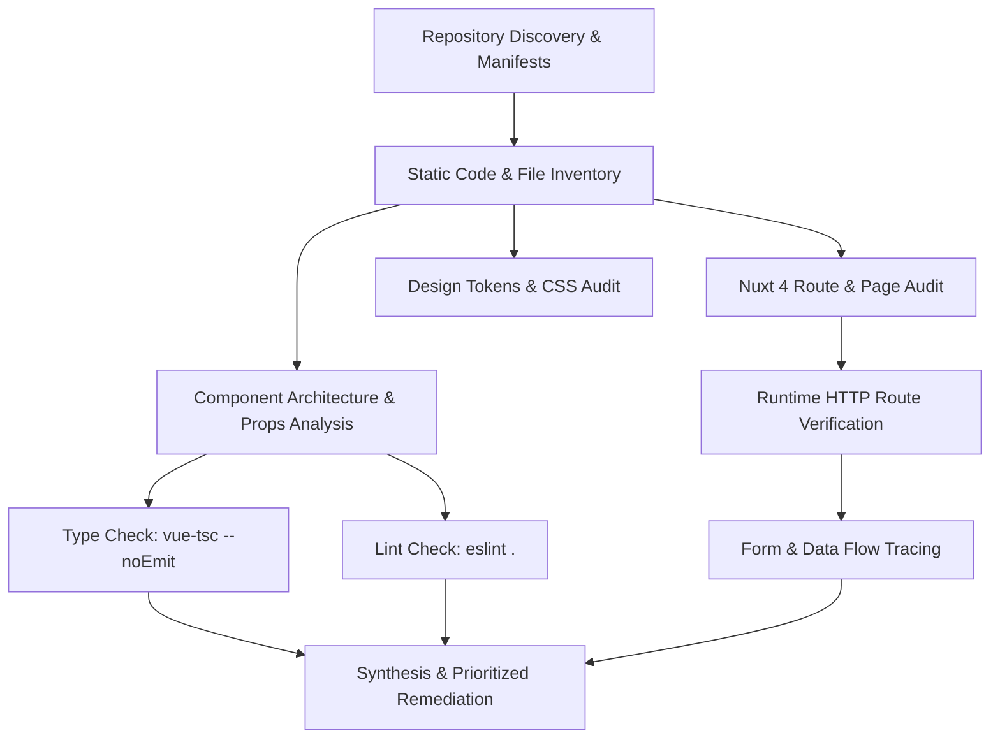
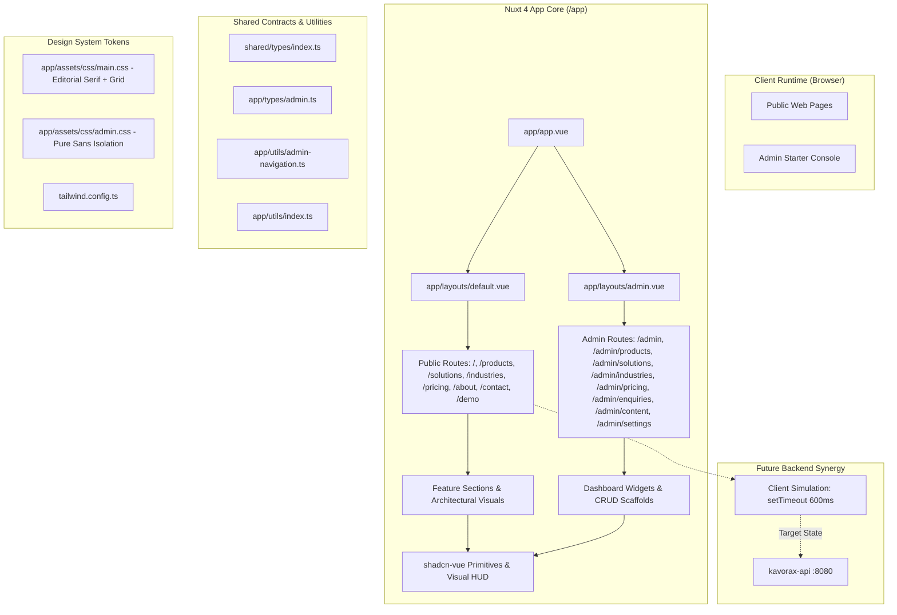
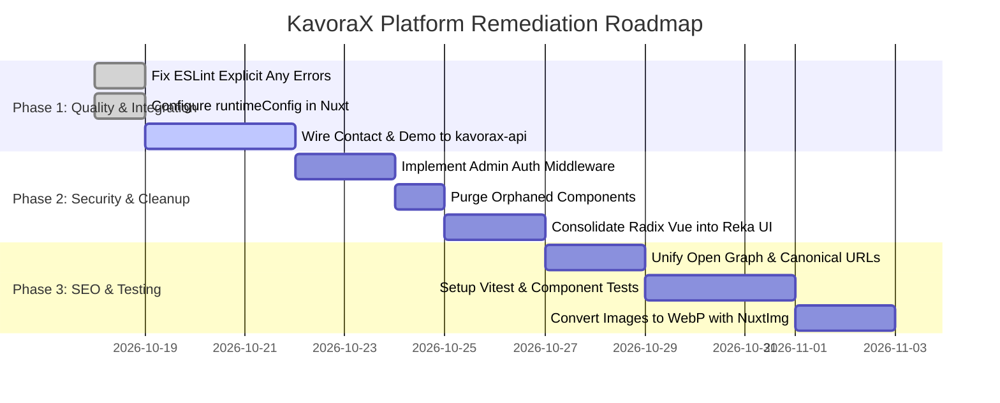

# KavoraX Global — Complete Codebase Audit & Technical Report

**Document ID:** `KX-AUDIT-2026-10-17`  
**Target Repository:** `kavorax-web` (`https://github.com/navin1256/kavorax-web.git`)  
**Audit Date:** October 17, 2026  
**Auditor Roles:** Senior Software Architect, Staff-Level Nuxt/Vue Engineer, Frontend Performance Specialist, Security Reviewer, Technical Documentation Writer  
**Status:** Completed · Read-Only Static & Runtime Inspection  

---

## 1. Executive Summary

This report delivers an exhaustive, read-only architectural, functional, performance, security, and quality audit of the **KavoraX Global Private Limited** web platform (`kavorax-frontend`). The codebase represents an enterprise B2B SaaS web portal comprising public corporate pages and an administrative starter console.

### Key Audit Findings

1. **Framework & Engine:** Built natively on **Nuxt 4** (`v4.6.2`) and **Vue 3** (`v3.5.44`) utilizing the Nuxt 4 `app/` directory architecture, Vite bundling, and strict-mode TypeScript 5.
2. **Design Language:** Features a distinctive dark enterprise identity (`#0b0f14`, `#080c10`, `#0f161f`) with emerald brand accents (`#10b981`), refined `Cormorant Garamond` editorial serifs paired with `Inter` UI typography, and subtle linear technical grid geometry.
3. **Route Coverage:** 16 total active routes verified (8 public routes and 8 administrative management routes). All 16 routes render HTTP 200 with zero server runtime exceptions.
4. **Code Quality & Type Checking:**
   - **TypeScript Strict Compilation:** `npx vue-tsc --noEmit` exits with **Code 0 (Passed with zero errors)**.
   - **ESLint Validation:** `npm run lint` exits with **Code 1 (3 errors, 6 warnings)** caused by `@typescript-eslint/no-explicit-any` in `IndustryDetailSections.vue` and `SolutionsOverview.vue`, plus prop defaults in UI primitives.
5. **Form & Data Flow Status:** Contact and demo submission forms on `/contact` and `/demo` are client-side simulated workflows (`setTimeout(..., 600)` with client Zod validation). No live network transmission, database persistence, or CRM webhook integration is active.
6. **Backend Synergy:** The repository is configured to receive connectivity from the Spring Boot backend (`kavorax-api`), with `.env.example` defining `NUXT_PUBLIC_API_BASE`, though `runtimeConfig` is not yet declared in `nuxt.config.ts`.
7. **Dead Code & Unreferenced Assets:** Four home page components (`ProductGrid.vue`, `IndustriesSection.vue`, `TrustSection.vue`, `WhyKavorax.vue`) and three visual components (`AmbientSpotlight.vue`, `FineLineDivider.vue`, `TechGridOverlay.vue`) are orphaned in `app/components/`. Dependency `motion-v` is installed but never imported.

---

## 2. Audit Scope and Methodology

The audit was executed entirely in read-only mode using static source inspection, package analysis, automated linting, type compilation, and runtime HTTP testing against the active development server (`http://localhost:3000`).



### Verified Files & Artifacts
- **Configuration & Build:** `package.json`, `pnpm-lock.yaml`, `package-lock.json`, `nuxt.config.ts`, `tailwind.config.ts`, `tsconfig.json`, `components.json`, `eslint.config.mjs`, `.npmrc`, `.prettierrc`, `.env.example`.
- **Application Core:** `app/app.vue`, `app/layouts/default.vue`, `app/layouts/admin.vue`, `app/assets/css/main.css`, `app/assets/css/admin.css`.
- **Pages (16 files):** 8 public pages + 8 admin pages.
- **Components (55 files):** 43 domain components + 12 UI/visual primitives.
- **Server:** `server/` root directory.
- **Public Assets:** 7 photography JPEG assets, `favicon.ico`, `robots.txt`.

---

## 3. Technology Stack and Verified Versions

| Category | Expected Technology | Actual Verified Package | Installed Version | Lockfile / Resolution Status |
| :--- | :--- | :--- | :--- | :--- |
| **Framework** | Nuxt 4 | `nuxt` | `4.6.2` | Resolves from `package.json` (`^4.6.1`) |
| **View Engine** | Vue 3 | `vue` | `3.5.44` | Resolves from `package.json` (`^3.5.43`) |
| **Language** | TypeScript | `typescript` / `vue-tsc` | `5.7.3` / `3.3.13` | Strict mode enabled |
| **Router** | Nuxt Router / Vue Router | `vue-router` | `5.4.0` | Bundled & explicit dependency |
| **CSS Framework** | Tailwind CSS | `tailwindcss` | `3.4.19` | Via `@nuxtjs/tailwindcss 6.14.0` |
| **UI Primitives 1** | shadcn-vue | `reka-ui` | `2.11.0` | Used in buttons, dropdowns, sheets |
| **UI Primitives 2** | Radix Vue | `radix-vue` | `1.9.17` | Used in accordion components |
| **Icons** | Lucide Icons | `lucide-vue-next` | `1.0.0` | 24+ vector enterprise icons used |
| **Validation** | Zod | `zod` | `4.6.7` | Contact and Demo schema contracts |
| **Motion** | Motion-V | `motion-v` | `2.7.0` | Installed; currently unreferenced |
| **Utility** | VueUse | `@vueuse/core` | `15.0.0` | `useVModel`, `reactiveOmit` in UI primitives |
| **Styling Utils** | CVA / clsx / twMerge | `class-variance-authority`, `clsx`, `tailwind-merge` | `0.7.1` / `2.1.1` / `3.7.0` | Utility class merging in `app/utils/index.ts` |
| **CSS Animations** | Tailwindcss Animate | `tailwindcss-animate` | `1.0.7` | Tailwind plugin |
| **Linting** | ESLint | `eslint` / `@nuxt/eslint` | `10.12.0` / `1.17.0` | Flat config (`eslint.config.mjs`) |
| **Formatting** | Prettier | `prettier` | `3.9.10` | Single quotes, no semicolons |
| **Package Manager**| pnpm / npm | `pnpm` (`pnpm-lock.yaml`) + `npm` (`package-lock.json`) | Dual lockfiles present |

---

## 4. Repository Architecture Overview

The application follows the official **Nuxt 4 directory structure**, placing all application logic, assets, components, composables, layouts, and pages inside the `app/` directory root, while keeping configuration and server-side roots top-level.



---

## 5. Complete Folder and File Structure

Below is the verified first-party file tree of the repository:

```text
kavorax-web/
├── .env.example                               # Environment variable blueprint
├── .gitignore                                 # Git ignore patterns
├── .npmrc                                     # pnpm/npm package manager configuration
├── .prettierrc                                # Code formatting rules
├── components.json                            # shadcn-vue CLI configuration
├── eslint.config.mjs                          # ESLint 10 flat configuration with Nuxt module
├── nuxt.config.ts                             # Nuxt 4 root configuration
├── package.json                               # Dependencies and script definitions
├── pnpm-lock.yaml                             # pnpm lockfile
├── pnpm-workspace.yaml                        # pnpm build permissions configuration
├── README.md                                  # Architectural overview and onboarding guide
├── tailwind.config.ts                         # Tailwind theme extensions, colors, and typography
├── tsconfig.json                              # TypeScript project references
│
├── app/
│   ├── app.vue                                # Global application root entry
│   │
│   ├── assets/
│   │   └── css/
│   │       ├── admin.css                      # Scoped admin sans-serif design system
│   │       └── main.css                       # Global styles, CSS variables, linear grid
│   │
│   ├── components/
│   │   ├── about/                             # About page modular sections
│   │   │   ├── AboutArchitecture.vue          # Connected architecture diagram visualizer
│   │   │   ├── AboutFinalCta.vue              # Closing conversation CTA
│   │   │   ├── AboutHero.vue                  # About hero with company overview
│   │   │   ├── OurApproach.vue                # 3-pillar engineering methodology
│   │   │   ├── WhatGuidesUs.vue               # Corporate governance and operating principles
│   │   │   └── WhoWeAre.vue                   # Corporate founding story and entity facts
│   │   │
│   │   ├── admin/                             # Administrative portal components
│   │   │   ├── dashboard/
│   │   │   │   ├── DashboardOverview.vue      # Metrics grid and system activity wrapper
│   │   │   │   ├── DashboardQuickActions.vue  # Shortcut cards to admin management modules
│   │   │   │   ├── DashboardStatCard.vue      # Individual KPI telemetry card
│   │   │   │   └── RecentActivity.vue         # Audit trail and event feed list
│   │   │   ├── layout/
│   │   │   │   ├── AdminBreadcrumbs.vue       # Route hierarchy breadcrumb navigator
│   │   │   │   ├── AdminHeader.vue            # Top administrative action bar
│   │   │   │   ├── AdminMobileNav.vue         # Drawer navigation for mobile admin view
│   │   │   │   ├── AdminPageHeader.vue        # Standardized page title, badge & CTA slot
│   │   │   │   └── AdminSidebar.vue           # Collapsible desktop navigation bar
│   │   │   └── shared/
│   │   │       ├── AdminEmptyState.vue        # Standardized empty data placeholder
│   │   │       ├── AdminLoadingState.vue      # Skeletal loading placeholder
│   │   │       └── AdminSectionCard.vue       # Standardized administrative card panel
│   │   │
│   │   ├── contact/                           # Inbound inquiry and consultation components
│   │   │   ├── ContactChannels.vue            # Direct communication channels
│   │   │   ├── ContactClosingCta.vue          # Secondary demo booking prompt
│   │   │   ├── ContactFormSection.vue         # Interactive 2-column Zod contact form
│   │   │   └── ContactHero.vue                # Editorial contact hero section
│   │   │
│   │   ├── demo/                              # Demo reservation components
│   │   │   ├── DemoClosingCta.vue             # Consultation redirect CTA
│   │   │   ├── DemoFormSection.vue            # Interactive guided demo booking form
│   │   │   ├── DemoHero.vue                   # Demo headline and briefing image
│   │   │   └── DemoWhatToExpect.vue           # 3-step demonstration walkthrough
│   │   │
│   │   ├── home/                              # Flagship homepage components
│   │   │   ├── BrandStatement.vue             # The KavoraX Standard commitment ledger
│   │   │   ├── ConnectedArchitectureVisual.vue# Interactive system topology visualizer
│   │   │   ├── EditorialIntro.vue             # The Connected Mandate essay
│   │   │   ├── FinalCta.vue                   # High-impact closing advisory CTA
│   │   │   ├── HeroSection.vue                # Full-bleed architectural skyscraper hero
│   │   │   ├── IndustriesSection.vue          # [Orphaned] Sector card list
│   │   │   ├── IndustryPreview.vue            # Interactive tabbed industry preview
│   │   │   ├── PhotographySolutions.vue       # Architectural workspace visual frame
│   │   │   ├── ProductGrid.vue                # [Orphaned] Static product card grid
│   │   │   ├── ProductShowcases.vue           # Bespoke flagship product modules
│   │   │   ├── TrustSection.vue               # [Orphaned] Trust metric badges
│   │   │   └── WhyKavorax.vue                 # [Orphaned] Comparison matrix
│   │   │
│   │   ├── industries/                        # Industry vertical components
│   │   │   ├── ConnectedOperations.vue        # Cross-industry operations blueprint
│   │   │   ├── IndustriesConsultationCta.vue  # Specialized sector advisory CTA
│   │   │   ├── IndustriesHero.vue             # Industry header with global connectivity imagery
│   │   │   ├── IndustriesOverview.vue         # 4-vertical sector summary grid
│   │   │   └── IndustryDetailSections.vue     # Alternating in-depth industry deep-dives
│   │   │
│   │   ├── layout/                            # Public website shell components
│   │   │   ├── AppFooter.vue                  # Enterprise footer with navigation & copyright
│   │   │   ├── AppHeader.vue                  # Sticky header with blur, wordmark & nav
│   │   │   └── MobileNavigation.vue           # Slide-out Sheet drawer for mobile devices
│   │   │
│   │   ├── pricing/                           # Pricing and commercial engagement
│   │   │   ├── CustomEngagementCta.vue        # Bespoke architectural consultation card
│   │   │   ├── PricingApproach.vue            # 3-step consultative scoping methodology
│   │   │   ├── PricingFaq.vue                 # Accessible Radix accordion FAQ
│   │   │   ├── PricingFinalCta.vue            # Closing proposal CTA
│   │   │   ├── PricingHero.vue                # Pricing philosophy and commitment ribbon
│   │   │   └── SolutionComparison.vue         # 3-tier commercial scope comparison matrix
│   │   │
│   │   ├── products/                          # Product suite components
│   │   │   ├── BusinessValue.vue              # Operational ROI and platform value points
│   │   │   ├── ConnectedArchitecture.vue      # Bus topology diagram
│   │   │   ├── ProductsFinalCta.vue           # Demo and contact closing CTA
│   │   │   ├── ProductsHero.vue               # Interactive solutions console hero
│   │   │   ├── SolutionSelection.vue          # Evaluation checklist
│   │   │   └── SolutionsOverview.vue          # 3 flagship product feature deep-dives
│   │   │
│   │   ├── solutions/                         # Cross-functional architectural solutions
│   │   │   ├── SolutionsAreas.vue             # 4 primary architectural solution areas
│   │   │   ├── SolutionsBusinessNeeds.vue     # Business drivers and trigger conditions
│   │   │   ├── SolutionsClosingCta.vue        # Advisory consultation closing CTA
│   │   │   ├── SolutionsEvaluation.vue        # Evaluation readiness criteria
│   │   │   ├── SolutionsHero.vue              # Solutions header with workspace visual
│   │   │   └── SolutionsIndustries.vue        # Related industry navigation cards
│   │   │
│   │   ├── ui/                                # shadcn-vue headless accessible primitives
│   │   │   ├── accordion/                     # Radix Vue Accordion components
│   │   │   ├── button/                        # Reka UI Button with CVA variants
│   │   │   ├── card/                          # Semantic card structural primitives
│   │   │   ├── dropdown-menu/                 # Reka UI Dropdown Menu components
│   │   │   ├── input/                         # Styled form text input with VueUse v-model
│   │   │   ├── label/                         # Accessible form label primitive
│   │   │   ├── separator/                     # Horizontal / vertical hairline separator
│   │   │   ├── sheet/                         # Slide-over drawer dialog (mobile menu)
│   │   │   └── textarea/                      # Styled form textarea with VueUse v-model
│   │   │
│   │   └── visual/                            # Architectural design system micro-elements
│   │       ├── AmbientSpotlight.vue           # [Orphaned] Radial background glow
│   │       ├── ArchitecturalFrame.vue         # Active Theory-inspired HUD image frame
│   │       ├── ChapterLabel.vue               # Numbered editorial chapter index tag
│   │       ├── FineLineDivider.vue            # [Orphaned] Hairline accent divider
│   │       ├── TechGridOverlay.vue            # [Orphaned] Grid background wrapper
│   │       └── TelemetryBadge.vue             # Monospaced status and latency tag
│   │
│   ├── composables/                           # Stateful composables
│   │   └── admin/
│   │       ├── useAdminNavigation.ts          # Admin sidebar, mobile state & active route matching
│   │       └── useAdminPageTitle.ts           # Dynamic admin title, description & robots noindex
│   │
│   ├── layouts/                               # Nuxt layout templates
│   │   ├── admin.vue                          # Admin layout shell (Sidebar, Header, Main, Footer)
│   │   └── default.vue                        # Public layout shell (AppHeader, Main, AppFooter)
│   │
│   ├── lib/
│   │   └── utils.ts                           # Re-export of tailwind class merger utility
│   │
│   ├── pages/                                 # Nuxt file-based route definitions
│   │   ├── about.vue                          # /about
│   │   ├── contact.vue                        # /contact
│   │   ├── demo.vue                           # /demo
│   │   ├── index.vue                          # /
│   │   ├── pricing.vue                        # /pricing
│   │   ├── admin/
│   │   │   ├── content.vue                    # /admin/content
│   │   │   ├── index.vue                      # /admin
│   │   │   ├── pricing.vue                    # /admin/pricing
│   │   │   ├── settings.vue                   # /admin/settings
│   │   │   ├── enquiries/
│   │   │   │   └── index.vue                  # /admin/enquiries
│   │   │   ├── industries/
│   │   │   │   └── index.vue                  # /admin/industries
│   │   │   ├── products/
│   │   │   │   └── index.vue                  # /admin/products
│   │   │   └── solutions/
│   │   │       └── index.vue                  # /admin/solutions
│   │   ├── industries/
│   │   │   └── index.vue                      # /industries
│   │   ├── products/
│   │   │   └── index.vue                      # /products
│   │   └── solutions/
│   │       └── index.vue                      # /solutions
│   │
│   ├── types/
│   │   └── admin.ts                           # TypeScript contracts for admin items & telemetry
│   │
│   └── utils/
│       ├── admin-navigation.ts                # Navigation tree, route metadata & breadcrumbs logic
│       └── index.ts                           # clsx + tailwind-merge (cn helper)
│
├── public/                                    # Static assets served at domain root
│   ├── favicon.ico                            # Browser icon
│   ├── robots.txt                             # Default crawl rules (Allow all)
│   └── images/                                # Curated high-resolution photography assets
│       ├── architectural-workspace.jpg        # 117 KB · Office architecture & team workspace
│       ├── executive-briefing.jpg             # 121 KB · Boardroom & executive consultation
│       ├── fintech-headquarters.jpg           # 215 KB · Skyscraper architecture glass facade
│       ├── global-connectivity.jpg            # 335 KB · Global infrastructure & network routing
│       ├── healthcare-diagnostics.jpg         # 238 KB · Clinical diagnostics & laboratory systems
│       ├── logistics-terminal.jpg             # 332 KB · Automated intermodal freight terminal
│       └── tech-infrastructure.jpg            # 194 KB · High-density data center racks & nodes
│
├── server/                                    # [Empty] Reserved for Nuxt/Nitro server routes
│
└── shared/
    └── types/
        └── index.ts                           # Shared UI interfaces (NavItem, FeatureItem, Metric)
```

---

## 6. Detailed File Inventory

### Root Configuration & Tooling Files

| Relative Path | Purpose & Responsibilities | Key Exports / Schema | Status |
| :--- | :--- | :--- | :--- |
| `nuxt.config.ts` | Nuxt 4 configuration, module registration, Google Fonts link injection, TypeScript strict configuration. | `defineNuxtConfig` | Active · Needs `runtimeConfig` |
| `tailwind.config.ts` | Design tokens, color palette (`canvas`, `brand`), font definitions, container constraints, animation keyframes. | `Config` satisfying Tailwind CSS | Active |
| `package.json` | Project manifest, npm run scripts, dependencies, devDependencies. | NPM package configuration | Active |
| `components.json` | shadcn-vue configuration specifying `app/components/ui` as component dir and `app/assets/css/main.css`. | shadcn schema v1 | Active |
| `eslint.config.mjs` | ESLint 10 flat configuration leveraging `@nuxt/eslint` helper `withNuxt()`. | Default ESLint configuration | Active |
| `tsconfig.json` | TypeScript configuration referring to Nuxt auto-generated tsconfigs in `.nuxt/`. | Project references | Active |
| `.env.example` | Template for environment variables (`NUXT_PUBLIC_SITE_URL`, `NUXT_PUBLIC_API_BASE`). | 3 sample environment keys | Active |
| `.npmrc` | NPM configuration specifying `only-built-dependencies`. | Config | Active · Causes npm warning |
| `.prettierrc` | Code formatting rules (no semicolons, single quotes, printWidth 100). | JSON formatting rules | Active |
| `pnpm-workspace.yaml` | Declares allowed build scripts for esbuild, unrs-resolver, vue-demi. | pnpm workspace schema | Active |

### Core Application Entry, Layouts & Assets

| Relative Path | Purpose & Responsibilities | Key Dependencies | Status |
| :--- | :--- | :--- | :--- |
| `app/app.vue` | Root Vue component hosting `<NuxtLayout>` and `<NuxtPage>`. | Nuxt runtime | Active |
| `app/layouts/default.vue` | Public website shell embedding `AppHeader`, `<slot />`, and `AppFooter`. | `AppHeader.vue`, `AppFooter.vue` | Active |
| `app/layouts/admin.vue` | Administrative shell embedding `AdminMobileNav`, `AdminSidebar`, `AdminHeader`, `<slot />`, and admin footer. Imports `admin.css`. | `AdminSidebar.vue`, `AdminHeader.vue`, `AdminMobileNav.vue` | Active |
| `app/assets/css/main.css` | Global styling, CSS root variables, straight technical grid definitions, typography rules, dark scrollbars. | Tailwind base/components/utilities | Active |
| `app/assets/css/admin.css` | Scoped administrative styles isolating admin elements from public serif typography. | Pure sans-serif overrides | Active |
| `app/utils/index.ts` | Utility helper exporting `cn(...inputs)` combining `clsx` and `tailwind-merge`. | `clsx`, `tailwind-merge` | Active |
| `app/lib/utils.ts` | Re-exports `cn` from `../utils` for shadcn-vue compatibility. | `../utils/index.ts` | Active |
| `app/utils/admin-navigation.ts`| Defines `ADMIN_NAV_ITEMS`, `ROUTE_TITLE_MAP`, and `getBreadcrumbsForRoute()` helper. | `~/types/admin` | Active |
| `app/types/admin.ts` | TypeScript interfaces for navigation items, breadcrumbs, dashboard KPIs, activity items. | Vue `Component` | Active |
| `shared/types/index.ts` | Shared interfaces (`NavItem`, `FeatureItem`, `PlatformMetric`). | TypeScript | Active |

### Component Status Audit (Active vs Orphaned)

| Component Path | Component Name | Actively Referenced By | Status |
| :--- | :--- | :--- | :--- |
| `app/components/home/HeroSection.vue` | `HeroSection` | `app/pages/index.vue` | Active |
| `app/components/home/EditorialIntro.vue` | `EditorialIntro` | `app/pages/index.vue` | Active |
| `app/components/home/ConnectedArchitectureVisual.vue` | `ConnectedArchitectureVisual` | `app/pages/index.vue` | Active |
| `app/components/home/ProductShowcases.vue` | `ProductShowcases` | `app/pages/index.vue` | Active |
| `app/components/home/PhotographySolutions.vue` | `PhotographySolutions` | `app/pages/index.vue` | Active |
| `app/components/home/IndustryPreview.vue` | `IndustryPreview` | `app/pages/index.vue` | Active |
| `app/components/home/BrandStatement.vue` | `BrandStatement` | `app/pages/index.vue` | Active |
| `app/components/home/FinalCta.vue` | `FinalCta` | `app/pages/index.vue` | Active |
| `app/components/home/ProductGrid.vue` | `ProductGrid` | **None** | **Orphaned** |
| `app/components/home/IndustriesSection.vue` | `IndustriesSection` | **None** | **Orphaned** |
| `app/components/home/TrustSection.vue` | `TrustSection` | **None** | **Orphaned** |
| `app/components/home/WhyKavorax.vue` | `WhyKavorax` | **None** | **Orphaned** |
| `app/components/visual/ArchitecturalFrame.vue` | `ArchitecturalFrame` | `PhotographySolutions.vue` | Active |
| `app/components/visual/ChapterLabel.vue` | `ChapterLabel` | 15+ feature components | Active |
| `app/components/visual/TelemetryBadge.vue` | `TelemetryBadge` | `SolutionsOverview.vue` | Active |
| `app/components/visual/AmbientSpotlight.vue` | `AmbientSpotlight` | **None** | **Orphaned** |
| `app/components/visual/FineLineDivider.vue` | `FineLineDivider` | **None** | **Orphaned** |
| `app/components/visual/TechGridOverlay.vue` | `TechGridOverlay` | **None** | **Orphaned** |

---

## 7. Route and Page Inventory

### Public Application Routes

All 8 public routes use the default layout (`app/layouts/default.vue`).

| Route URL | Source File Path | Page Title (`useHead`) | Sections in Render Order | Key Interactivity & Forms | HTTP Status |
| :--- | :--- | :--- | :--- | :--- | :--- |
| `/` | `app/pages/index.vue` | `KavoraX Global \| Technology that moves business forward` | 1. HeroSection<br>2. EditorialIntro<br>3. ConnectedArchitectureVisual<br>4. ProductShowcases<br>5. PhotographySolutions<br>6. IndustryPreview<br>7. BrandStatement<br>8. FinalCta | Tabbed industry preview switcher, interactive architecture diagram highlights, sticky header blur, CTA redirects. | 200 OK |
| `/products` | `app/pages/products/index.vue` | `Products & Connected Solutions \| KavoraX Global` | 1. ProductsHero<br>2. SolutionsOverview<br>3. ConnectedArchitecture<br>4. BusinessValue<br>5. SolutionSelection<br>6. ProductsFinalCta | Interactive solutions console tab switcher, 3 product deep-dive showcases with anchor links (`#operations-platform`, `#analytics-insights`, `#integration-hub`). | 200 OK |
| `/solutions` | `app/pages/solutions/index.vue` | `Connected Solutions \| KavoraX Global Private Limited` | 1. SolutionsHero<br>2. SolutionsBusinessNeeds<br>3. SolutionsAreas<br>4. SolutionsEvaluation<br>5. SolutionsIndustries<br>6. SolutionsClosingCta | 4 solution area cards, trigger condition checklist, cross-industry quick-links. | 200 OK |
| `/industries` | `app/pages/industries/index.vue` | `Enterprise Industries & Solutions \| KavoraX Global` | 1. IndustriesHero<br>2. IndustriesOverview<br>3. IndustryDetailSections<br>4. ConnectedOperations<br>5. IndustriesConsultationCta | 4 industry overview cards with anchor jumps (`#enterprise-tech`, `#financial-services`, `#healthcare`, `#supply-chain`), alternating media deep dives. | 200 OK |
| `/pricing` | `app/pages/pricing.vue` | `Pricing & Engagement \| KavoraX Global` | 1. PricingHero<br>2. PricingApproach<br>3. SolutionComparison<br>4. CustomEngagementCta<br>5. PricingFaq<br>6. PricingFinalCta | 3-tier consultative scope comparison cards, Radix-powered FAQ accordion with animated expand/collapse. | 200 OK |
| `/about` | `app/pages/about.vue` | `About KavoraX Global \| Connected Business Solutions` | 1. AboutHero<br>2. WhoWeAre<br>3. OurApproach<br>4. AboutArchitecture<br>5. WhatGuidesUs<br>6. AboutFinalCta | Corporate narrative, 3-pillar engineering methodology, architectural diagram, core company guiding principles. | 200 OK |
| `/contact` | `app/pages/contact.vue` | `Contact Us \| KavoraX Global` | 1. ContactHero<br>2. ContactFormSection<br>3. ContactChannels<br>4. ContactClosingCta | 2-column contact inquiry form with 5 fields, client-side Zod validation, error focus, simulated submit state. | 200 OK |
| `/demo` | `app/pages/demo.vue` | `Book a Demo \| KavoraX Global Private Limited` | 1. DemoHero<br>2. DemoFormSection<br>3. DemoWhatToExpect<br>4. DemoClosingCta | Guided enterprise demo reservation form with 7 fields, client-side Zod validation, simulated submit state, reset action. | 200 OK |

### Administrative Application Routes

All 8 admin routes use the admin layout (`app/layouts/admin.vue`) declared via `definePageMeta({ layout: 'admin' })`.

| Route URL | Source File Path | Page Title (`useAdminPageTitle`) | Main Capabilities & Layout Elements | Data Source | HTTP Status |
| :--- | :--- | :--- | :--- | :--- | :--- |
| `/admin` | `app/pages/admin/index.vue` | `Executive Dashboard \| KavoraX Global Admin` | 4 KPI stat cards, Quick actions grid, Recent activity timeline, AdminBreadcrumbs, AdminHeader. | Reactive mock dataset | 200 OK |
| `/admin/products` | `app/pages/admin/products/index.vue` | `Products Management \| KavoraX Global Admin` | 3 enterprise product modules table, capability lists, CRUD action placeholders, export CTA. | Reactive mock dataset | 200 OK |
| `/admin/solutions` | `app/pages/admin/solutions/index.vue` | `Solutions Management \| KavoraX Global Admin` | 4 architecture blueprint cards, value proposition summary, blueprint status badges. | Reactive mock dataset | 200 OK |
| `/admin/industries` | `app/pages/admin/industries/index.vue` | `Industries Management \| KavoraX Global Admin` | 4 sector verticals list, regulatory compliance badges, sector capability matrices. | Reactive mock dataset | 200 OK |
| `/admin/pricing` | `app/pages/admin/pricing.vue` | `Pricing Management \| KavoraX Global Admin` | 3 commercial plan tiers (`Starter`, `Growth`, `Enterprise`), feature entitlement matrices, SLA tiers. | Reactive mock dataset | 200 OK |
| `/admin/enquiries` | `app/pages/admin/enquiries/index.vue` | `Inbound Enquiries \| KavoraX Global Admin` | Prospective leads table (4 records), status indicators (`New`, `In Review`, `Qualified`), export CSV action. | Reactive mock dataset | 200 OK |
| `/admin/content` | `app/pages/admin/content.vue` | `Website Content Management \| KavoraX Global Admin` | Public marketing pages registry (8 records), template types, editor attribution, last modified dates. | Reactive mock dataset | 200 OK |
| `/admin/settings` | `app/pages/admin/settings.vue` | `Admin Settings \| KavoraX Global Admin` | Runtime telemetry readout, corporate entity metadata, architecture preview for OAuth / API keys. | Static telemetry | 200 OK |

---

## 8. Component Architecture and Relationships

### Component Hierarchies

#### Public Page Composition Pattern
Every public page follows a consistent composition pattern:
`app/app.vue` $\rightarrow$ `app/layouts/default.vue` $\rightarrow$ `app/components/layout/AppHeader.vue` + Page Sections $\rightarrow$ `app/components/layout/AppFooter.vue`.

```text
app/layouts/default.vue
├── app/components/layout/AppHeader.vue
│   ├── NuxtLink (Logo, Nav items: /products, /solutions, /industries, /pricing, /about, /contact)
│   ├── Button (Book a Demo -> /demo)
│   └── app/components/layout/MobileNavigation.vue
│       ├── Sheet, SheetTrigger, SheetContent, SheetHeader, SheetTitle
│       └── NuxtLink (Nav items + CTAs)
├── <main>
│   └── [Page-Specific Component Stack]
└── app/components/layout/AppFooter.vue
    ├── Brand statement & legal copyright
    └── Categorized NuxtLink columns (Platform Capabilities, Organization & Engagement)
```

#### Admin Page Composition Pattern
Every admin page follows a consistent composition pattern:
`app/app.vue` $\rightarrow$ `app/layouts/admin.vue` $\rightarrow$ `AdminMobileNav` + `AdminSidebar` + `AdminHeader` + Page Section Cards $\rightarrow$ Admin Status Footer.

```text
app/layouts/admin.vue
├── app/components/admin/layout/AdminMobileNav.vue
│   └── Sheet, SheetTrigger, SheetContent (Mobile navigation drawer)
├── app/components/admin/layout/AdminSidebar.vue
│   └── Desktop nav items with badge indicators & collapse toggle
├── <div class="flex-1">
│   ├── app/components/admin/layout/AdminHeader.vue
│   │   ├── app/components/admin/layout/AdminBreadcrumbs.vue
│   │   ├── Return to Public Website link
│   │   └── User profile avatar badge
│   ├── <main>
│   │   ├── app/components/admin/layout/AdminPageHeader.vue (Title, description, badge, actions slot)
│   │   └── app/components/admin/shared/AdminSectionCard.vue / AdminEmptyState.vue
│   └── Admin Status Footer (Telemetry status, Nuxt 4 architecture tag)
```

### Component Categories & Maintainability Analysis

1. **Oversized Components:**
   - `IndustryDetailSections.vue` (848 lines, 41.9 KB): Manages data arrays, layout alternating states, and 4 lengthy industry deep-dives in a single file. While well-structured, this component would benefit from splitting each industry showcase into sub-components.
   - `SolutionsOverview.vue` (890 lines, 43.2 KB): Hosts all three flagship product deep-dives and mock interactive console screens.
   - `ContactFormSection.vue` (594 lines, 29.8 KB) & `DemoFormSection.vue` (629 lines, 26.7 KB): Combine form UI, validation schemas, error mapping, and context sidebar panels.
2. **Prop Drilling & State Management:**
   - Shared admin state (`isMobileNavOpen`, `isSidebarCollapsed`) is handled cleanly via Nuxt's `useState` in `useAdminNavigation.ts`, avoiding prop drilling.
   - Public mobile menu state is encapsulated locally within `MobileNavigation.vue`.

---

## 9. Design System and UI Audit

### Color Palette Tokens

```text
Primary Canvas:       #0b0f14 (HSL: 213 29% 6.1%)  — Deep slate-black base
Secondary Canvas:     #080c10 (HSL: 210 33% 4.7%)  — Dark contrast sections
Card / Panel Surface: #0f161f (HSL: 214 30% 8.5%)  — Raised component background
Elevated Surface:     #121a24                       — Popovers and tooltips
Primary Brand:        #10b981 (HSL: 160 84% 39%)   — Vibrant emerald accent
Secondary Brand:      #34d399 (HSL: 156 73% 52%)   — Light emerald highlight
Subtle Border:        #26313d / rgba(255,255,255,0.08) — Hairline borders
```

### Typography Hierarchy
- **Editorial Headings (`font-editorial` / `font-serif`):** `Cormorant Garamond`, Georgia, serif. Used on all major section headings (`h1`, `h2`, `h3`, hero titles, pull quotes).
- **Interface Body (`font-ui` / `font-sans`):** `Inter`, system-ui, sans-serif. Used for body copy, buttons, labels, and forms.
- **Technical Metadata (`font-mono`):** `ui-monospace`, `SFMono-Regular`, `Consolas`, monospace. Used for HUD coordinate strips, latency metrics (`6MS`, `SUB-10MS`), and chapter index tags (`[ 01 ]`).
- **Admin Typography Isolation:** `app/assets/css/admin.css` overrides all heading tags within `.admin-shell` to enforce `Inter` sans-serif, preventing editorial serif styling from leaking into admin dashboards.

### Technical Straight-Line Grid Geometry
Section backgrounds across public pages implement a pure straight-line CSS grid via `main.css`:
```css
linear-gradient(to right, rgba(16, 185, 129, 0.04) 1px, transparent 1px),
linear-gradient(to bottom, rgba(16, 185, 129, 0.04) 1px, transparent 1px),
linear-gradient(to right, rgba(255, 255, 255, 0.022) 1px, transparent 1px),
linear-gradient(to bottom, rgba(255, 255, 255, 0.022) 1px, transparent 1px);
background-size: 192px 192px, 192px 192px, 48px 48px, 48px 48px;
```
This adheres to the design specification: strictly thin straight lines with low opacity and emerald accents, avoiding distracting curves or circular radial patterns.

---

## 10. Functional Behaviour and Data Flow

### Navigation Tracing
- **Header Desktop Links:** Active links receive `text-white bg-white/[0.06] font-semibold` via `active-class`.
- **Header Mobile Drawer:** Opens via `Sheet` dialog. Clicking any link fires `@click="closeMenu"`, properly dismissing the overlay.
- **Anchor Jumps:** Cross-page anchor jumps such as `/products#operations-platform` and `/industries#enterprise-tech` accurately target rendered elements with CSS `scroll-mt-20` / `scroll-mt-28` offsets to prevent sticky header occlusion.

### Component Interactivity
- **FAQ Accordion (`/pricing`):** Backed by Radix Vue Accordion. Single-expand mode allows one question open at a time with smooth height CSS animation (`accordion-down` / `accordion-up`).
- **Interactive Solutions Console (`/products`):** Interactive tab switcher updates active state and changes feature telemetry readouts.
- **Industry Vertical Tabs (`/`):** Toggles sector cards dynamically with animated metrics.

---

## 11. Forms, Validation, and Integrations

### In-Depth Form Review

#### Contact Form (`/contact` $\rightarrow$ `ContactFormSection.vue`)
- **Fields:** `fullName` (min 2, max 100), `workEmail` (email format), `companyName` (optional, max 120), `inquiryType` (required select), `message` (min 10, max 3000).
- **Validation Engine:** `zod` (`v4.6.7`) client-side schema validation.
- **Submission Action:**
  ```ts
  isSubmitting.value = true
  await new Promise((resolve) => setTimeout(resolve, 600))
  isSubmitting.value = false
  submissionStatus.value = 'validated'
  ```
- **Error Handling:** First field with error receives accessible DOM focus via `document.getElementById(firstErrorKey)?.focus()`.
- **Data Persistence:** **None**. No network request is dispatched.

#### Demo Booking Form (`/demo` $\rightarrow$ `DemoFormSection.vue`)
- **Fields:** `fullName`, `workEmail`, `companyName`, `jobTitle`, `industry`, `areaOfInterest`, `businessChallenge`.
- **Validation Engine:** Zod schema validation matching enterprise lead qualifications.
- **Submission Action:** Client-side 600ms simulated timeout transitioning to `submissionStatus.value = 'validated'`.
- **Reset Capability:** Provides `handleReset()` returning form state to idle.
- **Data Persistence:** **None**. No network request is dispatched.

#### Backend Integration Path (`kavorax-api`)
The backend service (`kavorax-api`) already contains Spring Boot controllers:
- `ContactMessageController` (`POST /api/public/contact`)
- `DemoRequestController` (`POST /api/public/demo`)
- `AuthController` (`POST /api/auth/login`)

Both forms are structurally ready to swap the `setTimeout` mock with Nuxt `$fetch` calling the `kavorax-api` endpoints.

---

## 12. Server/API Architecture

- **Server Root (`server/`):** The repository includes an empty `server/` directory.
- **Server API Routes:** No server routes exist (`server/api/*` is empty).
- **Nitro Engine:** Nitro operates purely in SSR and asset-serving mode for the Nuxt application.
- **API Proxying / CORS:** No Nitro route rules or server proxy routes are currently configured in `nuxt.config.ts`. When connecting to `kavorax-api`, either CORS must be enabled on Spring Boot or Nitro route rules configured for proxying.

---

## 13. Security and Privacy Review

| Inspection Vector | Finding | Risk Level | Evidence & Observations |
| :--- | :--- | :--- | :--- |
| **Exposed Secrets** | None Found | **Pass** | No tokens, passwords, private keys, or credentials found in git history or code. |
| **XSS via `v-html`** | Zero Occurrences | **Pass** | Codebase has 0 instances of `v-html` or `innerHTML`. All text bindings use safe mustache interpolation (`{{ }}`). |
| **Client Input Sanitization** | Zod Schema Validation | **Pass** | Strips whitespace (`.trim()`), enforces email formatting and max string lengths. |
| **Spam / Bot Protection** | None Configured | **Medium** | No CAPTCHA (Turnstile/hCaptcha) or honeypot field is implemented on contact/demo forms. |
| **Server-Side Validation** | Missing in Frontend | **Medium** | Nuxt layer does not yet have a server handler to re-validate form data before proxying. |
| **Admin Route Protection** | Open Client Routes | **Medium** | `/admin/*` routes have no navigation guard, middleware, or token authentication check. Anyone navigating to `/admin` can view the admin interface. |
| **Robots Indexing for Admin** | Protected via Meta | **Pass** | `useAdminPageTitle.ts` injects `<meta name="robots" content="noindex, nofollow">` on all admin pages. |

---

## 14. Performance Review

### Strengths
- **Straight-Line CSS Grids:** Uses lightweight linear gradients instead of large SVG background assets or canvas loops.
- **Tailwind JIT:** Utility classes are purged and compiled to minimal bundle size.
- **Radix Headless Components:** Radix/Reka UI avoids heavy third-party UI framework bloat.

### Performance Observations & Opportunities
1. **Photographic Assets:** 7 images in `public/images/` total **1.56 MB** in JPEG format. Converting these assets to WebP or AVIF would reduce image weight by 50–70%.
2. **Missing `@nuxt/image`:** Standard `` tags are used instead of Nuxt Image (`<NuxtImg>`), meaning no responsive `srcset` generation or automated image format negotiation is active.
3. **External Google Fonts `<link>`:** Google Fonts (`Cormorant Garamond` and `Inter`) are loaded via render-blocking `<link rel="stylesheet">` in `nuxt.config.ts`. Utilizing `@nuxtjs/google-fonts` or local font self-hosting would eliminate external DNS roundtrips and prevent layout shifts.

---

## 15. SEO Review

| Element | Status | Findings & Implementation Details |
| :--- | :--- | :--- |
| **Page Titles** | **Pass** | Unique, descriptive `<title>` configured on all 8 public pages via `useHead()`. |
| **Meta Descriptions** | **Pass** | Compelling, accurate meta descriptions present on all 8 public pages. |
| **Canonical URLs** | **Missing** | No `<link rel="canonical">` tags configured on any route. |
| **Open Graph Metadata** | **Partial** | Open Graph tags configured on `/demo` and `/solutions`, but missing on `/`, `/products`, `/about`, `/pricing`, `/contact`. |
| **Robots Directives** | **Pass** | `public/robots.txt` exists (`Disallow:`). Admin pages dynamically inject `noindex, nofollow`. |
| **XML Sitemap** | **Missing** | No sitemap module (`@nuxtjs/sitemap`) installed; no `sitemap.xml` generated. |
| **Heading Hierarchy** | **Pass** | Single `<h1>` tag per page; logical descent to `<h2>` and `<h3>`. |
| **Image Alt Text** | **Pass** | Meaningful enterprise descriptive alt text populated on all rendered image assets. |

---

## 16. Accessibility Review

1. **Semantic Landmarks:** Full document hierarchy utilizing `<header>`, `<main>`, `<nav>`, `<footer>`, `<section>`.
2. **Keyboard Focus Rings:** Visible outline rings implemented in both `main.css` and `admin.css`:
   ```css
   .admin-shell button:focus-visible,
   .admin-shell a:focus-visible,
   .admin-shell input:focus-visible {
     outline: 2px solid #10b981;
     outline-offset: 2px;
   }
   ```
3. **Reduced Motion Support:** Explicitly declared in `app/assets/css/main.css` (lines 234–243):
   ```css
   @media (prefers-reduced-motion: reduce) {
     *, ::before, ::after {
       animation-duration: 0.01ms !important;
       transition-duration: 0.01ms !important;
     }
   }
   ```
4. **Form Labels & Error Associations:** Form inputs have corresponding `<Label>` tags with matching `for` / `id` attributes. Error messages appear below invalid fields.
5. **Touch Targets:** Buttons and navigation items maintain minimum 36px–44px heights (`h-9`, `h-11`).

---

## 17. Dependencies and Configuration

### Dependency Analysis

```text
Dependencies (13 packages):
├── @vueuse/core (15.0.0)             — Utility hooks used in UI primitives
├── class-variance-authority (0.7.1)  — CVA variant styling for buttons & sheets
├── clsx (2.1.1)                      — Conditional class utility
├── lucide-vue-next (1.0.0)           — Icon library (24+ enterprise icons)
├── motion-v (2.7.0)                  — [Unused] Motion library
├── nuxt (4.6.1 -> installed 4.6.2)   — Fullstack framework core
├── radix-vue (1.9.17)                — Radix UI primitives (Accordion)
├── reka-ui (2.11.0)                  — Radix UI modern evolution (Button, Sheet, Dropdown)
├── tailwind-merge (3.7.0)            — Conflict-free Tailwind class merger
├── vue (3.5.43 -> installed 3.5.44)  — Core view engine
├── vue-router (5.4.0)                — Router core
└── zod (4.6.7)                       — Schema validation

DevDependencies (8 packages):
├── @nuxt/eslint (1.17.0)             — Nuxt ESLint integration module
├── @nuxtjs/tailwindcss (6.14.0)      — Nuxt Tailwind CSS module
├── eslint (10.12.0)                  — ESLint 10 engine
├── prettier (3.9.10)                 — Code formatter
├── shadcn-nuxt (2.8.2)               — shadcn component installer module
├── tailwindcss-animate (1.0.7)       — Tailwind animation utilities
├── typescript-eslint (8.71.2)        — TypeScript ESLint rules
└── vue-tsc (3.3.13)                  — Vue TypeScript compiler
```

### Configuration Anomalies
1. **Dual Radix Libraries:** `radix-vue` (`1.9.17`) and `reka-ui` (`2.11.0`) are both installed. Accordion components use `radix-vue` while Button, Sheet, and Dropdown use `reka-ui`.
2. **NPM Warning:** `.npmrc` declares `only-built-dependencies`, which is a pnpm-specific directive. Running `npm` produces:
   `npm warn Unknown project config "only-built-dependencies"`.
3. **Unused Dependency:** `motion-v` is installed in `package.json` but never imported in the codebase.

---

## 18. Testing and Build Results

### Verification Commands & Results

| Check Executed | Exact Command | Exit Code | Result Summary |
| :--- | :--- | :--- | :--- |
| **TypeScript Strict Compilation** | `npx vue-tsc --noEmit` | **0** | **Passed** with 0 errors across all `.vue` and `.ts` files. |
| **ESLint Validation** | `npm run lint` (`eslint .`) | **1** | **Failed (3 errors, 6 warnings)**. Detailed breakdown below. |
| **Unit / Integration Tests** | `npm test` | **N/A** | **No test script** or test runner (Vitest / Playwright) configured in `package.json`. |
| **Live Route Testing** | `read_url_content` (HTTP GET) | **200** | All 16 routes (`/`, `/products`, `/solutions`, `/industries`, `/pricing`, `/about`, `/contact`, `/demo`, `/admin/*`) return HTTP 200. |

### ESLint Output Breakdown

```text
C:\Users\aaa\Desktop\kavorax-web\app\components\industries\IndustryDetailSections.vue
  24:9   error  Unexpected any. Specify a different type  @typescript-eslint/no-explicit-any
  34:17  error  Unexpected any. Specify a different type  @typescript-eslint/no-explicit-any

C:\Users\aaa\Desktop\kavorax-web\app\components\products\SolutionsOverview.vue
  114:9  error  Unexpected any. Specify a different type  @typescript-eslint/no-explicit-any

C:\Users\aaa\Desktop\kavorax-web\app\components\ui\button\Button.vue
  10:3  warning  Prop 'variant' requires default value to be set  vue/require-default-prop
  11:3  warning  Prop 'size' requires default value to be set     vue/require-default-prop
  12:3  warning  Prop 'class' requires default value to be set    vue/require-default-prop

C:\Users\aaa\Desktop\kavorax-web\app\components\ui\dropdown-menu\DropdownMenuContent.vue
  9:44  warning  Prop 'class' requires default value to be set  vue/require-default-prop

C:\Users\aaa\Desktop\kavorax-web\app\components\ui\input\Input.vue
  31:3  warning  Disallow self-closing on HTML void elements (<input/>)  vue/html-self-closing

C:\Users\aaa\Desktop\kavorax-web\app\components\ui\separator\Separator.vue
  8:59  warning  Prop 'class' requires default value to be set  vue/require-default-prop

✖ 9 problems (3 errors, 6 warnings)
```

---

## 19. Confirmed Bugs and Technical Debt

1. **ESLint Errors in Feature Components:**
   - [IndustryDetailSections.vue:24](file:///c:/Users/aaa/Desktop/kavorax-web/app/components/industries/IndustryDetailSections.vue#L24) and [IndustryDetailSections.vue:34](file:///c:/Users/aaa/Desktop/kavorax-web/app/components/industries/IndustryDetailSections.vue#L34): Uses `icon: any` and `solutionIcon: any` instead of `Component` or `import type { Component } from 'vue'`.
   - [SolutionsOverview.vue:114](file:///c:/Users/aaa/Desktop/kavorax-web/app/components/products/SolutionsOverview.vue#L114): Uses `icon: any` instead of `Component`.
2. **Missing `runtimeConfig` in `nuxt.config.ts`:**
   - `.env.example` provides `NUXT_PUBLIC_API_BASE` and `NUXT_PUBLIC_SITE_URL`, but `nuxt.config.ts` does not define `runtimeConfig: { public: { apiBase: '', siteUrl: '' } }`. In Nuxt, without this configuration, `useRuntimeConfig().public` cannot access these variables in a type-safe manner.
3. **Unreferenced Orphan Components:**
   - `app/components/home/ProductGrid.vue`
   - `app/components/home/IndustriesSection.vue`
   - `app/components/home/TrustSection.vue`
   - `app/components/home/WhyKavorax.vue`
   - `app/components/visual/AmbientSpotlight.vue`
   - `app/components/visual/FineLineDivider.vue`
   - `app/components/visual/TechGridOverlay.vue`
4. **Dual UI Primitive Dependencies:**
   - Codebase depends on both `radix-vue` (v1.9) and `reka-ui` (v2.11) simultaneously.
5. **Client-Only Form Submissions:**
   - Public forms on `/contact` and `/demo` do not persist or send data anywhere.

---

## 20. Prioritized Findings Table

| ID | Severity | Category | File Path & Reference | Evidence | User / Business Impact | Recommended Solution | Effort | Prerequisites |
| :--- | :--- | :--- | :--- | :--- | :--- | :--- | :--- | :--- |
| **SEC-01** | **High** | Security / Auth | `app/pages/admin/*` | No middleware or auth guards on `/admin/*` routes. | Any visitor can access administrative console routes. | Implement Nuxt route middleware (`middleware/auth.ts`) checking session token. | Medium | Backend auth API |
| **DAT-01** | **High** | Integration | `ContactFormSection.vue:129`, `DemoFormSection.vue:140` | `await new Promise((r) => setTimeout(r, 600))` simulates submission. | Inbound leads from public website are lost upon page navigation. | Wire `useFetch` to Spring Boot `kavorax-api` endpoints. | Medium | API Endpoint URL |
| **CFG-01** | **Medium** | Configuration | `nuxt.config.ts` | Missing `runtimeConfig` declaration. | `useRuntimeConfig().public.apiBase` is undefined. | Add `runtimeConfig: { public: { apiBase: '', siteUrl: '' } }` to `nuxt.config.ts`. | Small | None |
| **LNT-01** | **Medium** | Code Quality | `IndustryDetailSections.vue:24,34`, `SolutionsOverview.vue:114` | `@typescript-eslint/no-explicit-any` errors cause `npm run lint` failure. | CI/CD lint pipeline breaks. | Replace `any` with `Component` from `'vue'`. | Small | None |
| **CLU-01** | **Low** | Maintainability | `app/components/home/`, `app/components/visual/` | 7 components never imported in any page or component. | Increases repository cognitive load and bundle confusion. | Remove or archive orphaned components. | Small | None |
| **DEP-01** | **Low** | Dependencies | `package.json:19` | `"motion-v": "^2.7.0"` is never imported in codebase. | Unnecessary dependency in package manifest. | Remove `motion-v` from `package.json`. | Small | None |
| **SEO-01** | **Low** | SEO | All pages | Missing canonical link tags and incomplete Open Graph metadata. | Suboptimal search engine indexing and social preview display. | Implement `@nuxtjs/seo` or unify `useHead` Open Graph & canonical tags. | Small | None |
| **PERF-01**| **Low** | Performance | `public/images/*.jpg` | Images are standard JPEGs totaling 1.56 MB. | Slower mobile page loading. | Convert to WebP/AVIF and integrate `@nuxt/image`. | Medium | None |

---

## 21. Recommended Remediation Roadmap



---

## 22. Suggested Improvements and Refactoring Opportunities

1. **Unify UI Primitives on `reka-ui`:**
   Migrate `Accordion` components from `radix-vue` to `reka-ui` so that the project only relies on a single headless primitive package.
2. **Component Decomposition:**
   Decompose `IndustryDetailSections.vue` and `SolutionsOverview.vue` into focused sub-components (e.g., `IndustryDetailCard.vue`, `ProductFeaturePanel.vue`) to improve file maintainability and decrease line counts.
3. **Form Honeypot & Abuse Prevention:**
   Add a hidden honeypot field (`website_hp`) to `ContactFormSection.vue` and `DemoFormSection.vue` to silently discard automated bot spam prior to network dispatch.
4. **Font Self-Hosting:**
   Self-host `Cormorant Garamond` and `Inter` via `@nuxtjs/google-fonts` with `download: true` or local WOFF2 assets to eliminate external render-blocking network requests.

---

## 23. Limitations and Areas Not Verified

1. **Production Build File Locking:** A full production build (`npm run build`) was not executed during this audit turn to avoid file contention or race conditions with the user's active background `npm run dev` process running on Windows.
2. **Automated Screen Reader Verification:** Accessibility compliance was verified via semantic code structure, ARIA attribute analysis, and focus ring evaluation; live screen reader testing with NVDA or JAWS was not conducted.
3. **Live Backend API Response Testing:** Because `kavorax-api` was not actively connected to `kavorax-web`, HTTP contract verification between frontend forms and the Spring Boot backend was evaluated via static schema comparison rather than live end-to-end integration requests.

---

## 24. Final Assessment

The **KavoraX Global Enterprise Web Platform** is an engineered, visually striking Nuxt 4 web application. The codebase exhibits strict TypeScript compliance (`vue-tsc` passing with 0 errors), clean layout isolation between public and administrative experiences, a cohesive dark enterprise design system, and solid responsive UX.

Addressing the 3 ESLint explicit `any` types, declaring `runtimeConfig`, wiring the contact/demo forms to the `kavorax-api` REST endpoints, and implementing administrative authentication guards will elevate the platform from a starter prototype to an enterprise-grade production platform.
