# KAVORAX GLOBAL — COMPREHENSIVE CODEBASE AUDIT & DEFECT REPORT

**Project:** KavoraX Global Enterprise Platform (`kavorax-web`)  
**Framework:** Nuxt 4, Vue 3.5, TypeScript 6, Vite 8, Tailwind CSS v4  
**Audit Scope:** Full Application Stack (Architecture, Routing, Layouts, APIs, Security, Accessibility, Assets, Configuration)  
**Audit Date:** October 2026  
**Status:** COMPLETED & DOCUMENTED  

---

## 1. Executive Summary

A comprehensive, evidence-based code analysis was performed across the entire KavoraX Global web application repository. While recent implementations of the **Pricing**, **Industries**, and **Contact** pages successfully introduced state-of-the-art cinematic editorial animations, zero layout shifts, and strong typography, the broader codebase exhibits structural debt, configuration anomalies, broken legacy routes, unauthenticated administrative paths, and orphaned dependencies.

This report catalogs all identified defects, classified by severity, with root cause explanations, exact file references, and prioritized remediation paths.

### Summary of Findings by Severity
- **P0 — Critical / High Impact (5 issues):**
  - Project directory divergence between workspace root and active Git repository.
  - Legacy page bloat and route collisions (`contact.vue` vs `contact-us.vue`, `industries/index.vue` vs `industries.vue`).
  - 19 broken internal links returning HTTP 404 in public navigation and template files.
  - Dual Header and Footer components causing duplicate rendering in legacy templates.
  - HTML5 semantic landmark nesting violation (nested `<main>` tags).
- **P1 — High / Security & Configuration (5 issues):**
  - Unauthenticated Admin Panel (`/admin/*`) without route middleware or access guards.
  - Public indexing risk: `_robots.txt` does not disallow `/admin` from search engine crawlers.
  - Font loading mismatch: `nuxt.config.ts` preconnects EB Garamond / Plus Jakarta Sans, while CSS defines Cormorant Garamond / Inter.
  - Missing Cloudflare Turnstile bot verification on public inquiry and demo forms.
  - Hardcoded developmental `postMessage` listener active in production builds (`studio-listener.client.ts`).
- **P2 — Medium / Technical Debt & Maintenance (6 issues):**
  - Orphaned Nuxt modules installed and active without implementation (Pinia, @nuxt/image, better-sqlite3).
  - Unused Internationalization (`@nuxtjs/i18n`): 4 locale files loaded, but zero component usage (`$t()` count: 0).
  - Empty stub components (`WhatsAppWidget.vue`, `CookieConsent.vue`).
  - Disconnected Admin Inbound Enquiries page displaying static hardcoded mock data.
  - Inactive Cookie Banner: `CookieBanner.vue` exists but is never mounted in any layout.
  - Tailwind CSS v4 ambiguous class warnings (`duration-[550ms]`, `ease-[cubic-bezier(...)]`).
- **P3 — Low / Polish & Hygiene (2 issues):**
  - Broken ESLint command (`npx eslint .` crashes due to missing `eslint.config.*`).
  - Deprecated PostCSS nesting module warning in build pipeline.

---

## 2. P0 — Critical Issues & Architectural Deficiencies

### Issue 2.1: Workspace Root vs. Active Git Repository Divergence
- **Severity:** P0 (Critical)
- **Locations:**
  - `C:\Users\aaa\Desktop\kavorax-web` (Active Git repository on remote `origin: https://github.com/navin1256/kavorax-web.git`)
  - `c:\Users\aaa\Desktop\New folder\kavorax-web` (Active IDE workspace directory)
- **Root Cause:** The IDE workspace was opened in `New folder\kavorax-web`, which lacks `.git` metadata and contains legacy/stale files not present in the primary repository.
- **Impact:** Changes made in one directory are not automatically synced to the git repository, leading to HMR desynchronization, phantom bugs, and lost commits.
- **Remediation:** Align IDE workspace directly to `C:\Users\aaa\Desktop\kavorax-web` and deprecate `New folder\kavorax-web`.

### Issue 2.2: Legacy Page Bloat & Conflicting Routes
- **Severity:** P0 (Critical)
- **Affected Files:**
  - `app/pages/contact-us.vue` (60.7 KB) vs `app/pages/contact.vue` (1.0 KB)
  - `app/pages/industries.vue` (55.5 KB) vs `app/pages/industries/index.vue` (1.3 KB)
  - `app/pages/solutions.vue` (48.7 KB) vs `app/pages/solutions/index.vue` (1.7 KB)
  - Standalone legacy pages: `careers.vue` (66.8 KB), `resources.vue` (65.4 KB), `pos-and-billing.vue`, `kitchen-display.vue`, `multi-location.vue`, `inventory-and-stock.vue`, `digital-ordering.vue`, `crm.vue`, `delivery-management.vue`, `business-analytics.vue`.
- **Root Cause:** When migrating to modular directory-based routing (`industries/index.vue`, `solutions/index.vue`, `contact.vue`), the monolithic historical `.vue` files were retained in `app/pages/`.
- **Impact:** Nuxt 4 treats both `industries.vue` and `industries/index.vue` as routing definitions. In Vue Router, `industries.vue` acts as a parent layout component expecting `<NuxtPage />`, which conflicts with `industries/index.vue`.
- **Remediation:** Remove or archive all deprecated flat files (`contact-us.vue`, `industries.vue`, `solutions.vue`, etc.) so only the verified modular pages remain active.

### Issue 2.3: 19 Broken Internal Links Returning HTTP 404
- **Severity:** P0 (Critical)
- **Evidence:** Automated crawl of all internal links across templates identified 19 dead routes returning 404:
  ```
  /business-analytics   -> 404 Not Found
  /cafes                -> 404 Not Found
  /careers              -> 404 Not Found
  /contact-us           -> 404 Not Found
  /convenience-stores   -> 404 Not Found
  /crm                  -> 404 Not Found
  /delivery-management  -> 404 Not Found
  /digital-ordering     -> 404 Not Found
  /ecommerce            -> 404 Not Found
  /hospitality          -> 404 Not Found
  /inventory-and-stock  -> 404 Not Found
  /multi-location       -> 404 Not Found
  /pos-and-billing      -> 404 Not Found
  /privacy-policy       -> 404 Not Found
  /resources            -> 404 Not Found
  /restaurants          -> 404 Not Found
  /retail               -> 404 Not Found
  /salons               -> 404 Not Found
  /terms-of-service     -> 404 Not Found
  ```
- **Referencing Files:**
  - `app/components/Header.vue` and `app/components/Footer.vue`
  - `app/components/ProductPageTemplate.vue`
  - Older legacy pages in `app/pages/`
- **Impact:** Any user or crawler following these navigation links encounters a 404 error page.
- **Remediation:** Update navigation menus and links to point to canonical routes (`/products`, `/solutions`, `/industries`, `/pricing`, `/about`, `/contact`), or implement valid modular pages for necessary destinations.

### Issue 2.4: Dual Header and Footer Components & Duplicate Rendering
- **Severity:** P0 (Critical)
- **Affected Files:**
  - `app/components/layout/AppHeader.vue` & `app/components/layout/AppFooter.vue` (Active layout)
  - `app/components/Header.vue` & `app/components/Footer.vue` (Legacy components)
- **Root Cause:** `app/layouts/default.vue` automatically mounts `<AppHeader />` and `<AppFooter />`. However, legacy page templates (`careers.vue`, `contact-us.vue`, `privacy-policy.vue`, `terms-of-service.vue`, `resources.vue`) explicitly include `<Header />` and `<Footer />` inside their template without setting `definePageMeta({ layout: false })`.
- **Impact:** When visiting these pages, users see two stacked headers at the top of the viewport and two stacked footers at the bottom.
- **Remediation:** Delete legacy `Header.vue` and `Footer.vue`. All pages must inherit layout components purely through `layouts/default.vue`.

### Issue 2.5: HTML5 Semantic Landmark Nesting Violation (Nested `<main>`)
- **Severity:** P0 (High / Accessibility)
- **Affected Files:**
  - `app/layouts/default.vue` (line 11: `<main class="flex-1 max-w-full overflow-x-hidden">`)
  - `app/pages/demo.vue` (line 29: `<main class="min-h-screen bg-[#0b0f14] text-white">`)
  - `app/pages/solutions/index.vue` (line 31: `<main class="min-h-screen bg-[#0b0f14] text-white">`)
- **Root Cause:** The root default layout provides the top-level `<main>` wrapper. Pages nested inside `<slot />` erroneously declare their root container as `<main>`.
- **Impact:** Violates W3C HTML5 specification and WCAG 2.2 Landmark navigation guidelines. Screen readers announce nested main landmarks, disorienting visually impaired users.
- **Remediation:** Change `<main>` in `demo.vue` and `solutions/index.vue` to `<div class="min-h-screen ...">`.

---

## 3. P1 — High Severity & Security Deficiencies

### Issue 3.1: Completely Unauthenticated Admin Portal (`/admin/*`)
- **Severity:** P1 (High / Security)
- **Affected Routes:**
  - `/admin` (Executive Dashboard)
  - `/admin/enquiries` (Inbound Prospect Leads)
  - `/admin/settings` (Runtime Telemetry & Preferences)
  - `/admin/pricing`, `/admin/content`, `/admin/products`, `/admin/solutions`, `/admin/industries`
- **Evidence:** `app/middleware/` is an empty directory. No route guards or authentication checks exist.
- **Impact:** Anyone visiting `/admin` on a deployed environment can inspect business telemetry, lead enquiry tables, and system metrics.
- **Remediation:** Implement an `auth.ts` route middleware with session verification, JWT validation, or an HTTP Basic Auth reverse-proxy gate.

### Issue 3.2: Search Engine Crawlers Allowed to Index `/admin` via `_robots.txt`
- **Severity:** P1 (High / Security & SEO)
- **File:** `public/_robots.txt`
- **Code:**
  ```text
  User-Agent: *
  Disallow:
  ```
- **Impact:** Search engine bots (Google, Bing) are permitted to crawl and index all admin pages and administrative sub-paths.
- **Remediation:** Update `_robots.txt` and `@nuxtjs/robots` configuration:
  ```text
  User-Agent: *
  Disallow: /admin
  Disallow: /admin/
  Disallow: /api/
  ```

### Issue 3.3: Font Loading Desynchronization
- **Severity:** P1 (High / Visual Identity & Performance)
- **Files:**
  - `nuxt.config.ts` (lines 17–19): Preconnects and loads:
    `family=EB+Garamond:ital,wght@...&family=Plus+Jakarta+Sans:ital,wght@...`
  - `app/assets/css/main.css` (lines 54, 69, 76, 80): Declares:
    - Display Headings: `'Cormorant Garamond', Georgia, serif`
    - Body UI: `'Inter', system-ui, -apple-system, sans-serif`
- **Impact:** The browser downloads unused font files (`EB Garamond` and `Plus Jakarta Sans`) on every page load, while the actual design system fonts (`Cormorant Garamond` and `Inter`) must fall back to local system fonts or trigger unplanned font network requests via `@nuxt/fonts`.
- **Remediation:** Update the Google Fonts `<link>` in `nuxt.config.ts` to request `Cormorant+Garamond` and `Inter`.

### Issue 3.4: Cloudflare Turnstile Inactive on Public Lead Forms
- **Severity:** P1 (High / Anti-Spam)
- **Files:**
  - `nuxt.config.ts`: Loads `@nuxtjs/turnstile`.
  - `app/components/contact/ContactFormSection.vue` & `app/components/demo/DemoFormSection.vue`
- **Impact:** No siteKey or secretKey is configured in `runtimeConfig`, and no Turnstile widget is embedded in the form templates. Forms are vulnerable to automated bot submissions.
- **Remediation:** Configure `turnstile: { siteKey: process.env.TURNSTILE_SITE_KEY }` and add `<NuxtTurnstile v-model="token" />` to the public inquiry and demo forms.

### Issue 3.5: Hardcoded Development `postMessage` Listener in Production
- **Severity:** P1 (Security / Reliability)
- **File:** `app/plugins/studio-listener.client.ts`
- **Code:**
  ```ts
  function handleMessage(event: MessageEvent) {
    if (event.origin !== 'http://localhost:3001') return
    // Directly mutates DOM based on event payload
  }
  ```
- **Impact:** Plugin is active in all build environments without an `if (!process.dev) return` guard.
- **Remediation:** Wrap plugin initialization in `if (!import.meta.dev) return` to completely eliminate the listener in production bundles.

---

## 4. P2 — Technical Debt, Unused Modules & Dead Code

### Issue 4.1: Unused Heavy Dependencies in `package.json`
| Dependency | Listed In | Actual Usage | Impact |
|---|---|---|---|
| `better-sqlite3: ^13.0.3` | `dependencies` | Zero imports across entire project | Unnecessary native binary dependency in node_modules |
| `@pinia/nuxt: ^1.0.2` & `pinia: ^4.0.3` | `modules` / `dependencies` | `app/stores` is completely empty | Adds state management overhead without any stores |
| `@nuxt/image: ^2.1.0` | `modules` / `dependencies` | Zero `<NuxtImg>` usage across all 76 images | Missing automated WebP/AVIF compression & responsive sizing |

### Issue 4.2: Inactive Internationalization (`@nuxtjs/i18n`)
- **Severity:** P2 (Medium)
- **Files:** `nuxt.config.ts`, `i18n/locales/*.json`
- **Detail:** `@nuxtjs/i18n` is configured with 4 locales (`en`, `ar`, `hi`, `ta`) and strategy `prefix_except_default`. However, an automated scan revealed **0 instances** of `$t()` or `useI18n()` across all `.vue` templates. All copy is hardcoded English.
- **Impact:** Visiting `/ar` or `/hi` loads the page with RTL direction flags or localized URL prefixes, but displays hardcoded English, causing visual layout fragmentation.

### Issue 4.3: Empty & Orphaned Components
- **`app/components/WhatsAppWidget.vue`:** Contains only `<template></template>` (23 bytes), despite `runtimeConfig.public.whatsappNumber` being configured.
- **`app/components/CookieConsent.vue`:** Contains only `<template></template>` (176 bytes).
- **`app/components/CookieBanner.vue`:** Complete, working GDPR consent component with localStorage integration, but is never imported or rendered in `app.vue` or `layouts/default.vue`.
- **`app/components/NewsletterForm.vue` & `UiButtonCTA.vue`:** Fully styled components that are never referenced by any page.

### Issue 4.4: Disconnected Admin Enquiries Data
- **File:** `app/pages/admin/enquiries/index.vue`
- **Code:** `const sampleEnquiries: EnquiryRecord[] = [...]`
- **Impact:** The admin portal displays 4 static mock enquiries (`Eleanor Vance`, `David Sterling`, etc.). It has no connection to backend APIs or databases to display real prospect submissions submitted via `/contact` or `/demo`.

### Issue 4.5: Tailwind CSS v4 Ambiguous Class Warnings
- **Console Warnings:**
  ```text
  WARN warn - The class duration-[550ms] is ambiguous and matches multiple utilities.
  WARN warn - The class ease-[cubic-bezier(0.16,1,0.3,1)] is ambiguous and matches multiple utilities.
  ```
- **Cause:** In Tailwind CSS v4, arbitrary value square brackets without escaping match multiple internal utilities.
- **Remediation:** Replace with standard Tailwind theme classes or use verified `.transition-editorial` utility classes in `main.css`.

---

## 5. P3 — Build & Tooling Issues

### Issue 5.1: Missing ESLint Configuration
- **File:** Root directory
- **Evidence:** Running `npx eslint .` produces:
  ```text
  ESLint couldn't find an eslint.config.* file.
  From ESLint v9.0.0, the default configuration file is now eslint.config.*.
  ```
- **Remediation:** Add `eslint.config.mjs` using `@nuxt/eslint` flat config preset:
  ```js
  import withNuxt from './.nuxt/eslint.config.mjs'
  export default withNuxt()
  ```

### Issue 5.2: Deprecated PostCSS Nesting Plugin Warning
- **Console Warning:**
  ```text
  WARN [NUXT_B7027] The PostCSS plugin tailwindcss/nesting could not be loaded: tailwindcss is installed but does not provide it.
  ```
- **Cause:** Tailwind CSS v4 uses native CSS nesting and `@tailwindcss/vite`, making the legacy `tailwindcss/nesting` PostCSS plugin obsolete.
- **Remediation:** Remove `tailwindcss/nesting` from any PostCSS configurations or dependencies.

---

## 6. Actionable Remediation Roadmap

```mermaid
graph TD
    A["Priority 1: Clean Up Core Architecture"] --> A1["Delete obsolete legacy pages (contact-us, industries.vue, etc.)"]
    A --> A2["Delete obsolete Header.vue & Footer.vue"]
    A --> A3["Sync workspace to primary Git repository"]
    
    B["Priority 2: Fix Routing & A11y"] --> B1["Remove duplicate nested <main> in demo.vue & solutions/index.vue"]
    B --> B2["Update 19 broken links in navigation & templates"]
    B --> B3["Add Privacy Policy & Terms of Service modular pages"]

    C["Priority 3: Security & Access Control"] --> C1["Add auth middleware to /admin/*"]
    C --> C2["Block /admin in public/_robots.txt"]
    C --> C3["Guard studio-listener.client.ts with process.dev"]

    D["Priority 4: Configuration & Polish"] --> D1["Align Google Fonts in nuxt.config.ts to Cormorant Garamond & Inter"]
    D --> D2["Mount CookieBanner.vue in default.vue layout"]
    D --> D3["Remove better-sqlite3 and prune unused modules"]
    D --> D4["Add eslint.config.mjs"]
```



---

## 7. Conclusion

The core public experience for KavoraX Global has strong visual, motion, and typographic foundations across its primary pages (`/`, `/about`, `/contact`, `/pricing`, `/industries`, `/products`, `/solutions`, `/demo`). By addressing the structural bloat, securing the administrative interface, synchronizing font configs, and fixing the 19 broken legacy navigation references, the codebase will achieve institutional-grade production quality and maintainability.
