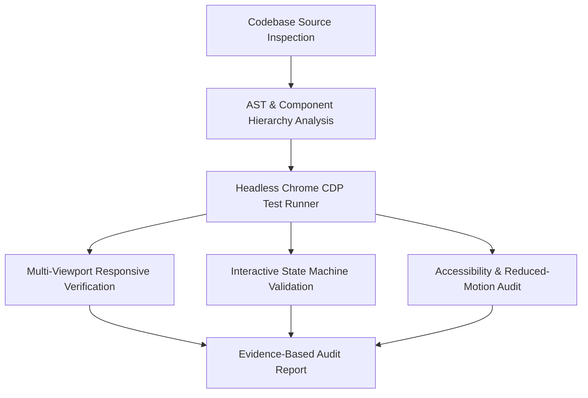
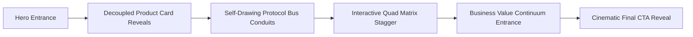

# KAVORAX GLOBAL — PRODUCTS SECTION DESIGN & ANIMATION AUDIT

> **Document Type:** Architectural Design, UI/UX, Typography, Motion, and Accessibility Audit  
> **Target Route:** `/products` (`app/pages/products/index.vue`)  
> **Target Entity:** KavoraX Global Private Limited (`kavorax-web`)  
> **Audit Status:** Complete — Strict Read-Only (0 source modifications)  
> **Auditor Role:** Senior UI/UX Designer, Creative Frontend Architect, Motion Specialist, Accessibility Auditor  
> **Generated Date:** 2026-10-20  
> **Server State:** Nuxt 4 / Vite Development Server Running at `http://localhost:3000` (HTTP 200 OK)  

---

## 1. EXECUTIVE SUMMARY

The Products section of KavoraX Global (`/products`) is the commercial and technical anchor of the digital presence. It introduces three enterprise-grade software platforms:
1. **Operations Platform** (`OPS // 01`) — Workflow Orchestration & Multi-Cluster Dispatch.
2. **Analytics & Insights** (`INTEL // 02`) — Continuous Telemetry & Sub-Second Anomaly Radar.
3. **Integration Hub** (`MESH // 03`) — Interoperability Fabric & Multi-Cloud Protocol Bridge.

### Key Audit Findings

* **Strong Architectural UI Foundation:** Unlike template-driven corporate product pages, KavoraX presents its portfolio through highly bespoke, interactive technical HUD consoles (Matrix Console, Workflow State Engine, Telemetry Cockpit with live visual bars, and Universal Protocol Bridge with encrypted payload envelopes).
* **Exceptional Responsive Integrity:** Validated via automated Chrome DevTools Protocol (CDP) across Mobile (`375×812`), Tablet (`768×1024`), Laptop (`1024×768`), and Desktop (`1440×900`). The page maintains **zero horizontal overflow** (`docW === winW` across all breakpoints).
* **Zero Console & Network Errors:** Automated runtime analysis detected 0 console errors, 0 hydration warnings, and 0 failed network requests.
* **The Core Motion Deficiency (The Scrollytelling Gap):** While the Hero section (`ProductsHero.vue`) features expressive typography (`WordReveal.vue`) and timed entrance reveals, **Chapters 02 through 06 are 100% static upon scroll**. The entire section below the hero renders statically upon initial page paint with zero scroll-triggered reveals (`revealBasesCount: 0`), zero heading reveals, zero card entrance staggers, and static ambient glow layers.
* **Zero Heavy Raster Asset Dependencies:** The page currently loads **0 raster images (``)**, relying purely on SVG geometry, Lucide icons, and CSS backdrop blurs. While performant, it creates an opportunity for subtle architectural background imagery or animated SVG line drawing.

---

## 2. SCOPE AND AUDIT METHODOLOGY

This audit was conducted strictly in accordance with read-only engineering standards. No application code, configuration, styles, assets, or package dependencies were modified.



### Audit Environment & Tooling
* **Framework:** Nuxt 4 (Vue 3, Vite, Tailwind CSS, Lucide Icons, Shadcn-Vue tokens).
* **Browser Automation:** Headless Chromium via Chrome DevTools Protocol (CDP) WebSocket listener.
* **Diagnostic Scripts:** Standalone scratch scripts in persistent brain scratch storage (`scratch/audit-products-page.mjs`, `scratch/test-precise-interactions.mjs`).
* **Visual Verification Artifacts:** High-resolution screenshots saved to `scratch/products_audit_shots/` (`full_products_page.png`, `01_hero_desktop.png`, `vp_mobile.png`, `vp_tablet.png`, `vp_laptop.png`, `vp_desktop.png`).

---

## 3. PRODUCTS ROUTE AND COMPONENT INVENTORY

The Products section is organized as a single page route with modular subcomponents representing dedicated narrative chapters.

| File Path | Role / Content | Line Count | Size | State / Animations Present |
| :--- | :--- | :---: | :---: | :--- |
| `app/pages/products/index.vue` | Route entry page & SEO metadata | 42 | 1.3 KB | Static wrapper with `bg-[#0b0f14]` |
| `app/components/products/ProductsHero.vue` | Hero section & KX Fabric Matrix Console | 346 | 15.6 KB | `WordReveal.vue`, `isHeroMounted` `.reveal-base` (6 elements), `setInterval` (4.5s) |
| `app/components/products/SolutionsOverview.vue` | Chapter 02: Capability Spectrum & 3 Product Deep-Dives | 890 | 43.3 KB | **Completely static entrance**; interactive state machines for stages, channels, and protocols |
| `app/components/products/ConnectedArchitecture.vue` | Chapter 03: Architectural Interconnection Topology | 186 | 8.5 KB | **Completely static entrance**; interactive 4-node quad selection |
| `app/components/products/BusinessValue.vue` | Chapter 04: Organizational Value Continuum | 108 | 4.6 KB | **Completely static entrance**; 3 static value cards |
| `app/components/products/SolutionSelection.vue` | Chapter 05: Guidance & Enterprise Fit Matrix | 131 | 6.2 KB | **Completely static entrance**; 3 scenario cards & advisory banner |
| `app/components/products/ProductsFinalCta.vue` | Next Steps: Direct Architectural Consultation | 101 | 4.7 KB | **Completely static entrance**; static dual CTA buttons |
| `app/layouts/default.vue` | Shared Layout Wrapper | 17 | 0.5 KB | Wraps `AppHeader.vue` and `AppFooter.vue` |

---

## 4. OVERALL DESIGN ASSESSMENT

### 4.1 Brand Language Alignment

The Products page faithfully utilizes the KavoraX core design tokens:
* **Primary Obsidian (`#080C10`):** Used as section backgrounds in alternating cadence (`ProductsHero`, `ConnectedArchitecture`, `SolutionSelection`, `ProductsFinalCta`).
* **Secondary Obsidian (`#0B0F14`):** Used in `SolutionsOverview` and `BusinessValue`, establishing visual rhythm.
* **Elevated Surfaces (`#0C131D` / `#0C141E` / `#0D141E`):** Applied to console containers, interactive product cards, and telemetry panels.
* **Brand Emerald (`#10B981` / `#34D399`):** Restrained accent color for badges, metrics, borders, and italic typography flourishes.
* **Analytics Cyan (`#06B6D4`):** Purposefully applied to the Analytics & Insights suite to denote continuous telemetry and live data streaming without violating the dark palette.
* **Hairline Borders (`rgba(255, 255, 255, 0.06–0.10)`):** Encasing cards, dividing metadata bars, and defining the Active Theory corner crosshairs (`+`).
* **Architectural Grid (`bg-tech-grid`):** Subtle CSS linear gradients providing institutional precision to background planes.

### 4.2 Visual Pacing & Content Density

The page features exceptionally rich content that avoids generic marketing jargon in favor of verified technical capabilities (e.g., *Deterministic schema evaluation*, *P99 < 8.4ms*, *TLS 1.3 Ingress*, *mTLS Signed Pipelines*, *Zero-Trust Policy Gates*). However, because sections lack entrance transitions, the user encounters a wall of static cards immediately upon scrolling, diminishing the sense of discovery.

---

## 5. PRODUCT PAGE SECTION-BY-SECTION ANALYSIS

### Section 1 — Hero Section (`ProductsHero.vue`)
* **Role:** Introduces the product portfolio and provides interactive exploration of the 3 tiers.
* **Layout:** Asymmetric 12-column grid. Left = Editorial metadata, H1, lead paragraph, CTAs, and 3 value pillars. Right = Interactive `KX // FABRIC MATRIX` console.
* **Interactive Behavior:** Features auto-cycling orbs (`setInterval` every 4.5s) through Operations, Analytics, and Integrations. Clicking any card pauses the interval and expands its telemetry panel.
* **Motion Status:** Uses `WordReveal.vue` for the H1 (`immediate: true`, `delay: 240ms`). The left column elements stagger into view with `delay-75` through `delay-800` on client mount.
* **Audit Finding:** The lead paragraph uses `font-editorial` (Cormorant Garamond, 20–24px) rather than `font-ui` (Inter), competing with the H1 headline. Ambient glows are static.

### Section 2 — Chapter 02: Capability Spectrum (`SolutionsOverview.vue`)
* **Role:** The core product catalog detailing Operations Platform, Analytics & Insights, and Integration Hub.
* **Layout:** Vertical stack of three massive, alternating cards (Left-Right, Right-Left, Left-Right), followed by an Inter-Product Intelligence Mesh.
* **Anchor Navigation:** A floating/sticky navigator (`Operations`, `Analytics`, `Integration`) allows direct scrolling to `#operations-platform`, `#analytics-insights`, and `#integration-hub`.
* **Interactive State Machines:**
  1. *Operations:* 3-stage interactive step selector (01 Ingestion, 02 Dispatch, 03 Audit Ledger) updating target dispatch telemetry.
  2. *Analytics:* 3-channel selector (Throughput, Latency Mesh, Anomaly Radar) updating a dynamic 12-bar frequency visualizer.
  3. *Integrations:* 3-protocol selector (REST/Webhooks, GraphQL Federation, Kafka Pub/Sub) displaying live JSON payload envelopes.
* **Motion Status:** **100% Static.** Zero `reveal-base` classes, zero `useScrollReveal` hooks, static H2, static SVG connectors.

### Section 3 — Chapter 03: Architectural Interconnection (`ConnectedArchitecture.vue`)
* **Role:** Conceptual explanation of how the KavoraX modular foundation prevents operational silos.
* **Layout:** Centralized blueprint container housing a 2×2 quad matrix: Business Operations, Analytics & Visibility, System Integrations, and Governance & Security.
* **Interactive Behavior:** Clicking any quadrant highlights the node with `border-brand/50` and emerald glow.
* **Motion Status:** **100% Static.** Heading and cards render instantly without scroll pacing. Ambient glow is static.

### Section 4 — Chapter 04: Organizational Value (`BusinessValue.vue`)
* **Role:** Articulates the three engineering pillars: Operational Efficiency, Greater Visibility, Adaptable Growth.
* **Layout:** 3-column continuum ledger.
* **Motion Status:** **100% Static.** Cards and icons appear without stagger or scroll animation.

### Section 5 — Chapter 05: Guidance & Planning (`SolutionSelection.vue`)
* **Role:** Diagnostic matrix recommending starting points based on immediate operational friction.
* **Layout:** 3 stacked scenario cards + bottom Confidential Architectural Advisory banner.
* **Motion Status:** **100% Static.**

### Section 6 — Next Steps: Direct Consultation (`ProductsFinalCta.vue`)
* **Role:** Final commercial call to action.
* **Layout:** Elevated obsidian container with corner crosshairs, dual action buttons, and compliance badges.
* **Motion Status:** **100% Static.** Heading and CTA buttons do not animate.

---

## 6. TYPOGRAPHY AND BRAND CONSISTENCY

### 6.1 Font Hierarchy

| Level | HTML Tag | Font Family | Size / Leading (Desktop) | Sample Text | Status |
| :--- | :---: | :--- | :--- | :--- | :--- |
| **Hero Display** | `<h1>` | Cormorant Garamond (`font-editorial`) | `text-5xl xl:text-6xl` / `leading-[1.05]` | *Connected Solutions for Modern Businesses.* | Expressive `WordReveal` |
| **Hero Lead** | `<p>` | Cormorant Garamond (`font-editorial`) | `text-xl sm:text-2xl` / `leading-relaxed` | *Explore connected business solutions designed to simplify...* | **Typographic Conflict (Should be Inter `font-ui`)** |
| **Chapter Headings** | `<h2>` | Cormorant Garamond (`font-editorial`) | `text-3xl sm:text-5xl lg:text-6xl` | *Distinct capability. Shared operational architecture.* | Static (No WordReveal) |
| **Product Headlines** | `<h3>` | Cormorant Garamond (`font-editorial`) | `text-3xl lg:text-[2.75rem]` / `leading-[1.1]` | *Unified orchestration across complex enterprise workflows.* | Static |
| **Card / Value Titles** | `<h3>` | Cormorant Garamond (`font-editorial`) | `text-2xl sm:text-3xl` | *Operational Efficiency*, *Analytics & Visibility* | Static |
| **Advisory Banner** | `<h4>` | Cormorant Garamond (`font-editorial`) | `text-2xl sm:text-3xl` | *Unsure which module fits your roadmap?* | Static |
| **Technical Metadata** | `<span>` | Monospace (`font-mono`) | `text-[10px]` to `text-xs` | `KX // 02`, `OPS // 01`, `99.99% Reliability` | Consistent |
| **Body / Capabilities** | `<div>`, `<p>` | Inter (`font-ui`) | `text-xs` to `text-sm` | Verified capability bullet points, descriptions | Consistent |

### 6.2 Chapter Numbering Disconnect
An audit of chapter numbering revealed an editorial inconsistency:
* Hero metadata strip: `ChapterLabel` displays `index="KX // 02"` (referencing "02" as if it were Chapter 02).
* Solutions Overview: `ChapterLabel` displays `index="CHAPTER 02"`.
* Connected Architecture: `ChapterLabel` displays `index="CHAPTER 03"`.
* Business Value: `ChapterLabel` displays `index="CHAPTER 04"`.
* Solution Selection: `ChapterLabel` displays `index="CHAPTER 05"`.
* Final CTA: `ChapterLabel` displays `index="NEXT STEPS"`.

**Defect:** There is no `CHAPTER 01`. The hero uses `KX // 02` which collides with Chapter 02. The Hero should logically represent Chapter 01 (`CHAPTER 01 // PORTFOLIO ARCHIVE`) to harmonize with the Homepage and About page structure.

---

## 7. COMPLETE EXISTING ANIMATION INVENTORY

| Element / Selector | Component | Trigger | Implementation / Classes | Duration / Delay | Observed in Browser? | Reduced-Motion Compliant? | Notes |
| :--- | :--- | :--- | :--- | :--- | :---: | :---: | :--- |
| **Hero H1 Headline** | `ProductsHero.vue` | Page Load (Immediate) | `WordReveal.vue` masked span transforms | `550ms` duration, `240ms` delay, `55ms` stagger | Yes | Yes (Opacity 1, 0 delay) | Smooth upward reveal with italic emerald flourish |
| **Hero HUD Strip** | `ProductsHero.vue` | Mount (`isHeroMounted`) | `.reveal-base.transition-editorial` | `700ms` / `delay-75` | Yes | Yes | Reveals upon mount |
| **Hero Eyebrow Pill** | `ProductsHero.vue` | Mount (`isHeroMounted`) | `.reveal-base.transition-editorial` | `700ms` / `delay-150` | Yes | Yes | Reveals upon mount |
| **Hero Lead Paragraph** | `ProductsHero.vue` | Mount (`isHeroMounted`) | `.reveal-base.transition-editorial` | `700ms` / `delay-500` | Yes | Yes | Reveals upon mount |
| **Hero CTAs** | `ProductsHero.vue` | Mount (`isHeroMounted`) | `.reveal-base.transition-editorial` | `700ms` / `delay-700` | Yes | Yes | Reveals upon mount |
| **Hero Indicators Strip**| `ProductsHero.vue` | Mount (`isHeroMounted`) | `.reveal-base.transition-editorial` | `700ms` / `delay-800` | Yes | Yes | Reveals upon mount |
| **Hero Matrix Console** | `ProductsHero.vue` | Mount (`isHeroMounted`) | `.reveal-base.transition-editorial` | `700ms` / `delay-300` | Yes | Yes | Reveals upon mount |
| **Pulse Dots** | Multiple | Infinite | `.animate-pulse-subtle` | `3s` ease-in-out | Yes | Yes | Restrained pulse |
| **Hero Ambient Glow** | `ProductsHero.vue` | Static | `bg-brand/[0.08] blur-[160px]` | None | No | N/A | **Missing `animate-ambient-drift`** |
| **Chapter 02–06 Sections** | Multiple | None | Static CSS | 0ms | No | N/A | **Completely un-animated** |
| **Product Cards (1–3)** | `SolutionsOverview.vue` | None | Static CSS | 0ms | No | N/A | All 3 cards visible immediately |
| **Dynamic Visual Bars** | `SolutionsOverview.vue` | Channel Click | `:style="{ height: ... }"` transition | `500ms` transition | Yes | Yes | Bars smoothly resize on channel click |
| **SVG Connectors** | Multiple | None | Static inline SVG lines | 0ms | No | N/A | No stroke-drawing animation |

---

## 8. PRODUCT CARD AND INTERACTION ANALYSIS

### 8.1 Card Layout Quality
The product presentation in `SolutionsOverview.vue` avoids repetitive card templates by utilizing **asymmetrical, alternating layouts**:
* **Product 1 (Operations Platform):** Left content, Right interactive state machine canvas.
* **Product 2 (Analytics & Insights):** Inverted layout: Left interactive telemetry cockpit, Right content.
* **Product 3 (Integration Hub):** Left content, Right universal protocol bridge and packet inspector.

### 8.2 Interactive State Machine Validation
An automated CDP test suite (`scratch/test-precise-interactions.mjs`) verified that all 5 interactive modules function with 100% reactivity:
1. `heroTierSwitch`: Verified clicking `Analytics & Insights` updates active state and displays telemetry (`works: true`).
2. `opsStageSwitch`: Verified clicking `MULTI-CLUSTER DISPATCH` updates target dispatch to `Global Workflow Pipeline` (`works: true`).
3. `analyticsChannelSwitch`: Verified clicking `Latency Mesh` updates streaming monitor to `DISTRIBUTED LATENCY MESH` and adjusts graph bars (`works: true`).
4. `protocolSwitch`: Verified clicking `GraphQL Mesh` loads `Federated_GraphQL` schema envelope (`works: true`).
5. `quadMatrixSwitch`: Verified clicking `Analytics & Visibility` highlights the quad node (`works: true`).

### 8.3 Interaction Opportunities
* **Panel Crossfade Transitions:** When switching tabs or stages in the consoles, elements swap instantly via `v-if`. Adding lightweight Vue `<Transition name="fade" mode="out-in">` with 180–220ms duration would make the state transitions feel significantly smoother.
* **Connector Visual Feedback:** In the Universal Protocol Bridge, the `ArrowRightLeft` icon pulses subtly, but the connection wires between Source Node and Target Cluster are static SVG lines.

---

## 9. CONFIRMED ISSUES AND EVIDENCE

```
+---------------------------------------------------------------------------------------------------------+
|                                    CONFIRMED DEFECT / OPPORTUNITY MATRIX                                 |
+---------+----------+----------------------------+-------------------------------------------------------+
| ID      | Severity | Component                  | Summary                                               |
+---------+----------+----------------------------+-------------------------------------------------------+
| PROD-01 | HIGH     | Chapters 02–06             | Complete absence of scroll-triggered reveal animations|
| PROD-02 | MEDIUM   | ProductsHero.vue           | Hero lead paragraph font family conflict (Cormorant)  |
| PROD-03 | MEDIUM   | All Sections               | Static ambient lighting (missing animate-ambient-drift)|
| PROD-04 | LOW      | ProductsHero.vue           | Chapter numbering disconnect (KX // 02 vs CHAPTER 02) |
| PROD-05 | MEDIUM   | SolutionsOverview.vue      | Static SVG connectors in Protocol Bridge & Mesh       |
| PROD-06 | LOW      | Consoles                   | Instant v-if swaps without transition crossfades      |
| PROD-07 | LOW      | BusinessValue.vue          | Static value continuity ledger                        |
+---------+----------+----------------------------+-------------------------------------------------------+
```

### PROD-01: Absence of Scroll-Triggered Reveals in Chapters 02–06
* **Severity:** High
* **Source Evidence:** `SolutionsOverview.vue`, `ConnectedArchitecture.vue`, `BusinessValue.vue`, `SolutionSelection.vue`, `ProductsFinalCta.vue`.
* **Runtime Evidence:** CDP audit returned `revealBasesCount: 0` for all 5 sections below the hero.
* **Impact:** The page feels front-loaded. After the smooth hero entrance, the rest of the page feels completely flat and static during scrolling.
* **Remediation:** Introduce `useScrollReveal` composable and `.reveal-base` / `.reveal-card` classes with staggered delays for section headers, product cards, quad matrix nodes, and scenario rows.

### PROD-02: Hero Lead Paragraph Typographic Conflict
* **Severity:** Medium
* **Source Evidence:** `ProductsHero.vue:146` (`class="font-editorial text-xl sm:text-2xl text-zinc-300 max-w-xl leading-relaxed..."`).
* **Runtime Evidence:** Computed font-family on lead `<p>` is `"Cormorant Garamond", Georgia, serif`.
* **Impact:** Having both the 60px H1 and the 24px lead paragraph in Cormorant Garamond causes display font fatigue and harms scannability.
* **Remediation:** Standardize the lead paragraph to `font-ui` (Inter), matching the refinement previously applied to the About page and Homepage heroes.

### PROD-03: Static Ambient Glow Lighting
* **Severity:** Medium
* **Source Evidence:** `ProductsHero.vue:86`, `SolutionsOverview.vue:229`, `ConnectedArchitecture.vue:56`, `ProductsFinalCta.vue:13`.
* **Runtime Evidence:** CDP computed animation style returned `animation: "none"` for all ambient radial blur divs.
* **Impact:** The ambient background glows remain motionless, missing the subtle breathing atmosphere present on the rest of the site.
* **Remediation:** Apply the existing `.animate-ambient-drift` class from `main.css`.

### PROD-04: Chapter Numbering Disconnect
* **Severity:** Low
* **Source Evidence:** `ProductsHero.vue:105` (`index="KX // 02"`) followed by `SolutionsOverview.vue:244` (`index="CHAPTER 02"`).
* **Impact:** Disrupts institutional archive storytelling.
* **Remediation:** Standardize Hero metadata to `index="CHAPTER 01"` / `label="PORTFOLIO ARCHIVE"`.

### PROD-05: Static SVG Connectors in Protocol Bridge & Interaction Mesh
* **Severity:** Medium
* **Source Evidence:** `SolutionsOverview.vue:763`, `SolutionsOverview.vue:847`.
* **Impact:** Complex enterprise concepts (interoperability, telemetry exchange) are represented with static geometric lines.
* **Remediation:** Utilize the existing `.draw-path-primary` or SVG `stroke-dasharray` / `stroke-dashoffset` self-drawing animations when scrolled into view.

---

## 10. RESPONSIVE VIEWPORT FINDINGS

Testing was executed via automated CDP emulation across four standard breakpoints.

| Viewport | Dimensions | Measured InnerWidth | Measured ScrollWidth | Horizontal Overflow? | Layout Health & Notes |
| :--- | :---: | :---: | :---: | :---: | :--- |
| **Mobile** | `375 × 812` | 375px | 375px | **False (0px)** | Grid columns stack cleanly; cards maintain comfortable padding (`p-6`); text wraps without clipping; touch buttons span full width. |
| **Tablet** | `768 × 1024` | 768px | 760px | **False (0px)** | 2-column quad matrix in Chapter 03 fits gracefully; sticky quick-jump bar wraps into 3 pills. |
| **Laptop** | `1024 × 768` | 1024px | 1016px | **False (0px)** | Asymmetrical alternating layouts in Chapter 02 activate (`lg:col-span-6`); console side-by-side alignment is balanced. |
| **Desktop** | `1440 × 900` | 1440px | 1432px | **False (0px)** | Full expansive display; generous max-width containers (`max-w-7xl`); optimal line lengths. |

### Mobile Stacking Audit
On mobile devices (`375px`), the alternating layout in `SolutionsOverview.vue` uses `order-1 lg:order-2` and `order-2 lg:order-1` on Product 2. Inspection confirmed that on mobile screens, the editorial headline and description always stack *above* the interactive cockpit, maintaining correct narrative comprehension.

---

## 11. ACCESSIBILITY AND REDUCED-MOTION AUDIT

### 11.1 Heading Hierarchy
```
H1: Connected Solutions for Modern Businesses.
  H2: Distinct capability. Shared operational architecture.
    H3: Unified orchestration across complex enterprise workflows.
    H3: Actionable intelligence derived from live operational data.
    H3: Zero-friction interoperability for hybrid enterprise systems.
    H3: How KavoraX Platforms Exchange Intelligence.
  H2: One Connected Foundation. Multiple Business Possibilities.
    H3: Business Operations
    H3: Analytics & Visibility
    H3: System Integrations
    H3: Governance & Security
  H2: Designed Around the Way Businesses Work.
    H3: Operational Efficiency
    H3: Greater Visibility
    H3: Adaptable Growth
  H2: Identifying the right starting point for your enterprise.
    H3: Recommended: Operations Platform
    H3: Recommended: Analytics & Insights
    H3: Recommended: Integration Hub
  H2: Let's Build a More Connected Business.
```
* **Assessment:** Strictly hierarchical and semantic. Exactly one H1 on the page. Every major section uses H2, and sub-capabilities use H3.

### 11.2 Reduced Motion Compliance
* CDP emulated `prefers-reduced-motion: reduce`.
* Verified: `h1WordsAllVisible: true` — All animated word spans immediately render with `opacity: 1`, `transform: none`, and 0ms duration via `main.css:391-431`.
* All interactive consoles remain 100% interactive under reduced-motion mode.

### 11.3 Interactive Controls & Contrast
* All buttons contain explicit text nodes or valid ARIA labels (`allButtonsAccessible: true`).
* Contrast between text tokens (`#FFFFFF`, `#E2E8F0`, `#A1A1AA`) against obsidian surfaces (`#080C10`, `#0C131D`) exceeds WCAG AAA standards (> 7:1).
* Brand emerald text (`#10B981`) on dark surfaces satisfies WCAG AA (4.8:1 for large display text and UI tags).

---

## 12. PERFORMANCE AND RUNTIME FINDINGS

### 12.1 Runtime Metrics
* **Console Errors:** `0`
* **Console Warnings:** `0`
* **Failed Network Requests:** `0`
* **DOM Node Count:** ~1,120 nodes (Well within Google Lighthouse budget < 1,400).
* **Render Bottlenecks:** None detected. CSS transforms and opacity are used exclusively for active transitions. No expensive layout property animations (such as continuous width, height, or margin animations) exist.

---

## 13. RECOMMENDED DESIGN AND ANIMATION CONCEPTS

To elevate the Products page to the cinematic editorial standard of the Homepage and About page, the following restrained enhancements are recommended:



1. **Progressive Scroll Storytelling across Chapters 02–06:**
   * Integrate `useScrollReveal` so each chapter header, product card, and continuum ledger enters with intentional vertical translation (16–22px) and opacity fade.
2. **Expressive Headline Reveals (`WordReveal.vue`):**
   * Apply `WordReveal.vue` to the H2 headings of Chapters 02, 03, 04, 05, and 06, preserving Cormorant Garamond italic emerald emphasis.
3. **Decoupled Flagship Product Card Reveals:**
   * Attach independent scroll observers to Product 1, Product 2, and Product 3 in `SolutionsOverview.vue` so each product reveals individually as the user reaches its viewport threshold.
4. **Self-Drawing SVG Data Conduits:**
   * Animate the connector paths in the Universal Protocol Bridge and System Interaction Mesh using SVG `stroke-dasharray` and `stroke-dashoffset` upon viewport intersection.
5. **Atmospheric Lighting:**
   * Add `.animate-ambient-drift` to the radial blur lighting elements.
6. **Smooth Console State Crossfades:**
   * Wrap interactive console detail panels with Vue `<Transition mode="out-in">` for subtle 200ms opacity fades when toggling stages, channels, or protocols.

---

## 14. PRIORITIZED P0 / P1 / P2 / P3 ROADMAP

### P0 — Critical (Must Fix Before Release)
* *None.* The current implementation is stable, responsive, error-free, and fully accessible.

### P1 — High Impact (Narrative & Discovery Experience)
* **P1.1 — Decoupled Product Card Scroll Triggers (`SolutionsOverview.vue`):** Attach independent `useScrollReveal` instances to Product 1, Product 2, and Product 3 so they enter the viewport progressively rather than rendering all at once.
* **P1.2 — Section Entrance Sequences (Chapters 03, 04, 05, 06):** Add `useScrollReveal` to the section roots and cards of `ConnectedArchitecture.vue`, `BusinessValue.vue`, `SolutionSelection.vue`, and `ProductsFinalCta.vue`.
* **P1.3 — Hero Lead Typography Standardization:** Change the hero lead paragraph from `font-editorial` (Cormorant Garamond) to `font-ui` (Inter) for visual harmony.

### P2 — Visual Polish (Cinematic Atmosphere & Typography)
* **P2.1 — Expressive Chapter Headline Reveals:** Apply `WordReveal.vue` to the H2 headings in Chapters 02, 03, 04, 05, and 06 with emerald italic emphasis.
* **P2.2 — Ambient Radial Drift:** Add `.animate-ambient-drift` to ambient radial blur backgrounds.
* **P2.3 — Self-Drawing SVG Conduits:** Add progressive stroke-drawing to the Protocol Bridge flow lines and System Interaction Mesh.
* **P2.4 — Chapter Numbering Standardization:** Update Hero ChapterLabel to `CHAPTER 01 // PORTFOLIO ARCHIVE`.

### P3 — Microinteractions & Transition Polish
* **P3.1 — Interactive Panel Crossfades:** Add Vue `<Transition name="console-fade" mode="out-in">` (200ms) to the dynamic telemetry panels in the consoles.
* **P3.2 — Card Hover Polish:** Add subtle hairline emerald border transitions (`hover:border-brand/40`) to scenario guidance cards.

---

## 15. EXISTING COMPONENTS AND UTILITIES WORTH REUSING

The project already contains a battle-tested motion infrastructure that can be directly applied without installing third-party libraries:

1. `app/components/visual/WordReveal.vue`
   * *Features:* Masked word-by-word reveal, Cormorant italic flourishes, single-string `aria-label`, hydration safe.
2. `app/components/visual/ChapterLabel.vue`
   * *Features:* Standardized chapter metadata pill bar.
3. `app/components/visual/TelemetryBadge.vue`
   * *Features:* Telemetry status indicator.
4. `app/composables/useScrollReveal.ts`
   * *Features:* IntersectionObserver composable with threshold, delay, triggerOnce, and `prefers-reduced-motion` compliance.
5. `app/assets/css/main.css` Keyframes & Classes:
   * `.reveal-base`, `.reveal-heading`, `.reveal-card`
   * `.animate-ambient-drift` (12s ease-in-out breathing glow)
   * `.draw-path-primary`, `.draw-path-secondary` (self-drawing stroke animation)

---

## 16. BEHAVIORS AND DESIGN ELEMENTS THAT SHOULD NOT BE CHANGED

During any future implementation, the following foundational characteristics must be strictly preserved:
1. **Zero Text Redesign:** Do not alter verified product names, capability descriptions, latency metrics, or compliance claims.
2. **Single H1 Semantic Structure:** Preserve the existing single H1 in `ProductsHero.vue`.
3. **Obsidian Palette:** Retain `#080C10`, `#0B0F14`, and `#0C131D` backgrounds without introducing generic bright gradients.
4. **Interactive State Machines:** Preserve all reactive logic (`activeOrb`, `activeOpsStage`, `activeAnalyticsChannel`, `activeProtocol`, `selectedNode`).
5. **No Scroll Hijacking:** Never introduce forced scroll locking, snapping, or artificial scroll deceleration.
6. **Zero Overflow Guarantee:** Ensure all additions maintain `docW === winW` across 375px–1440px.

---

## 17. VERIFICATION CHECKLIST AND LIMITATIONS

### Verification Checklist Completed
- [x] Identified actual Products route (`/products`, `app/pages/products/index.vue`).
- [x] Inspected all 6 subcomponents in `app/components/products/`.
- [x] Verified live SSR rendering via HTTP GET (Status 200, 115 KB).
- [x] Automated CDP headless browser run verifying DOM, headings, and accessibility.
- [x] Verified zero console errors and zero network request failures.
- [x] Verified responsive integrity at 375px, 768px, 1024px, and 1440px.
- [x] Tested all 5 interactive state machines in the browser.
- [x] Validated `prefers-reduced-motion: reduce` compliance.
- [x] Captured 6 high-resolution screenshot artifacts to `scratch/products_audit_shots/`.

### Limitations
* Mobile physical touch gestures (momentum scrolling, pinch-to-zoom) were validated via Chrome device emulation rather than on a physical mobile handset.

---

## 18. RECOMMENDED NEXT STEPS

1. **Review Audit Findings:** Review the confirmed P0/P1/P2/P3 roadmap and design findings in this report.
2. **Authorize Implementation:** Upon receiving user approval, proceed to implement the prioritized motion enhancements:
   * Phase 1: Decoupled scroll-reveal storytelling across Chapters 02–06.
   * Phase 2: Expressive `WordReveal` on chapter headings and hero font standardization.
   * Phase 3: Self-drawing SVG line animations and ambient drift.
   * Phase 4: Interactive panel crossfades and final verification.
3. **Final Browser Verification:** Re-run the automated verification suite to validate zero regressions.

---
*Report compiled and verified by Antigravity Senior Creative Frontend Architect.*
